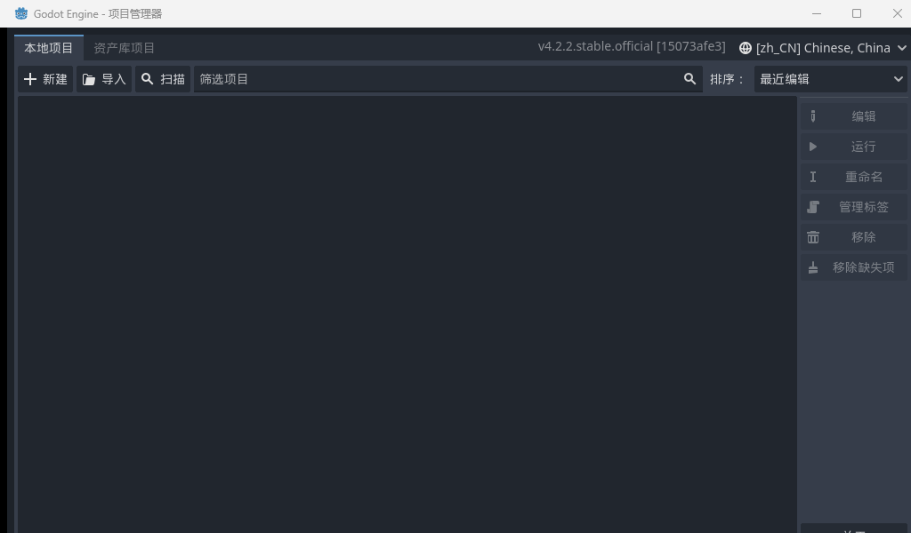
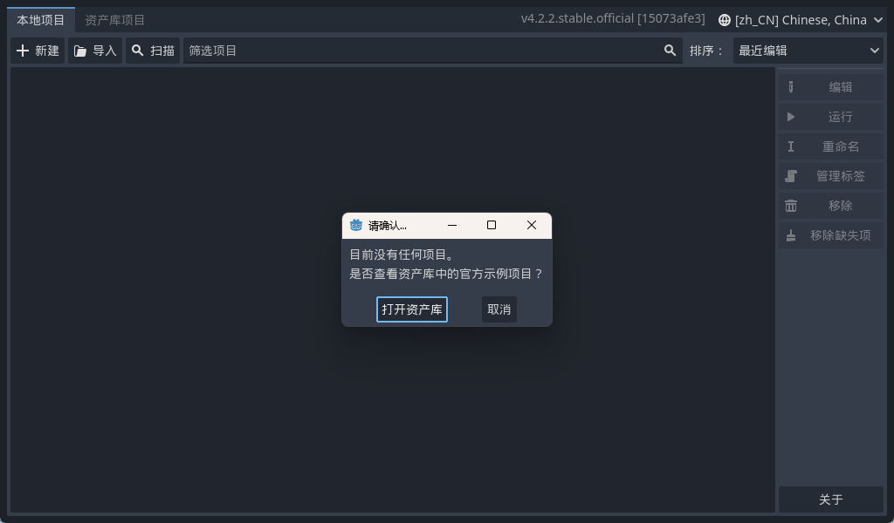
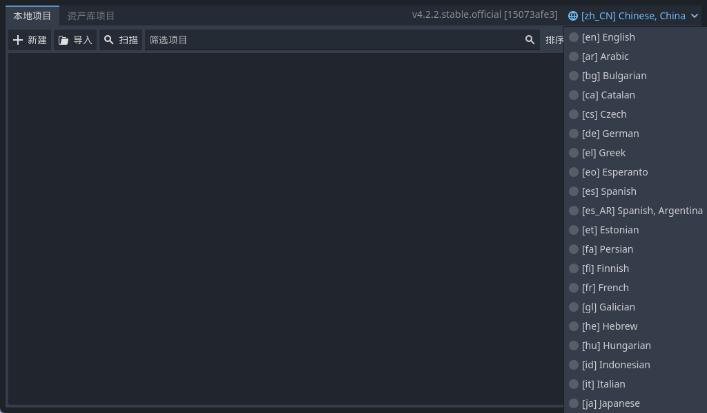
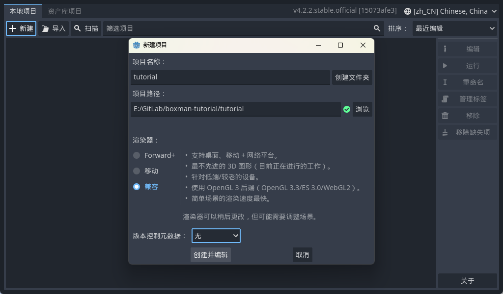
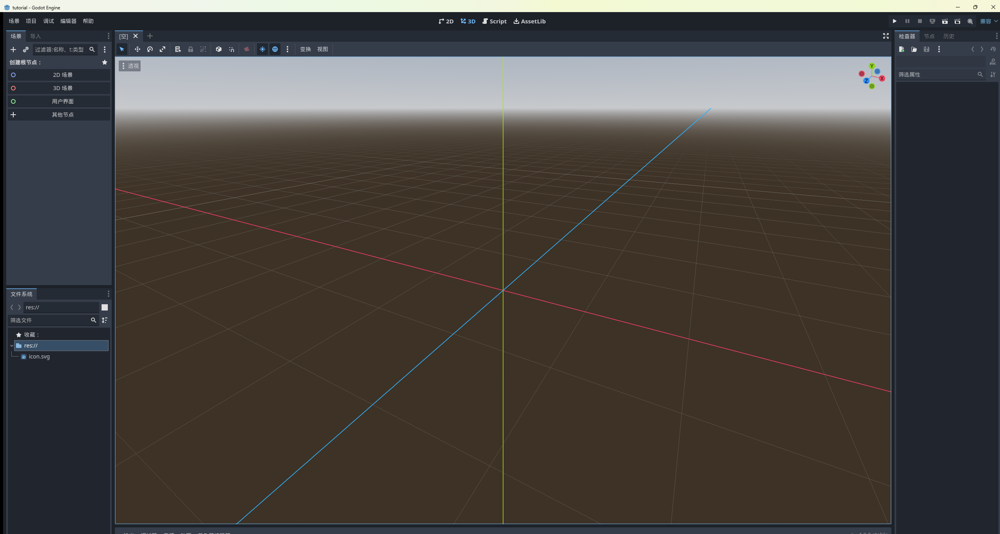

<!--
【CSDN 发布信息】
标题：Godot 入门实战（01）：下载安装与中文界面设置，零基础 5 分钟开箱
摘要：免费开源、不足 100MB、导出全平台——Godot 可能是最适合新手的第一款游戏引擎。这篇带你从下载安装走到中文界面 + 第一个项目，全程 5 分钟。
标签：Godot、游戏开发、游戏引擎、独立游戏、入门教程
截图清单（发布时按序上传）：
  1. ../img/01/01_pm_first.png —— 项目管理器首次启动
  2. ../img/01/01_pm_empty_prompt.png —— 零项目提示弹窗
  3. ../img/01/01_pm_language.png —— 语言选择下拉
  4. ../img/01/01_new_project_dialog.png —— 新建项目对话框
  5. ../img/01/01_editor_first.png —— 编辑器首次打开
-->

# Godot 入门实战（01）：下载安装与中文界面设置，零基础 5 分钟开箱

> 本系列的目标说出来你可能不信：从一个空文件夹开始，最后做出一个能选关、能存档、能发 Windows 和网页版的完整推箱子游戏。不需要编程基础，一篇只讲一个事。

开写之前先交代个背景。

当年我想做小游戏，在 Unity 和 Godot 之间纠结了一晚上。让我下定决心的不是什么技术选型分析，而是个特别没出息的理由——下载 Unity 那天我盯着 30 多 GB 的安装器和半条命的进度条，当场退了。转头打开 Godot 官网，一个几十 MB 的 zip，下载的工夫我泡了杯茶，回来就装完了。

行，就是它了。

这一篇咱们就干三件事：装上、切中文、建项目。别急，撑死 5 分钟。

## 一、Godot 是个啥，凭什么值得学

说人话版：**免费、开源、才几十 MB 的游戏引擎**，2D 3D 都能做，手机上跑的、Steam 上卖的、浏览器里点的游戏它都能出。

免费这事儿得展开讲讲，因为它确实是真免费。有些引擎的经典操作是"入门免费，你游戏赚钱了我抽成"——Godot 直接 MIT 协议一挂，你用它做的游戏卖一千万，人家一分钱不要。开源社区维护，没有老板娘，没有 KPI。

然后是体积。整个引擎解压出来就一个 exe，百八十 MB。我有时候出门把它扔 U 盘里，朋友的电脑想演示就插上，跟带个 U 盘版 Photoshop 似的。没有安装向导，没有强制注册，没有启动器里那种"每日精选资讯"弹窗，清净得让人感动。

写代码用的是自家的 GDScript，长得跟 Python 是亲兄弟，几行代码就能让一个方块满地跑。后面系列里所有代码我都会一行一行带着敲，你只管抄，抄完能跑。

版本这里提个醒：本系列用的是 **Godot 4.2.2**，写这篇时的稳定版。Godot 4 和老 3.x 的接口差异不小，网上 2022 年前后的教程大多是 3.x 的，跟着敲必报错。看到标题里带 3.x 的教程，绕道走，别跟自己过不去。

## 二、安装过程，我尽量写得长一点

为啥说"尽量写得长"？因为真没啥可写的。

打开官网 `godotengine.org`，顶部 **Download**，选 **Godot Engine - Standard version** 的 Windows 版，下载得到一个 zip。

然后是整个"安装流程"：

把 zip 解压到一个**纯英文路径**，比如 `D:\Godot\`。解压出来一个 `Godot_v4.2.2-stable_win64.exe`，完事儿。想方便点就右键发个桌面快捷方式，没有第三步了。

对，连安装器都没有。很多新手的反应跟我当年一样，对着解压完的文件夹愣半天：这就……装完了？对，装完了，双击运行去。

哦对了，路径为啥非要英文？倒不是英文路径一定出事，而是中文路径在个别插件、个别导出场景下会蹦出一些让你怀疑人生的报错。新手阶段没必要给自己加戏，能用英文就用英文，这条规矩能帮你省下未来某天晚上两小时的排查时间。信我。

双击 exe，第一次启动长这样，这个界面叫**项目管理器**（Project Manager），你可以理解成游戏版的"文件管理大厅"——以后你做的每个项目都会躺在这儿的列表里：

它刚睁眼还会热情地问你要不要去逛逛官方示例项目：

点**取消**。示例项目要从在线资产库拉资源，网络环境一言难尽，而且咱是来自己动手的，逛什么别人家后花园。

## 三、切中文：如果你需要的话

先说个冷知识：Godot 会**自动跟随系统语言**。所以如果你是简体中文的 Windows，双击打开那一瞬间它就已经是中文了，这一节你基本可以跳过，往下翻就行。

那如果你看到的是满屏英文呢？也简单。项目管理器**右上角标题栏**有个语言下拉，点开，一长串语言列表哗一下全出来：

列表按字母排序，一路滚到底，**[zh_CN] Chinese, China** 躺在最底下等着你。点它，界面当场变中文，设置自动记住，下次不用再弄。

顺便夸一句，Godot 的中文翻译完整度是真的高，我用了这么久，几乎没在界面里撞见过没翻译的英文单词。对零基础的朋友来说，这省的可不是一点半点的脑子。

## 四、新建项目：四个地方要看一眼

回到项目管理器，左上角**「+ 新建」**，弹出这么个对话框：

别被这一屏选项吓到，其实就四个地方值得你多看一眼：

**项目名称**，填 `tutorial`，跟我的教程工程保持同名，以后每篇的代码你都能拿自己的工程对照着看。

**项目路径**，选个空文件夹就行，对话框能顺手帮你建。还是那句话，英文路径。

**渲染器**，三个选项，选最下面那个**兼容**。我猜有朋友要问：Forward+ 听着就高科技，为啥不选它？这么讲吧，「兼容」走的是 OpenGL 3 后端，老显卡能跑、2D 游戏跑得最快，而且以后要导出网页版，走的必须是这条路。咱做的是 2D 推箱子，不是 4K 光追大作，它就是最优解。选贵的不如选对的。

**版本控制元数据**，选「无」。这玩意儿是给 Git 仓库准备的，现在选了会生成一堆你看不懂的文件，纯属提前发难。等以后咱把项目传 GitHub 的时候再回来开它，一句话的事。

四个都确认完，点**「创建并编辑」**，进度条一闪——

看见没，编辑器开出来了。中间那片带网格的 3D 视图先不用研究它，左上角 **2D / 3D / Script** 三个标签可以切换工作区，这次先混个脸熟，下一篇我带你把整个编辑器里里外外逛一遍，每个面板是干嘛的都交代清楚。

## 写在最后

盘点一下今天干成的活儿：解压了一个 exe，确认了中文界面，白嫖了一个空项目。没写一行代码，但讲道理，"装环境"这一关拦住过的人比后面的代码拦住的加起来都多，你今天已经跳过这个大坑了。

下一篇：《Godot 入门实战 02：编辑器导览——每个面板都是干嘛的》，带你把场景面板、文件系统、检查器这些"仪表盘"挨个盘一遍，顺便亲手创建第一个场景。

觉得这篇帮你省了事，**点个赞**再走；想跟着把游戏做完的，**关注「山岚的运维笔记」**，更新第一时间见。评论区开放中，问了就回。

---

*本系列配套工程同步放在 GitHub（仓库 seancheng33/Boxman 的 tutorial 分支），每篇打一个 tag，随时能下到对应进度的完整可运行工程。*
