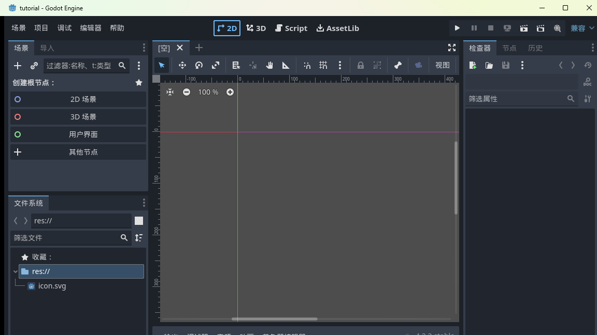
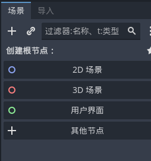
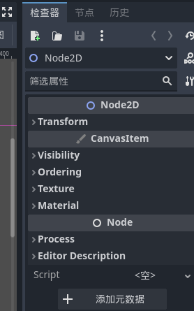
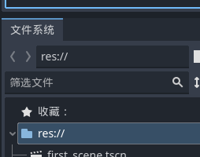
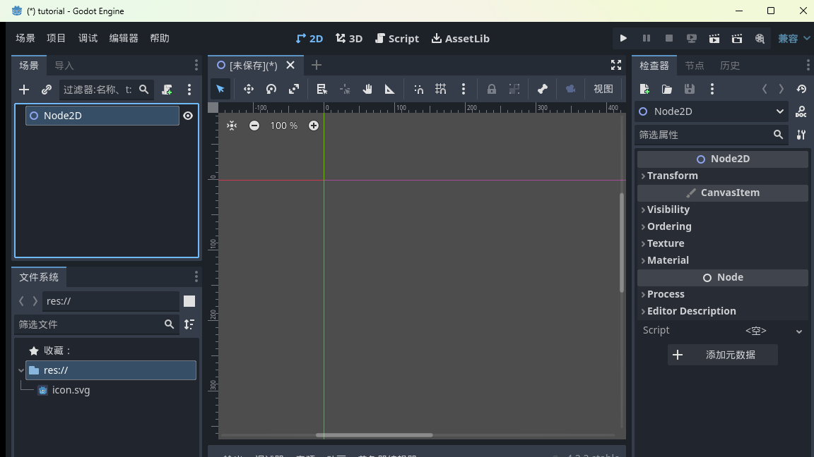
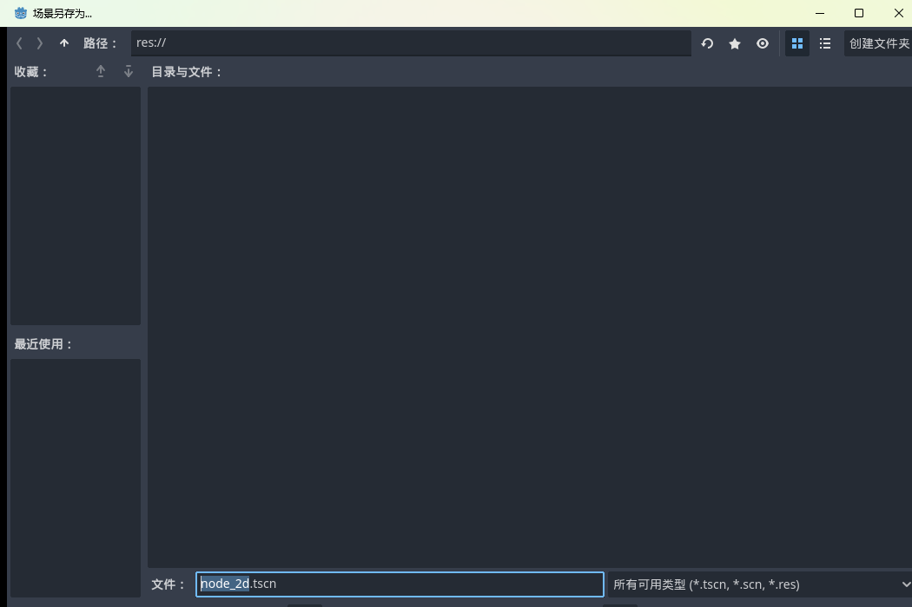
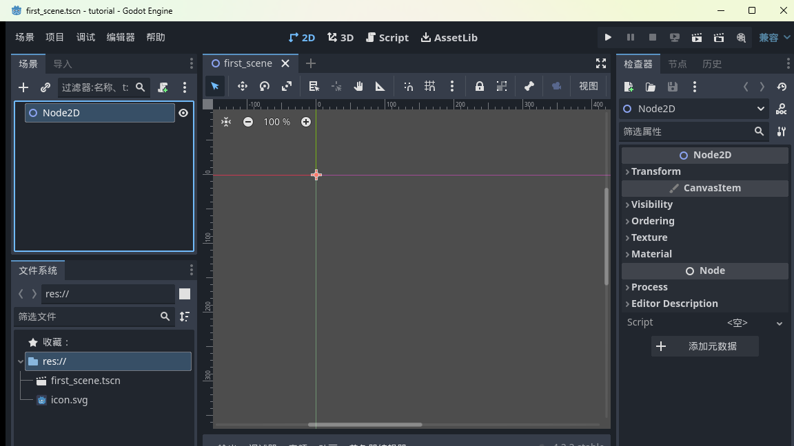

<!--
【CSDN 发布信息】
标题：Godot 入门（02）：编辑器导览，看懂每个面板
摘要：第一次打开 Godot 编辑器，四五个面板扑面而来容易发懵。这篇带你把每个面板的用途摸清楚，顺便亲手创建并保存第一个场景。
标签：Godot、游戏开发、游戏引擎、独立游戏、入门教程
截图清单（发布时按序上传）：
  1. ../img/02/02_editor_2d.png —— 2D 工作区全景
  2. ../img/02/02_dock_scene.png —— 场景面板
  3. ../img/02/02_dock_inspector.png —— 检查器面板
  4. ../img/02/02_dock_filesystem.png —— 文件系统面板
  5. ../img/02/02_create_root.png —— 创建根节点后的场景树
  6. ../img/02/02_save_dialog.png —— 场景另存为对话框
  7. ../img/02/02_scene_saved.png —— 保存完成
-->

# Godot 入门（02）：编辑器导览，看懂每个面板

> 上一篇我们装好了 Godot、建好了空项目。这一篇把编辑器里里外外逛一遍——每个面板是干嘛的、东西都藏在哪，最后亲手做出第一个场景。别急，都是点鼠标的活。

第一次打开编辑器嗰日嘅真实感受，我到而家都记得：左边一列、右边一列、中间一大片，加起来五六个面板，个个都写住奇奇怪怪嘅名。好似第一次坐入飞机驾驶舱咁？

放心，开 Godot 这架"飞机"需要的仪表，比驾驶舱少多了。呢篇逛完，你闭埋眼都搵到每个开关。

## 一、先分清三个工作区：2D / 3D / Script

编辑器顶部中间有三个标签（旁边还有个 AssetLib 是在线素材库，暂时无视）：

- **2D**：做 2D 游戏的工作区。我们这整个系列都住在这里；
- **3D**：做 3D 的工作区，上一篇文章里你看到的那片网格就是它；
- **Script**：写代码的工作区，相当于内置的代码编辑器。

点一下 **2D**，中间的视图切换成带标尺的平面——这就是你之后天天见的工作台。

## 二、场景面板：你的游戏是一棵树

左上角这个面板叫**场景**（Scene），是 Godot 里面最重要的一块：

它现在还空荡荡的，只有一句「创建根节点」和四个快捷按钮：**2D 场景、3D 场景、用户界面、其他节点**。

这里要先灌一个 Godot 的核心概念，整个引擎的玩法都建立在它上面：**在 Godot 里，万物皆节点，节点组成树**。

举个例：你游戏里的一个关卡，是一棵树——根上挂一个「关卡」节点，底下分出「玩家」「墙壁」「箱子」「目标点」几根枝，玩家底下可能还挂着「Sprite（样子）」「碰撞体（身体）」几片叶子。编辑器左边这个面板，就是给你打理这棵树用的。

而家唔使完全理解，有个印象就够，后面每篇你都同呢棵树打交道，自然就识喇。

## 三、检查器：选中谁，就显示谁的属性

右上角这个面板叫**检查器**（Inspector），它是场景面板的孪生兄弟：

规矩很简单：**你在场景树里点中哪个节点，检查器就显示这个节点的一切可调参数**——位置、大小、颜色、显示的图片……全在这。

以后你听到「把它的 Transform 改一下」「把贴图拖到 Texture 属性上」，讲嚟讲去都系喺呢个面板搞。左边拣人，右边调参，就系咁配合。

## 四、文件系统：项目里的一切文件

左下角是**文件系统**（FileSystem）面板，显示你项目文件夹里的所有文件：

图片、音效、场景、脚本，凡是放进项目文件夹的东西都会出现在这里。它旁边还有个「收藏」区，常用的文件夹可以拖进来存着，用起来跟浏览器的书签一个道理。

## 五、动手：创建并保存你的第一个场景

逛完喇，嚟真嘅。目标：做出一个只有一个 Node2D 节点的场景，存档。

**第一步**，场景面板里点**「2D 场景」**那个快捷按钮（就是有蓝圈图标的那个）。见证奇迹——场景树里出现了一个叫 **Node2D** 的节点，检查器也跟着列出它的一堆属性：

看到没，这棵树现在就一根光杆树干。Node2D 是个「带 2D 位置信息的空节点」，自己不会显示任何东西，但它是最常用的树干——后面墙啊箱子啊都往它身上挂。

**第二步**，按 **Ctrl+S** 保存。弹出的保存对话框里，默认文件名是 `node_2d.tscn`，我们给它改个有意义的名字：

把文件名改成 `first_scene.tscn`，回车。

> 小知识：`.tscn` 是 Godot 场景文件的后缀，Text Scene 的缩写。它是纯文本格式，你甚至可以用记事本打开看，不过没必要，编辑器会帮你打理。

**第三步**，看一眼成果——标题栏的星号没了，文件系统面板里多出了 `first_scene.tscn`：

恭喜，你嘅第一个场景正式落袋。虽然佢而家净系个空壳，但「建场景 → 改名 → 存档」呢套动作，以后你会重复几百次，今日就算出师喇。

## 写在最后

今天认识的三块面板，以后的任务分工是：**场景面板管结构，检查器管属性，文件系统管资产**。加上中间的视口，四件套齐了。

下一篇：《Godot 入门 03：让场景跑起来——主场景与 F5》，给你讲讲主场景是什么、怎么按 F5 让游戏窗口真正弹出来。

呢篇要系帮到你睇明编辑器，**点赞收藏**走一个；想跟完全程嘅，**关注「山岚的运维笔记」**，更新第一时间推送。评论区开放，有问必答。

---

*本系列配套工程同步放在 GitHub（仓库 seancheng33/Boxman 的 tutorial 分支），每篇打一个 tag，随时能下到对应进度的完整可运行工程。*
