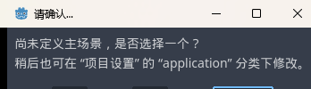
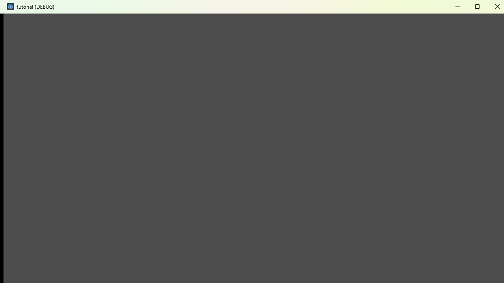
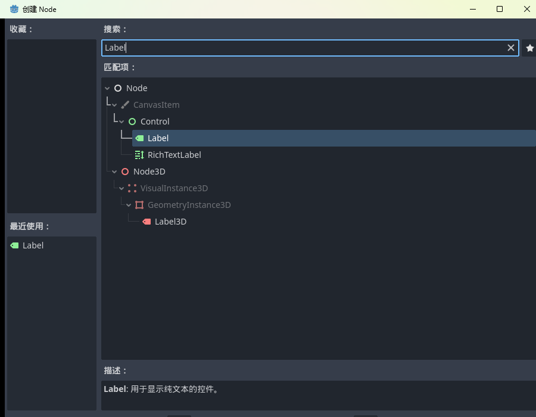
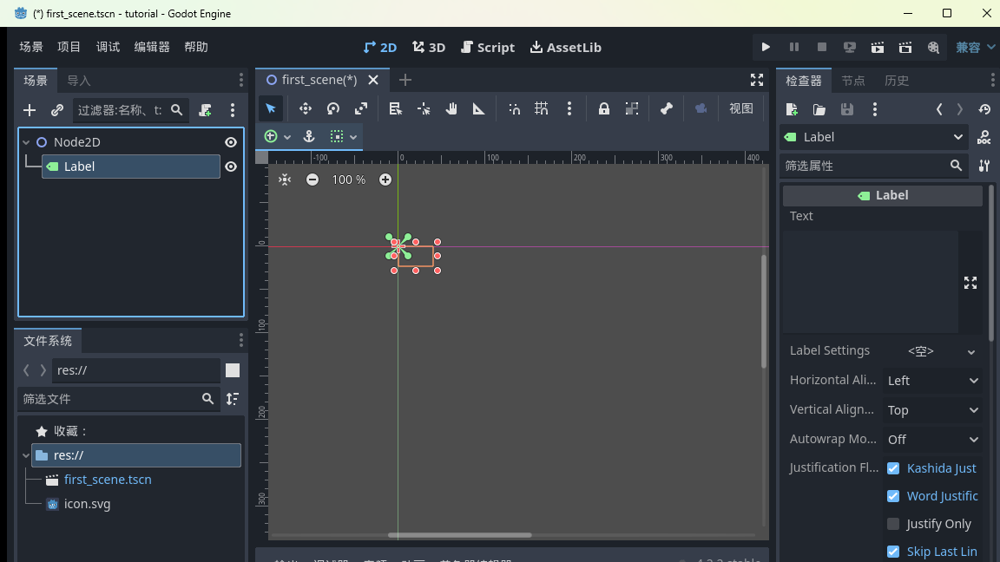
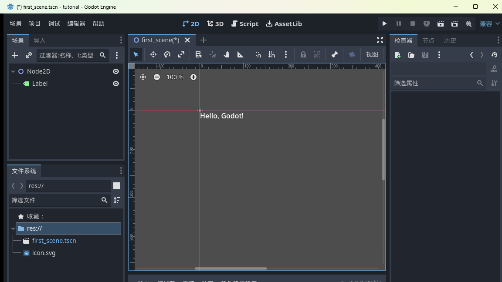
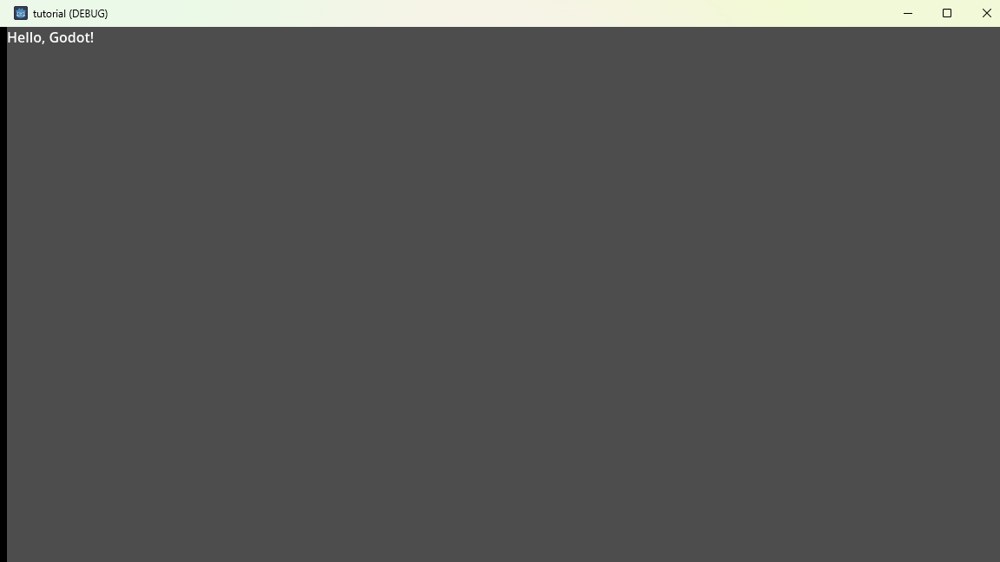

<!--
【CSDN 发布信息】
标题：Godot 入门（03）：主场景与 F5，让游戏跑起来
摘要：场景建好了，怎么变成真正能跑的游戏？这篇讲清楚主场景的概念，带你按下 F5、处理第一次运行必弹的提示框，再给窗口添上第一行字。
标签：Godot、游戏开发、游戏引擎、独立游戏、入门教程
截图清单（发布时按序上传）：
  1. ../img/03/03_f5_dialog.png —— 首次运行的未定义主场景提示
  2. ../img/03/03_empty_window.png —— 空白游戏窗口
  3. ../img/03/03_label_search.png —— 创建节点对话框搜索 Label
  4. ../img/03/03_label_added.png —— Label 挂进场景树
  5. ../img/03/03_label_text.png —— 视口里输入文字
  6. ../img/03/03_hello_window.png —— 游戏窗口显示 Hello, Godot!
-->

# Godot 入门（03）：主场景与 F5，让游戏跑起来

> 上一篇我们存下了第一个场景。但场景存几多个都好，唔按运行键，佢都净系一个文件。这篇讲清楚「主场景」这个概念，然后按下那个神圣的 F5。

说个真事。我第一次装好引擎、建好场景、存完档，然后盯着编辑器愣了半天：然后呢？游戏呢？嗰阵我连运行键喺边都唔知。

答案是一个键：**F5**。

但这一按，新手会遇到第一个弹窗。今天就把它掰开讲透。呢个弹窗拦住唔少人，我当年都懵咗一阵。

## 一、什么是主场景

先想一个问题：你的项目以后可能有几十个场景——主菜单、十个关卡、设置页……按 F5 运行的时候，引擎应该先打开哪一个？

总得有个默认入口吧。这个入口就叫**主场景（Main Scene）**：游戏启动时第一个被加载的场景。

Godot 唔会替你估。你唔讲，佢就问你。

## 二、按下 F5：第一次运行必弹的框

直接按 **F5**（或者点编辑器右上角那个播放按钮）。因为我们的项目还没设置主场景，Godot 会弹出一个确认框：

「尚未定义主场景，是否选择一个？」——选它，就是把**当前打开的场景**登记为主场景。我们只有 `first_scene.tscn`，选它正合适。

确认之后，一个独立的游戏窗口「啪」地弹出来：

标题是 `tutorial (DEBUG)`——DEBUG 的意思是这是开发时的试运行版本，以后正式导出就没有这个小尾巴了。

窗口入面嘛……一片灰。系啊，因为我哋除咗一个空 Node2D 咩都冇。但注意：**这个窗口就是一个真的、在运行的程序**，不是截图，不是预览。你现在写的每一行逻辑，最终都会活在这个窗口里。呢点好多新手都误会咗，我当初都以为系预览图。

关掉它（点右上角 ×），回到编辑器，你会发现主场景已经登记好了——再按 F5 不再弹窗，直接运行。

## 三、给窗口添点东西：第一个 Label

空窗口看着有点凄凉，加一句字吧。

场景还是那棵树：Node2D 一根光杆。现在给它挂一片叶子——按 **Ctrl+A**（或者点场景面板的「+」），弹出创建节点对话框：

在搜索框输入 `Label`，选中它回车。Label 是「显示一串文字」的节点，描述栏写得很明白。

创建完，场景树变成了两层：

Node2D 底下多了个 Label——上篇说的「节点组成树」，这就是了：Label 是挂在 Node2D 底下的子节点。

**接着给 Label 喂点文字**：看右边的检查器，最顶上有个 **Text** 属性，点它的输入框，打上 `Hello, Godot!`：

打完看中间视口——文字已经显示出来了（就在坐标原点那，位置先不管）。

## 四、再见，F5

**Ctrl+S** 存档，再按 **F5**：

睇到冇！左上角，白纸黑字，**Hello, Godot!**

这几行字的技术含量约等于零，但意义不一样：从「编辑器里的文件」到「跑起来的程序」，整条链路你已经走通了。以后不管做多大的游戏，流程都是这一条：改场景 → 存档 → F5 → 看效果。呢条链路一通，之后做咩都系喺上面加嘢。

## 写在最后

今天三个收获：

1. **主场景**是游戏启动的默认入口，首次 F5 会被要求指定；
2. **F5 运行 / 关窗停止**，弹出的窗口就是你的游戏本体；
3. 节点树是可以长的——Label 往 Node2D 上一挂，树就开枝散叶了。

不过你也发现了：到目前为止全是点鼠标，一行代码没写。文字是死的，要是想让它动起来、变颜色、跟玩家互动呢？那就得代码上场了。所以唔好怕代码，佢冇想象中咁难。

下一篇：《Godot 入门 04：GDScript 第一课——让代码接管节点》，正式开写第一行代码，把检查器里那堆属性变成你代码里的变量。

呢篇帮你跑通咗第一次运行嘅话，**点赞再收藏一下**；想跟住一路写到发布嘅，**关注「山岚的运维笔记」**。评论区见，有问必答。

---

*本系列配套工程同步放在 GitHub（仓库 seancheng33/Boxman 的 tutorial 分支），每篇打一个 tag，随时能下到对应进度的完整可运行工程。*
