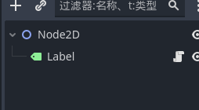
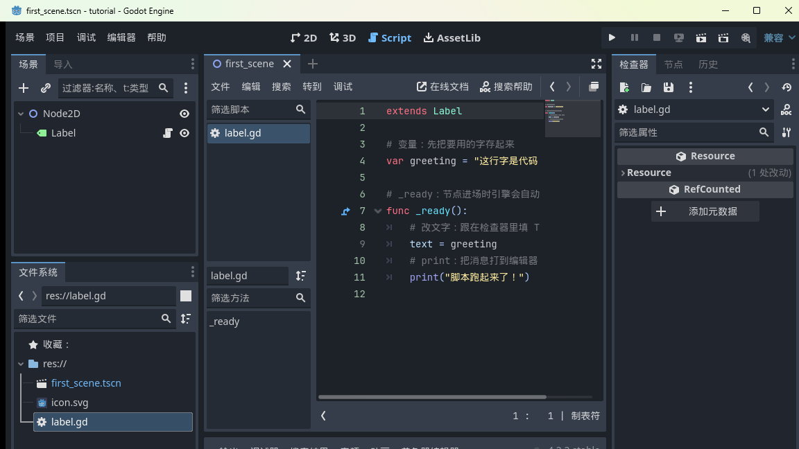
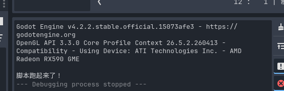
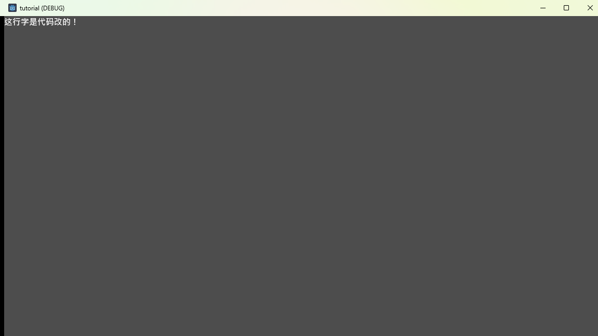

<!--
【CSDN 发布信息】
标题：Godot 入门实战（04）：GDScript 第一课，让代码接管节点
摘要：鼠标点到头了，该代码上场。这篇带你给节点挂上第一个脚本，认识变量、函数和 print，让文字由代码说了算。
标签：Godot、GDScript、游戏开发、游戏引擎、入门教程
截图清单（发布时按序上传）：
  1. ../img/04/04_scene_with_script.png —— 场景树中 Label 挂上脚本
  2. ../img/04/04_script_editor.png —— 脚本编辑器与完整代码
  3. ../img/04/04_output_panel.png —— 输出面板显示 print 结果
  4. ../img/04/04_hello_code_window.png —— 游戏窗口显示代码改的文字
-->

# Godot 入门实战（04）：GDScript 第一课，让代码接管节点

> 前三篇全是点鼠标：建场景、存场景、按 F5。这篇开始，代码正式上场——第一课只求一件事：让节点听代码的话。

先讲一个我的黑历史。当年学引擎，我卡在"检查器里能改的东西，为什么还要用代码改"这个想法上，觉得代码纯属多余，鼠标杆啥都能干。直到想做一个"每秒自己变颜色的方块"，才明白鼠标点得再多，它也只能设一个静态值。

**能跟着时间变、跟着玩家变的，只有代码。** 好，上货。

## 一、给 Label 挂个脚本

还是老朋友 first_scene 场景：Node2D 底下一个 Label。选中 Label，右键选「附加脚本」（场景面板顶部工具栏的卷轴图标也行），保持默认路径 `res://label.gd`，点创建。

创建完，场景树里 Label 后面会多一个小图标，意思是"这个节点有脚本了"：



同时编辑器会自动切到 **Script 工作区**，打开刚生成的 `label.gd`。

> 小知识：脚本文件后缀是 `.gd`，本质是纯文本，和场景文件 `.tscn` 一样躺在项目文件夹里。你在文件系统面板能看到它。

## 二、读懂模板，然后整个换掉

新建的脚本自带几行模板代码，`extends Label`、`func _ready()` 这些词第一次见确实唬人。别慌，我们把它们整个换成下面这段——一共 12 行，每一行都给你说清楚：



```gdscript
extends Label

# 变量：先把要用的字存起来
var greeting = "这行字是代码改的！"

# _ready：节点进场时引擎会自动调用的函数
func _ready():
	# 改文字：跟在检查器里填 Text 效果一样
	text = greeting
	# print：把消息打到编辑器的输出面板
	print("脚本跑起来了！")
```

逐行拆：

- **`extends Label`**：声明"我这个脚本是给 Label 用的"。写了这句，脚本里才能直接用 Label 的东西（比如下面的 text）；
- **`var greeting = "..."`**：定义一个**变量**——一块贴了名字的存储空间，把一串字存进去，后面随取随用；
- **`func _ready():`**：定义一个**函数**。`_ready` 是 Godot 约定好的特殊函数，**节点一进场，引擎自动调用它**，不用你喊；
- **`text = greeting`**：把变量的值赋给 Label 的 text 属性——等价于上篇在检查器里手动填 Text；
- **`print("...")`**：往编辑器的**输出面板**打一条消息，调试神器，以后天天见。

缩进用的是 **Tab 键**，GDScript 靠缩进认代码块，这行跟 Python 是一个脾气。缩进错了会报错，别手抖。

## 三、跑起来：两处证据

**Ctrl+S** 存脚本（脚本也要存档，忘存的话运行的是旧代码，这是新手经典陷阱），按 **F5**。

证据一，编辑器底部的**输出面板**：



`脚本跑起来了！`——这就是 print 干的活。游戏一启动，`_ready` 被自动执行，print 把消息打到了这里。

证据二，游戏窗口本身：



左上角的字从 `Hello, Godot!` 变成了 `这行字是代码改的！`——**检查器里填的 Text 被 `_ready` 里的代码覆盖了**。谁后说话听谁的：先加载检查器的值，再跑你的代码。

到这一步，你已经会"用代码改节点"了。这个能力看起来小，但所有游戏逻辑——移动、计分、敌人 AI——都是从这个口子长出来的。

## 写在最后

今天交了三个朋友：**变量**（存东西的盒子）、**函数**（打包好的动作）、**print**（探照灯，照亮代码跑到哪了）。外加一个关键认知：`_ready` 只在进场时跑一次。

那问题来了——如果想让代码**每一帧都跑**（比如让文字自己转圈、方块自己移动）呢？_ready 显然不够用。

下一篇：《Godot 入门实战 05：精灵与素材——Sprite2D 和像素风导入》，先给场景添置"能看见的东西"，为下下篇的逐帧逻辑做好铺垫。

这篇要是让你写下了人生第一段 GDScript，**点个赞**纪念一下；想跟完全程的，**关注「山岚的运维笔记」**。评论区见。

---

*本系列配套工程同步放在 GitHub（仓库 seancheng33/Boxman 的 tutorial 分支），每篇打一个 tag，随时能下到对应进度的完整可运行工程。*
