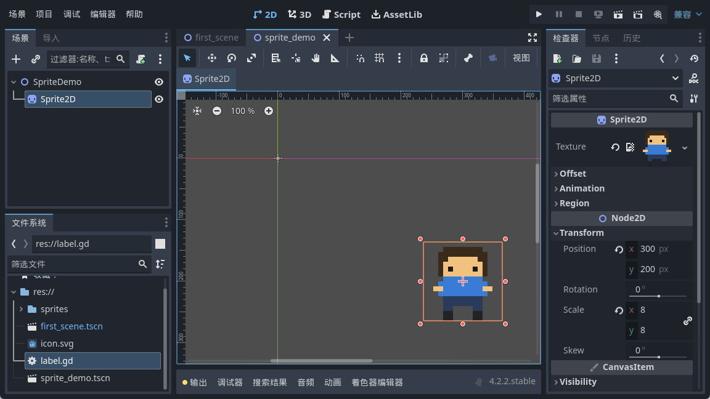
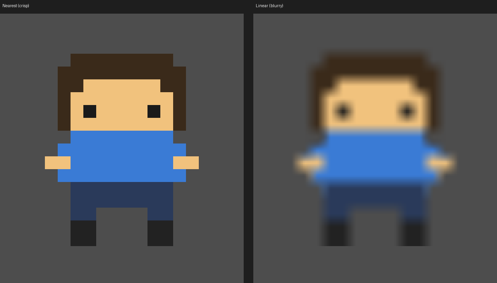
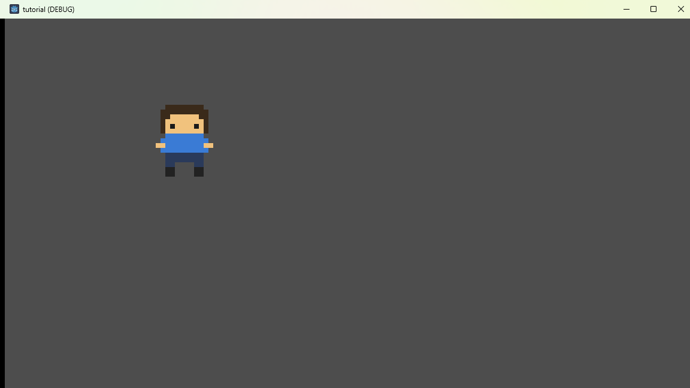

<!--
【CSDN 发布信息】
标题：Godot 入门实战（05）：Sprite2D 与像素风，别让精灵糊成一团
摘要：把一张 16×16 的小人丢进项目，它却糊成一团？这篇讲 Sprite2D 怎么挂纹理，以及像素风为啥要关掉「线性过滤」。
标签：Godot、Sprite2D、像素风、游戏开发、入门教程
截图清单（发布时按序上传）：
  1. ../img/05/05_editor.png —— Sprite2D 节点与检查器里的纹理
  2. ../img/05/05_blurry.png —— 默认线性过滤，小人边缘糊掉
  3. ../img/05/05_compare.png —— 最近邻 vs 线性，放一起看
  4. ../img/05/05_crisp.png —— 换成最近邻，像素边缘清爽
-->

# Godot 入门实战（05）：Sprite2D 与像素风，别让精灵糊成一团

> 前四篇我们一直跟文字打交道。今天换个活法——让屏幕里出现一个「人」。

我特意画了个 16×16 的小家伙：棕头发、蓝上衣、两条腿。本来是照着当年街机厅那些像素小人画的，歪歪扭扭但挺得意。结果拖进引擎一跑，我盯着屏幕愣了三秒——它糊了，像隔着一层毛玻璃。

不是图的问题。是引擎默认把像素当照片来「抹匀」了。

这篇就干一件事：**把糊掉的精灵救回来**，顺手认识一下 Sprite2D 这个节点。

## 一、先把素材放进项目

素材得先住进项目文件夹，引擎才认。

我在项目里新建了个 `sprites` 文件夹，把 `player.png` 拖进去（你也可以直接拖到左侧「文件系统」面板里）。拖完等一两秒，右下角会转个圈——那是在导入。导入完，`player.png` 旁边会多出一个 `.import` 文件，别手欠删它，引擎靠它对账。

> 小知识：`.import` 是 Godot 给每张图生成的「身份证」，记录这张图怎么被压缩、怎么被采样。真正的图还是你那张 png，`.import` 只是备注。

## 二、加一个 Sprite2D，挂上纹理

场景树里点根节点 `SpriteDemo`，右键 →「添加子节点」，搜 `Sprite2D`，加进来。

这里有个坑值得提前说：Godot 4 里这个节点叫 **Sprite2D**，不是老教程里的 `Sprite`。你要是照着 Godot 3 的教程搜 `Sprite`，也能搜到，但那是另一个东西。版本对不上，跟着做就会卡住，别怀疑自己。

选中 `Sprite2D`，看右边「检查器」，第一栏就是 **Texture（纹理）**，现在是空的。点它右边那个小箭头 →「加载」，选中我们刚拖进来的 `player.png`。

啪一下，2D 视口正中间就冒出那个小人了：

场景树里 `Sprite2D` 后面也挂上了这张图的缩略图。到这一步，「让东西出现在场景里」就算搞掂了。

## 三、它为啥糊？线性过滤惹的祸

先在检查器里把 `Scale` 调成 `8`，让这个 16 像素的小人放大 8 倍，看得清楚些。按 F5 跑起来是这样：

看出来了吧？边缘糊糊的，头发和脸的界线像被人用湿手指抹过。

原因其实不复杂。我们那张图只有 16×16 个像素，现在要显示成 128×128，中间多出来的像素从哪来？引擎得「猜」。默认的猜法叫**线性过滤（Linear）**，它把相邻两个像素的颜色按比例混一混，看起来平滑——这对照片是好事，对像素画就是灾难，因为它把硬边全揉软了。

像素画想要的是另一种猜法：**最近邻（Nearest）**。别混，谁近就用谁的颜色，放大后就是一个一个硬邦邦的方块，那才是我们要的复古味。

同一张图，换个过滤方式，放一起对比一下：

左边清爽，右边发虚。差距就系一个开关的事。

## 四、把「最近邻」设成默认

改法有两个，看你要改一张还是改全部。

**只改这一个节点**：选中 `Sprite2D`，检查器往下拉，找到 **CanvasItem → Texture → Filter**，把它从「继承」改成 **Nearest**。这一处只影响这个精灵。

**改整个项目（推荐）**：菜单「项目」→「项目设置」，左边找 **Rendering → Textures → Canvas Textures**，把 **Default Texture Filter** 设成 **Nearest**。以后新加的图默认就是像素风，不用每张都去点。

我一般选后者，一劳永逸。设完再跑一次：

边缘硬了，方块感回来了，那个歪歪扭扭的小人也终于有当年的味道。

## 写在最后

今天其实就记住一句话：**像素画要 Nearest，不要 Linear**。剩下的 Sprite2D 挂纹理，全是操作，点两下就会。

顺带补一句，导入面板里还有个「Mipmaps」的选项，像素风一般也别开——开了远处会糊。不过那是后话，今天先不展开，免得一次塞太多你消化不了。

那个小人现在能站在场景里了，但它还不会动，也不会被地图约束。下一篇我们给它铺一张真正的地图，讲坐标系和网格——推箱子游戏的一切，都是从一个格子一个格子开始的。

下一篇：《Godot 入门实战 06：画出第一张地图——坐标系与网格》。

觉得有用就**点个赞**，想跟完全程的，**关注「山岚的运维笔记」**。评论区见，有问必回。

---

*本系列配套工程同步放在 GitHub（仓库 seancheng33/Boxman 的 tutorial 分支），每篇打一个 tag，随时能下到对应进度的完整可运行工程。*
