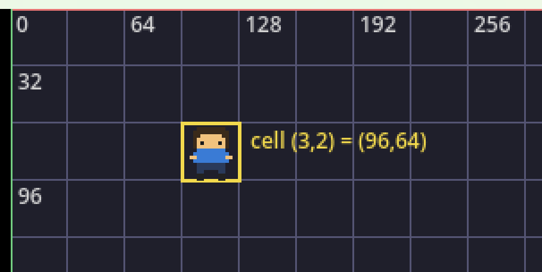
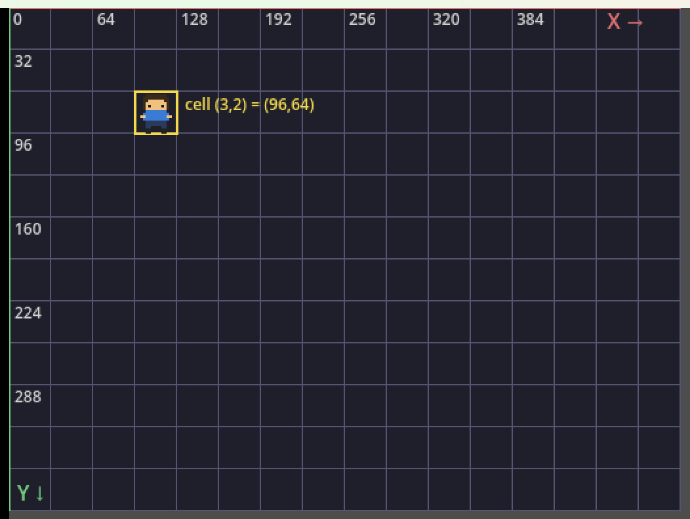
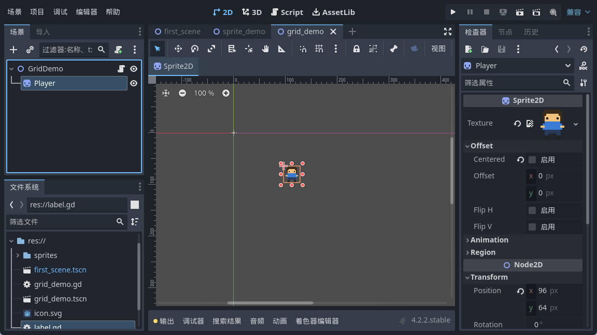
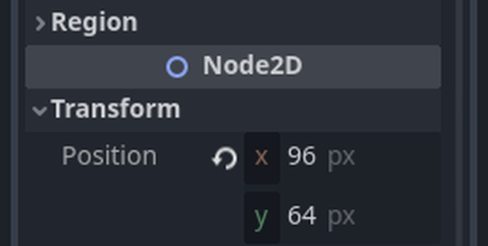

<!--
【CSDN 发布信息】
标题：Godot 入门实战（06）：坐标系与网格，一切从格子开始
摘要：小人会站了，可它到底站在哪？这篇把 Godot 的二维坐标系讲明白——原点在左上角、X 向右、Y 向下，再顺势把推箱子的「格子」算清楚。
标签：Godot、坐标系、网格、游戏开发、入门教程
截图清单（发布时按序上传）：
  1. ../img/06/06_axes.png —— 原点在左上角，X 向右、Y 向下
  2. ../img/06/06_run.png —— 32×32 的网格，精灵站在 cell(3,2)
  3. ../img/06/06_editor.png —— 编辑器里选中精灵，检查器显示 Position
  4. ../img/06/06_inspector.png —— Position 就是两个数字：x=96、y=64
-->

# Godot 入门实战（06）：坐标系与网格，一切从格子开始

> 上一篇，小人总算站进了屏幕。
> 可你要是跟它说「往右走一格」，它一脸茫然——一格是多远？
> 今天不聊动画也不聊输入，先把「一格」这个单位钉死。

## 一、先把尺子立起来：Godot 的二维坐标

定位一个点，无非横一个数、竖一个数，这个不新鲜。新鲜的是 Godot 的规矩：**原点在左上角**，X 往右长，Y 往下长。

注意那个「往下」。你中学画的坐标轴，Y 是朝上的；屏幕不一样，它从上往下数。所以越往下，Y 越大。第一次见会别扭，用两天自然就顺了。

单位是像素。`position = Vector2(96, 64)`，意思是从父节点的左上角算起，往右 96 像素、往下 64 像素。这里「父节点」三个字别漏掉——子节点的坐标是相对父节点的，父节点一动，底下的子节点全都跟着挪。这个坑以后做相机、做界面还会再撞一次，先埋个钉子。

我把坐标轴直接画出来了，你对着看：



顶边那条红线是 X 轴，左边那条绿线是 Y 轴，两条线的交点就是原点 (0,0)。格子每格 32 像素，所以刻度是 0、64、128 这样跳。

## 二、一格到底多大：CELL 与格子换算

推箱子这种游戏，本质是在一张方格纸上挪东西。所以第一件事，是定一个「格子」有多大。

我选 32 像素一格。为什么偏偏是 32？因为我们的像素小人正好 16×16，放大两倍刚好塞满一格，唔使用半像素去凑，看着就舒服。

插一句闲话。有人喜欢 16 一格，有人非要 64，我试过 30，结果所有贴图永远差半格，怎么对都对不齐。折腾一下午，最后老老实实回到 32。选择困难症，就是这么被治好的。

定了格子，就有了固定换算：

```gdscript
const CELL := 32                      # 一格 32 像素

func cell_to_pos(cell: Vector2i) -> Vector2:
    # 格子坐标 -> 像素坐标
    return Vector2(cell) * CELL
```

拿第 3 列、第 2 行来说，就是 `(3, 2) * 32 = (96, 64)`。图上那个小家伙，正正好站在这格：



黄框标的就是 cell(3,2)。它的左上角落在 (96,64)，跟公式对得上。

反着来也行。给你一个像素坐标，想知道它在哪一格，除以 32 再取整：

```gdscript
func pos_to_cell(pos: Vector2) -> Vector2i:
    return Vector2i(pos / CELL)
```

`Vector2i(...)` 这一手是截断取整，正好当「向下取整」使。负数要格外小心，那是后话，今天先不展开。

## 三、检查器里那两个数字

公式其实不用背。你在编辑器里选中精灵，右边检查器往下拉，Transform → Position 就是这两个数：



凑近看：



x=96、y=64，跟我手算的一模一样。所以你在代码里写 `position = Vector2(96, 64)`，跟在这里手填，根本是同一回事。区别只在于：代码能算，手填只能填。

## 四、编辑器也有网格，别浪费

2D 视图里本来就铺着一层淡淡的网格，只是默认不显眼。菜单「视图」→「显示网格」能把它点亮，快捷键是 Ctrl+G。

更实用的是**吸附**。视图上方那排工具里有个磁铁图标，点开能设网格步长。设成 32 之后，你拖精灵，它会「啪」地贴到格子线上，再也不会停在 96.3 这种鬼地方。

我早年做关卡，最烦的就是贴图差那么一两像素，那张图看着像被人从旁边推歪了。后来才明白，是我压根没开吸附，全靠手抖。开了之后，那一下午的憋屈算是白受了。

## 五、这些线，其实是画出来的

有朋友问，你那网格是拿什么素材贴的？

冇素材。就是代码画的。建个 `Node2D`，挂上脚本，重写 `_draw()`：

```gdscript
const CELL := 32
const COLS := 16
const ROWS := 12

func _draw() -> void:
    for c in range(COLS + 1):
        var x := float(c * CELL)
        draw_line(Vector2(x, 0), Vector2(x, ROWS * CELL), Color(0.33, 0.33, 0.45), 1)
    for r in range(ROWS + 1):
        var y := float(r * CELL)
        draw_line(Vector2(0, y), Vector2(COLS * CELL, y), Color(0.33, 0.33, 0.45), 1)
```

两个循环，一个画竖线一个画横线，`_draw` 里想画什么就画什么。这招以后做调试信息、画选中框都用得上，先记下。

顺便提醒，`_draw` 只在系统要重绘时跑一次。你改了数据，得手动 `queue_redraw()` 喊它一声。不喊，它就一直装死。

## 写在最后

今天其实就三句话。

原点在左上角，X 往右、Y 往下。一格 32 像素，(3,2) 就是 (96,64)。编辑器有网格和吸附，记得开。

尺子搞掂了，小人现在清楚自己站在哪一格。但它还是不会动——下一篇我们给它接上键盘，按一下走一格，把它真正开起来。

下一篇：《Godot 入门实战 07：输入映射与走一格》。

觉得有用就**点个赞收藏一下**，想跟完全程的，**关注「山岚的运维笔记」**。评论区见，有问必回。

---

*本系列配套工程同步放在 GitHub（仓库 seancheng33/Boxman 的 tutorial 分支），每篇打一个 tag，随时能下到对应进度的完整可运行工程。*
