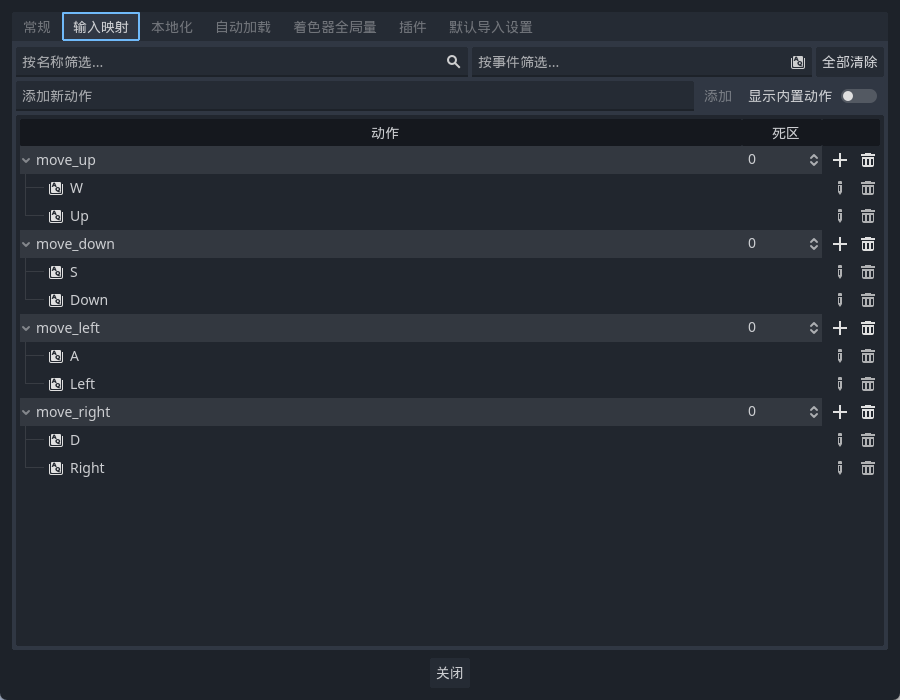
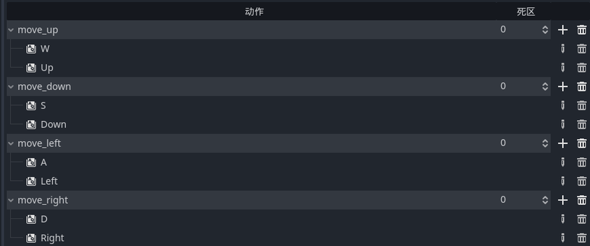
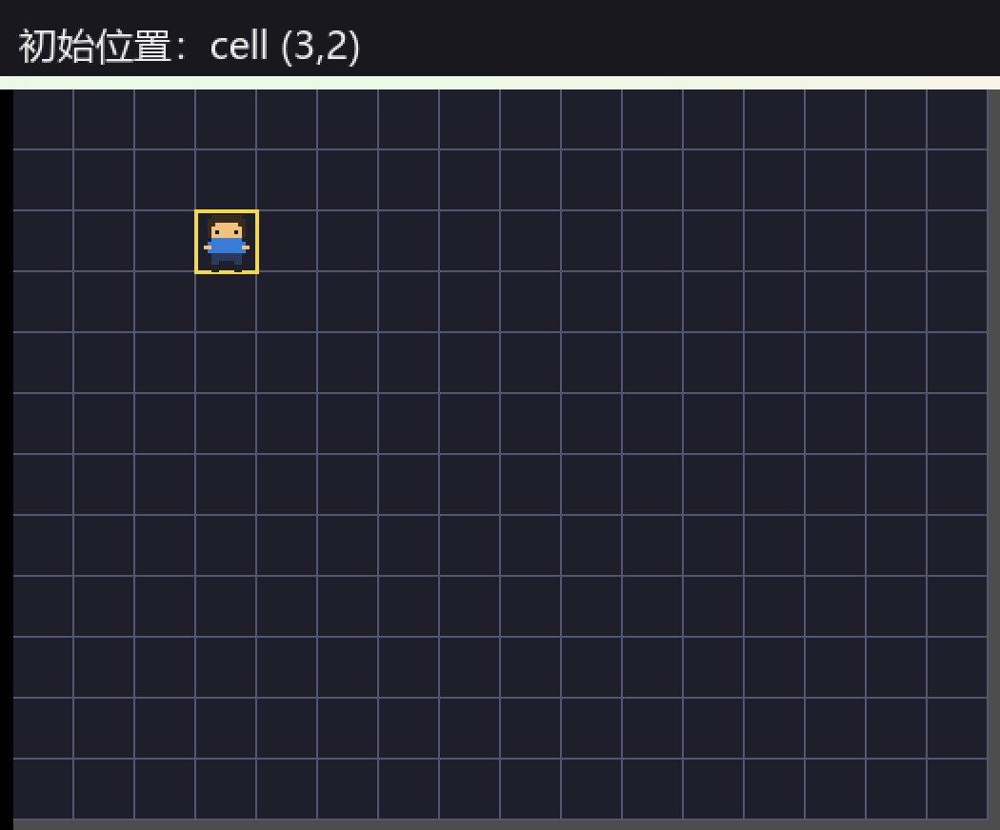
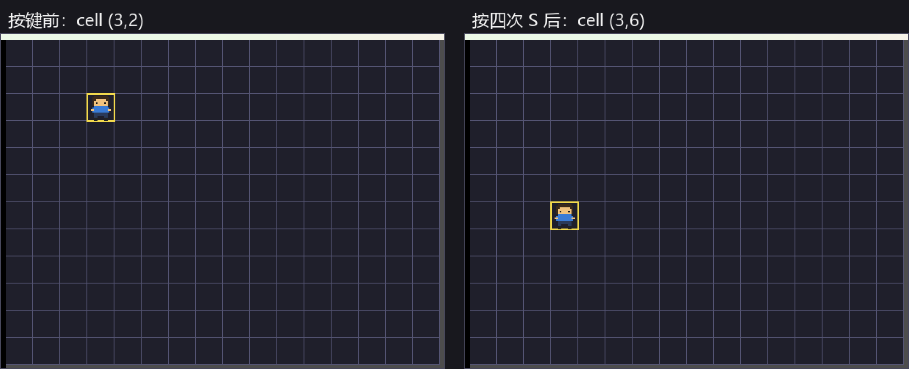
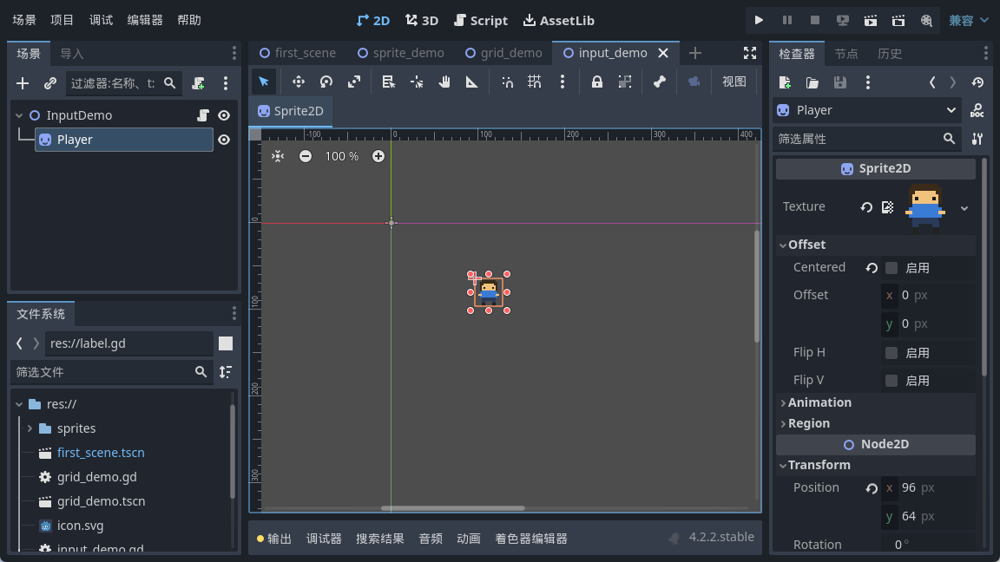

<!--
【CSDN 发布信息】
标题：Godot 入门（07）：InputMap，让键盘管住小人
摘要：上一把小人的坐标搞明白了，可它还是钉在原地。这篇配 InputMap——四个动作、每个绑两个键，再用 _unhandled_input 接住按键，按一下走一格，绝不连滚。
标签：Godot、InputMap、键盘输入、GDScript、入门教程
截图清单（发布时按序上传）：
  1. ../img/07/07_inputmap.png —— 项目设置里的「输入映射」面板
  2. ../img/07/07_actions.png —— 四个动作，每个都绑了两个键
  3. ../img/07/07_run.png —— 运行起来，小人站在 cell(3,2)
  4. ../img/07/07_compare.png —— 按四次 S，一格一格挪到 cell(3,6)
  5. ../img/07/07_editor.png —— 编辑器里选中 Player，检查器显示位置
-->

# Godot 入门（07）：InputMap，让键盘管住小人

> 坐标搞明白晒，小人仲系个钉子户，钉喺 (96,64) 郁都唔郁。
> 这回给它接上键盘。
> 顺手堵咗个新手最常犯嘅毛病：按住唔放，人物一路跑飞。

## 一、先别写代码，先去配键

新手容易犯一个毛病，一上手就在脚本里写 `if Input.is_key_pressed(KEY_W)`。能跑，真的能跑。

但这条路走不远。等你要加手柄、要加方向键、要做键位设置界面，满屏的 `KEY_W`、`KEY_A` 就得一个个改，改漏一个就是一个 bug。更麻烦嘅系——将来玩家话「我要用左手玩」，你唯有苦笑。

Godot 的解法叫**输入动作**（Input Action）。你别问「按下 W 这个键」，「玩家想往上走」才是一件事。键是键，事是事，中间那层翻译交给 InputMap。

打开**项目 → 项目设置 → 输入映射**：



左边一列是动作名，右边是给它绑的键。翻译过来就是：不管玩家按了哪个键，只要它属于 `move_up`，游戏收到的都只有一句「他要往上走」。

## 二、四个动作，八条绑定

推箱子只需要四个方向，所以我建了四个动作：`move_up`、`move_down`、`move_left`、`move_right`。

添加的步骤不复杂。在上面那个「添加新动作」的框里敲名字，回车，动作就有了。然后点它右边那个加号，弹出一个等按键的窗，这时候你按下 W，它自己就记上了。

每个动作我都绑了两个键，WASD 一套、方向键一套：



点解一定要绑两套？因为我呢双手写代码嗰阵离唔开 WASD，不过坐喺沙发上嗰阵又净系想按方向键。多绑一个又唔使钱，冇理由唔做。

顺便说一句那个**死区**（Deadzone）。它是给摇杆用的——摇杆不像按键，只有 0 和 1，它能到 0.37 这种中间值。死区就是「推得不够狠，当没推」的门槛。键鼠用不上，留着 0 就对了。

> 小提醒：如果你像我一样直接改 `project.godot` 文件，记得写成 `move_up={"deadzone":0.0,"events":[Object(InputEventKey,"keycode":87), ...]}` 这种字典格式。我一开始照老习惯写了两段 `[input/move_up]` 重复段头，Godot 一声不吭地全忽略掉，面板空空如也，白折腾半天。

## 三、接住按键：一行判断，一个方向

配好了，回到脚本。开一个 `_unhandled_input`：

```gdscript
func _unhandled_input(event) -> void:
    var dir := Vector2i.ZERO
    if event.is_action_pressed("move_up"):
        dir = Vector2i(0, -1)
    elif event.is_action_pressed("move_down"):
        dir = Vector2i(0, 1)
    elif event.is_action_pressed("move_left"):
        dir = Vector2i(-1, 0)
    elif event.is_action_pressed("move_right"):
        dir = Vector2i(1, 0)

    if dir != Vector2i.ZERO:
        cell += dir
        queue_redraw()
```

注意这里传的是**动作名**，不是键名。哪天玩家想把上键改成 `I`，你一行代码都不用动，去面板上换个绑定就完事。这就是前面那层翻译的回报。

还有 `Vector2i(0, -1)` 那个负号。上一篇说过 Y 轴朝下，所以「往上」是**减** y。我第一次写的时候顺手写了正一，结果按上键人物往下窜，愣了有三秒。

## 四、`is_action_pressed` 和 `is_action_just_pressed`，差一个字差很多

呢句系本篇最值钱嘅一句话。

`event.is_action_pressed(...)` 用在这个函数里，只在你**刚按下那一瞬间**那个事件上返回 true。按住不放，系统不会一直塞新事件给你，所以——按一下，走一格。

要是换成轮询的写法：

```gdscript
# 千万别这么写，按住会连滚
func _process(delta: float) -> void:
    if Input.is_action_pressed("move_down"):
        cell.y += 1
```

`_process` 一秒钟跑六十次，你手指按住半秒，它就给你走三十格。这不是推箱子，这是弹射起步。

正确姿势是用 `Input.is_action_just_pressed`：

```gdscript
func _process(delta: float) -> void:
    if Input.is_action_just_pressed("move_down"):
        cell.y += 1
```

名字里多了个 `just`，性质就完全不同。`just` 是「这一帧刚按下」，而且一帧只成立一次。我建议你两个都写一遍，亲手感受下按住唔放嘅区别，比睇十篇文章有用。

## 五、让它一格一格挪

呢度有个坑我要先讲，唔系嘅话，你照住写完会一头问号。

`cell` 只是我们自己记的一个格子号，小人真正站哪里，看的是它自己的 `position` 属性。这俩不是一回事。你只改 `cell` 不去动 `position`，结果就是黄框一格一格跑得欢，小人在原地纹丝不动——我第一次就是这么愣住的。

所以算完格子，还得把像素位置写回 `position`。最直接就是算完直接赋值：

```gdscript
player.position = Vector2(cell) * CELL
```

能走，但那是瞬间到位，硬跳看着像掉帧。用补间（Tween）把这段位移摊到一小段时间里就顺眼了：

```gdscript
var tween := create_tween()
tween.tween_property(player, "position", Vector2(cell) * CELL, 0.12)
```

0.12 秒，够短，不拖沓；又不是零，眼睛跟得上。至于 `queue_redraw()`，是给那个黄框喊一声「我位置变了，重画一下」。

跑起来，初始在 cell(3,2)：



然后我连按四次 S：



一格，一格，一格，一格。中间冇溜冰，都冇越过格子。呢个就系我要嘅手感。

编辑器里那个 `Player` 的 Position，也就跟着跑到 (96,192) 去了：



## 六、还差一块：它现在能穿墙

小人识行喇，不过佢而家系会穿墙嘅。往左按十下，它就从画面左边消失了——数组下标越界，或者干脆跑到屏幕外。

下一篇给它加上地图和边界，让它知道哪里能走、哪里不能走。

## 写在最后

今天三件事。动作名要和键名分开，配在输入映射里。接收按键用 `_unhandled_input` 配 `event.is_action_pressed`。想轮询就用 `is_action_just_pressed`，别用没 `just` 的那个。

对了，本篇的工程是 `input_demo.tscn`，在 Godot 里打开按 F5 就能自己按着玩。

下一篇：《Godot 入门 08：撞墙判定，数组地图与边界》。

有用就**点赞 + 收藏**来一套，想跟完全程嘅，**关注「山岚的运维笔记」**，包你唔迷路。评论区随便吹水，我逐条回。

---

*本系列配套工程同步放在 GitHub（仓库 seancheng33/Boxman 的 tutorial 分支），每篇打一个 tag，随时能下到对应进度的完整可运行工程。*
