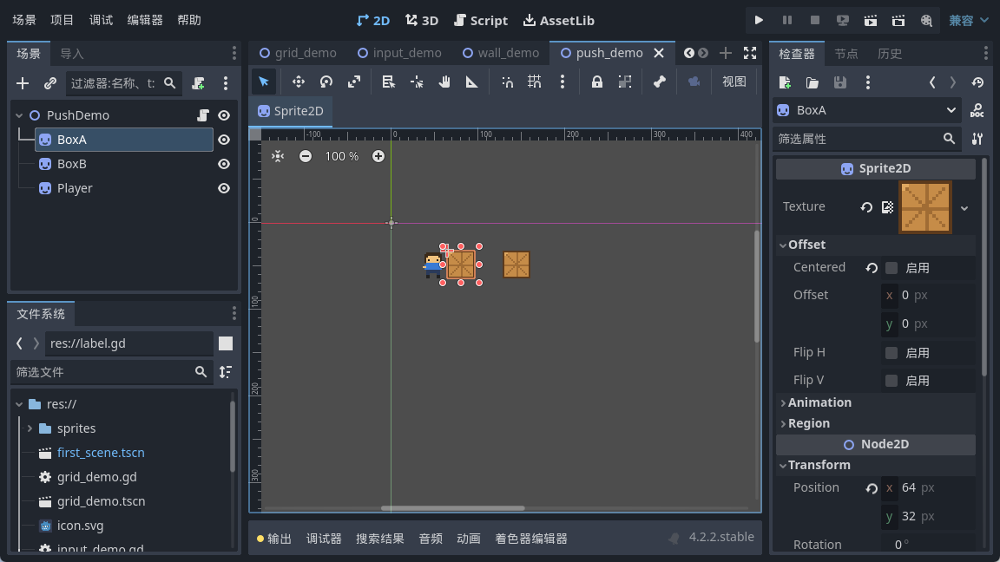
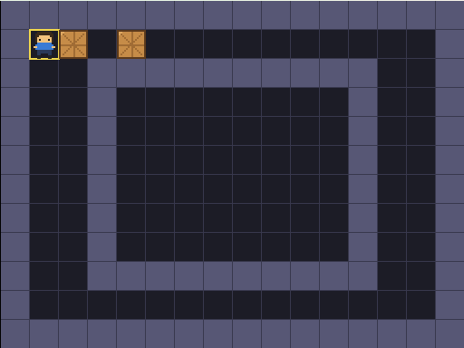
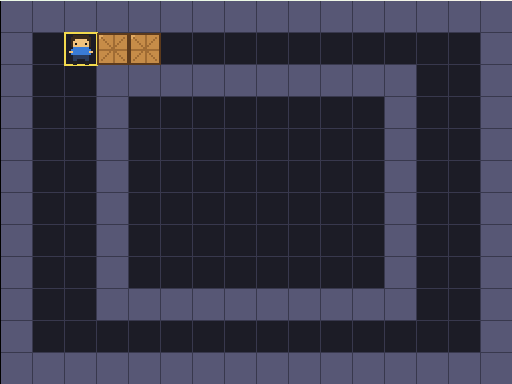
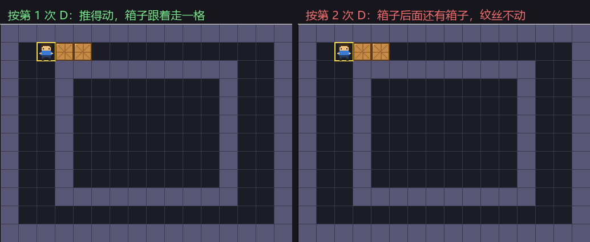
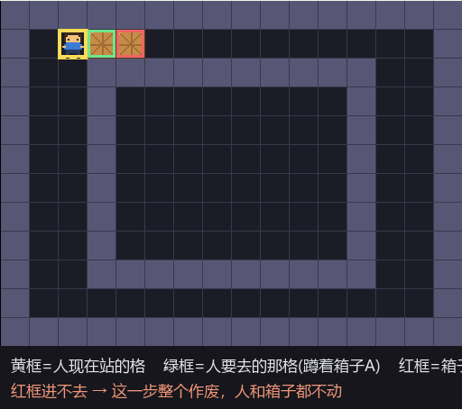

<!--
【CSDN 发布信息】
标题：Godot 入门（09）：推箱子，推得动与推不动
摘要：小人会撞墙就停了，可推箱子光会停还不够。这篇加两个箱子，讲清一件事：推之前要看的不是一格，是两格——人要去哪里，箱子要去哪里，两处都通得过才动。
标签：Godot、推箱子、GDScript、碰撞判定、入门教程
截图清单（发布时按序上传）：
  1. ../img/09/09_run.png —— 起点：人 cell(1,1)，箱子 A(2,1)、箱子 B(4,1)
  2. ../img/09/09_push.png —— 按第 1 次 D：推得动，箱子跟着走一格
  3. ../img/09/09_compare.png —— 按第 2 次 D：箱子后面还有箱子，纹丝不动
  4. ../img/09/09_two_cells.png —— 看两格：黄框人、绿框目标、红框箱子落点
  5. ../img/09/09_code.png —— 脚本编辑器里的 find_box 与推箱子判定
  6. ../img/09/09_editor.png —— 场景树里 BoxA / BoxB / Player 三个精灵
-->

# Godot 入门（09）：推箱子，推得动与推不动

> 上一篇小人学识撞墙就停，规矩系明咗。
> 不过推箱子呢个游戏，净系识停仲唔够——佢要识推。
> 今日同佢加两个箱子，再教佢一句要紧嘅话：有啲格子，睇落入得，其实推唔动。

## 一、箱子在代码里，就是一组格子号

先说清楚箱子是什么。它不是屏幕上那个木头方块，那只是影子。箱子在代码里就是一组坐标：

```gdscript
var box_cells: Array[Vector2i] = [
	Vector2i(2, 1),   # 箱子 A，紧挨着玩家
	Vector2i(4, 1),   # 箱子 B，挡在 A 后面
]
```

三个精灵在场景树里排排坐，数据这边就三个格子号，一一对应：



数据还数据，影子还影子。改 `box_cells`，影子跟着挪；你在编辑器里手动拖影子，数据压根不认账。

这个坑我在第 07 篇踩过一次——改了 `cell` 不动 `position`，小人在原地纹丝不动。到箱子这里是同一个道理，只不过换了个名字。

## 二、推之前，要看两格

第 08 篇讲的是「走之前先问一句」。到了推箱子，这一句得问两遍。

一问：人要去的格子 `target`，是不是墙？二问：要是 `target` 上蹲着箱子，那箱子要去的格子 `beyond`，进得去吗？

```gdscript
func _unhandled_input(event) -> void:
	var dir := _dir_from_event(event)
	if dir == Vector2i.ZERO:
		return

	var target := cell + dir
	if is_wall(target):
		return                      # 撞墙，这步作废

	var box_index := find_box(target)
	if box_index != -1:
		# 前面蹲着箱子，那就要多看一格：箱子要去哪里
		var beyond := target + dir
		if not can_enter(beyond):
			return                  # 箱子后面进不去，人和箱子都别动
		box_cells[box_index] = beyond

	cell = target
```

两关都过了，才真的动。任何一关不过，直接 `return`，什么都没发生过。

为什么非得先算再动？第 08 篇说过「先走再退」会埋雷，到推箱子这里雷更大。你要是先推了箱子再发现推不动，就得把箱子退回去；再往后，箱子上还挂着「推了几步」的统计、还有一步步的撤销记录，回滚起来能让你怀疑人生。

先算，判唔过就作废。咁先叫干净。

## 三、找箱子：返回下标，别返回 true/false

呢一段我觉得系本篇最值钱嘅地方。

```gdscript
func find_box(c: Vector2i) -> int:
	# 这格有箱子吗？有就返回它在数组里的下标，没有返回 -1
	for i in box_cells.size():
		if box_cells[i] == c:
			return i
	return -1
```

问「这格有没有箱子」，最直觉的回答是 true 或 false。可你问完这句，下一步十有八九是要挪它。

返回 true，你得再找一遍箱子在数组第几位；返回下标，直接 `box_cells[box_index] = beyond` 就完事。

没找到就返回 `-1`。`-1` 是约定俗成的「没有」，比返回 null 省心。判定的时候老老实实写 `!= -1`，别图省事拿它当布尔值用——读你代码的人会谢你。

## 四、能不能进，一句话说清

```gdscript
func can_enter(c: Vector2i) -> bool:
	# 能不能进 = 不是墙，而且没蹲着箱子
	return not is_wall(c) and find_box(c) == -1
```

两个条件挤一行，调用的地方一行都不用多想。

这个函数现在看着不起眼，后面它是主力：第 10 篇加目标点、第 11 篇加撤销，都得先问它一句。

## 五、跑起来，推一下试试

起点：人站 `cell(1,1)`，箱子 A 在 `(2,1)`，箱子 B 在 `(4,1)`。



按一下 D。人要去的 `(2,1)` 上蹲着箱子 A，那就多看一格——A 要去 `(3,1)`，是空地板，进得去。于是 A 被推到 `(3,1)`，人站上 `(2,1)`。



再按一下 D。这回人前面还是箱子 A，可 A 要去的那格 `(4,1)`，蹲着箱子 B。

箱子推箱子？谂多咗。呢一步整个作废，人同箱子都留喺原地。



左右两张我比对过，像素级一模一样。按咗，冇动，咁就啱喇。

「看两格」画出来是这样：



黄框是人站的格，绿框是人要去的格（蹲着箱子 A），红框是箱子 A 要去的那格（蹲着箱子 B）。红框进不去，整个动作取消。

## 六、一个顺手的小细节

箱子跟着人跑这段，我用了 `parallel()`：

```gdscript
	var tween := create_tween()
	tween.tween_property(player, "position", Vector2(cell) * CELL, 0.12)
	if box_index != -1:
		# parallel() 让箱子和人同时动，不加的话得等前一个补间跑完
		tween.parallel().tween_property(boxes[box_index], "position", Vector2(box_cells[box_index]) * CELL, 0.12)
```

不加 `parallel()` 的话，两个补间会排队——人先滑完 0.12 秒，箱子才开始挪，看着像卡了一下。加上，两者同时起步，才像「人推着箱子走」。

## 写在最后

今天其实就一句话：**推箱子之前，要看的不是一格，是两格。**

人要去哪里，箱子要去哪里，两处都通得过才动。`find_box` 返回下标不返回 true/false，省得找第二遍；`can_enter` 把「不是墙」和「没箱子」合起来，调用的地方不用操心。

而家箱子推得动都推唔动喇，不过佢哋仲未知自己应该去边度。下一篇给箱子找几个「家」——目标点，全部归位就算赢。

下一篇：《Godot 入门 10：目标点与胜利判定，箱子该回哪个家》。

呢篇帮你将箱子推起咗，就**点赞、收藏一下**啦；想跟完全程嘅，**关注「山岚的运维笔记」**。评论区见，问咩都答。

---

*本系列配套工程同步放在 GitHub（仓库 seancheng33/Boxman 的 tutorial 分支），每篇打一个 tag，随时能下到对应进度的完整可运行工程。*
