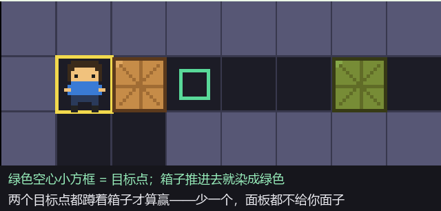
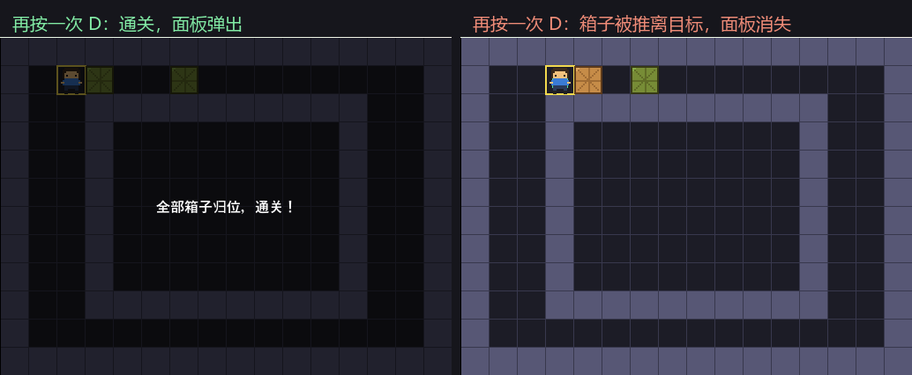
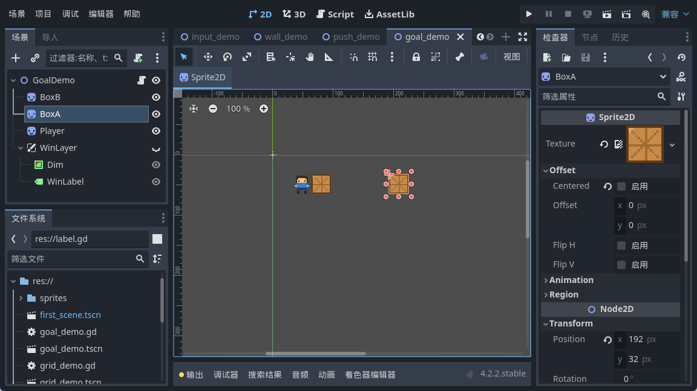
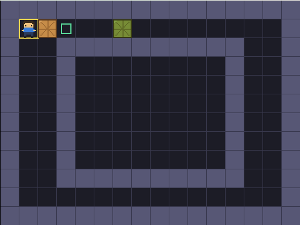
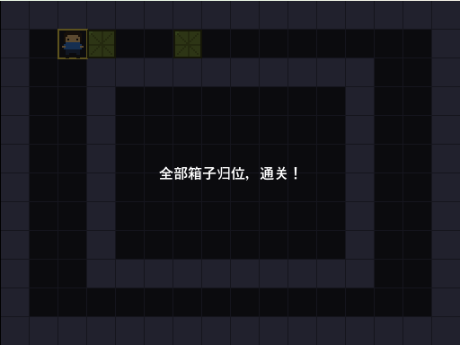

<!--
【CSDN 发布信息】
标题：Godot 入门（10）：目标点与胜利，箱子归位才算赢
摘要：箱子会推了，可它们不知道自己该去哪儿。这篇给箱子找几个「家」——目标点，再解决一件事：什么时候算赢。答案比想的简单，每走一步重新问一次就行。
标签：Godot、推箱子、胜利判定、CanvasLayer、入门教程
截图清单（发布时按序上传）：
  1. ../img/10/10_run.png —— 起点：一个箱子已在目标上（绿），另一个还没
  2. ../img/10/10_goals.png —— 目标点画法放大：空心绿方框，箱子推进去就染绿
  3. ../img/10/10_win.png —— 按一次 D，两个目标点都满了，通关面板弹出
  4. ../img/10/10_compare.png —— 再按一次 D，箱子被推离目标，面板消失
  5. ../img/10/10_code.png —— 脚本里的 is_win 与 _refresh
  6. ../img/10/10_editor.png —— 场景树里的 WinLayer（CanvasLayer + Label）
-->

# Godot 入门（10）：目标点与胜利，箱子归位才算赢

> 上一篇箱子推得动也推得不动了，规矩是有了。
> 可它们不知道自己该去哪儿，推来推去纯属锻炼身体。
> 今天给箱子找几个「家」，再解决一件更要紧的事：什么时候，才算赢。

## 一、目标点，还是一组坐标

跟箱子一个路数。目标点不是画上去的花纹，它也是一组坐标：

```gdscript
var goals: Array[Vector2i] = [
	Vector2i(3, 1),
	Vector2i(6, 1),
]
```

画的时候就照着这组坐标描框，`_draw()` 里加几行：

```gdscript
	# 目标点：画成一个小方框，箱子推进来就把它填上
	for g in goals:
		var p := Vector2(g) * CELL
		draw_rect(Rect2(p + Vector2(8, 8), Vector2(CELL - 16, CELL - 16)), Color(0.35, 0.85, 0.6), false, 2)
```

放大看是这样，绿色空心小方框就是「家」：



箱子推进去，我就把它染成绿色，一眼能看出哪个归位了。

## 二、赢没赢，一个循环就问出来了

胜利判定我一开始想复杂了，琢磨着要不要记「推了几步」「哪个箱子进了哪个坑」。其实不用。

**赢 = 每个目标点上都蹲着一个箱子。** 就这一句：

```gdscript
func is_win() -> bool:
	# 每个目标点上都得蹲着一个箱子，少一个都不算
	for g in goals:
		if find_box(g) == -1:
			return false
	return true
```

遍历目标点，有一个上面没箱子，直接 false。全都有，才 true。

注意这里查的是**目标点**，不是箱子。反过来写（遍历箱子看它在不在目标上）也能跑，但逻辑会绕：箱子数量和目标点数量万一不等，你就得额外处理。从目标点出发问「你那里有箱子吗」，问法跟需求一一对应，读起来不用拐弯。

## 三、数据变了，外观得跟着刷

箱子染绿这件事，写成一个 `_refresh()`，数据一变就调它：

```gdscript
func _refresh() -> void:
	# 数据变了，把「外观」刷一遍：箱子颜色 + 胜利面板
	for i in boxes.size():
		boxes[i].modulate = Color(0.6, 1.0, 0.75) if on_goal(box_cells[i]) else Color(1, 1, 1)
	win_layer.visible = is_win()
```

`modulate` 是 Godot 里给节点上色的属性，乘在原来的颜色上。填白色 `(1,1,1)` 就是不上色，原样。

这里有个习惯我想推荐：**数据改完，统一走一个函数刷外观**，别在每个改动的地方各写一遍染色的代码。将来要加「箱子归位时播个音效」「归位数显示在角落」，也只改这一个函数。

## 四、每走一步，都重新问一次

这是本篇我最想说的一句。

```gdscript
	# 每走一步都重新问一次「赢了吗」——推离目标点也得能取消
	_refresh()
```

我第一版是在推完箱子之后判一次，赢了就弹面板，完事。结果呢？通关之后我又把箱子推走了，面板还挂在那里，跟个甩不掉的横幅一样。

问题就出在「判一次」上。胜利不是一个事件，是**一个状态**。状态这东西，得每次数据变了就重新算。

改成每步都问之后，推离目标点，面板自己就消失了。



## 五、成功面板用 CanvasLayer

面板是 UI，得挂在 `CanvasLayer` 下面：



普通节点跟着场景走，摄像机一动它就跑；`CanvasLayer` 里的东西钉在屏幕上，不管游戏画面怎么滚。UI 就该放这一层。

节点结构是 `WinLayer`（CanvasLayer）下面挂一个半透明的 `ColorRect` 当遮罩，再挂一个 `Label` 写字。想显示就把 `WinLayer` 的 `visible` 打开，想隐藏就关掉，一行搞定。

## 六、跑起来，推一下

起点我摆成这样：箱子 A 一开始就在目标点上（绿的），箱子 B 还差一格。



这叫 1/2，不算赢，面板不给面子。

按一下 D，箱子 B 被推进目标点，两个都满了：



面板上就一行字。字不重要，重要的是它为什么这时候出现——因为 `is_win()` 这时候终于返回了 true。

## 写在最后

今天三句话。目标点也是一组坐标，跟箱子一个路数。胜利判定是遍历目标点问「你那里有箱子吗」，别绕。胜利是个状态，每走一步都得重新问一次，别只判一次。

现在游戏有输赢了，可推错一步只能干瞪眼。下一篇给它加个后悔药——Z 键撤销，用栈把走过的每一步记下来。

下一篇：《Godot 入门 11：Z 键撤销，用栈给每一步留个后悔药》。

这篇帮你把箱子送回家了，就**点个赞收藏**吧；想跟完全程的，**关注「山岚的运维笔记」**。评论区见，有问必回。

---

*本系列配套工程同步放在 GitHub（仓库 seancheng33/Boxman 的 tutorial 分支），每篇打一个 tag，随时能下到对应进度的完整可运行工程。*
