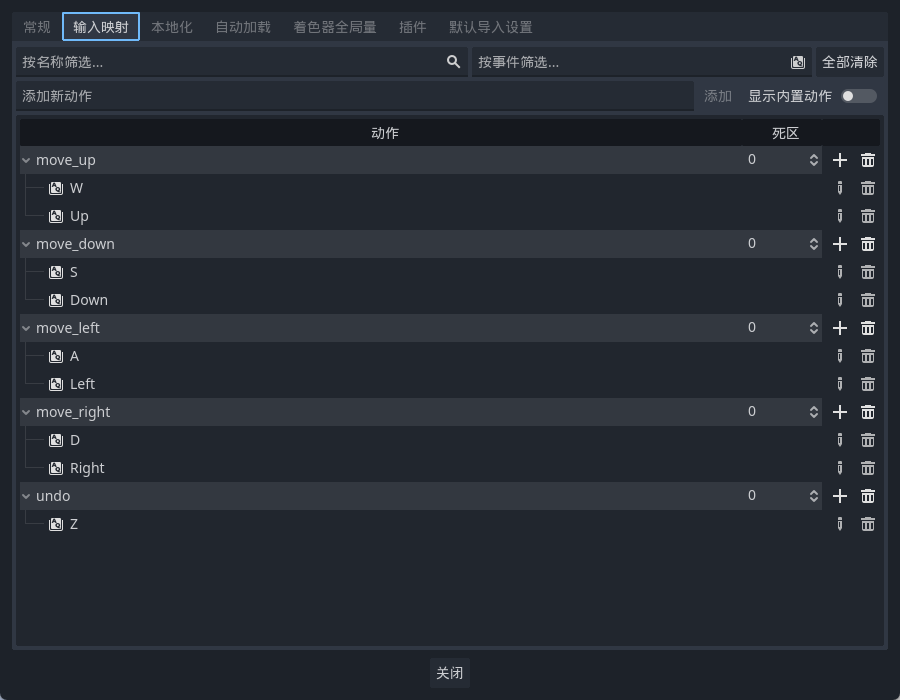
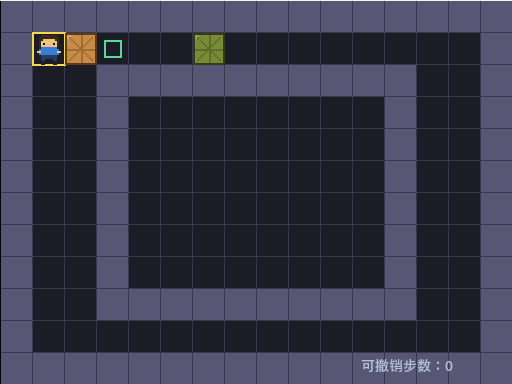
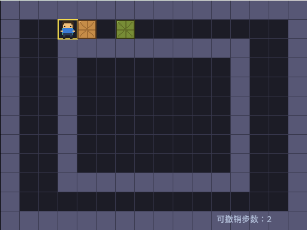
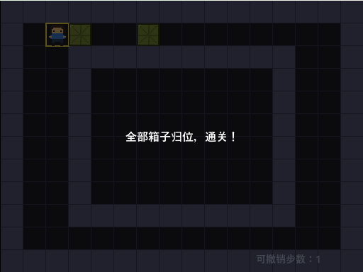
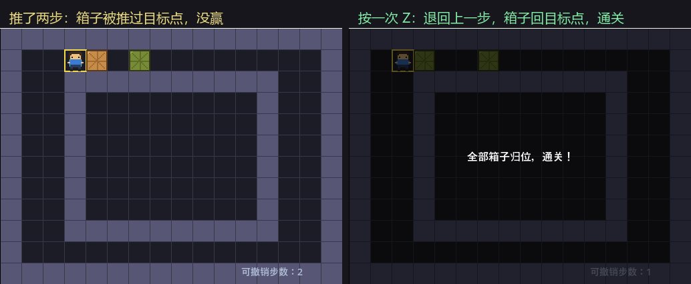

<!--
【CSDN 发布信息】
标题：Godot 入门（11）：Z 键撤销，用栈给每步留后悔药
摘要：推箱子最怕推错一步。这篇给它加撤销：用一个数组当栈，每走一步把「动之前」的样子存一笔，Z 键弹出来就退回去。顺带讲两个必踩的坑——数组存的是引用，还有存档必须赶在改数据之前。
标签：Godot、推箱子、撤销功能、栈、GDScript、入门教程
截图清单（发布时按序上传）：
  1. ../img/11/11_run.png —— 起点，右下角显示「可撤销步数：0」
  2. ../img/11/11_push2.png —— 按两次 D，箱子被推过目标点
  3. ../img/11/11_undo1.png —— 按一次 Z，退回上一步，箱子回目标点，通关面板弹出
  4. ../img/11/11_compare.png —— 撤销前后对比
  5. ../img/11/11_inputmap.png —— 项目设置里给 undo 动作绑上 Z 键
  6. ../img/11/11_code.png —— 脚本里的 _push_history 与 undo
  7. ../img/11/11_editor.png —— 场景树与撤销后的界面
-->

# Godot 入门（11）：Z 键撤销，用栈给每步留后悔药

> 上一篇游戏有输赢喇，不过推错一步净系识干瞪眼，要由头嚟过。
> 推箱子呢个游戏，一步行错整关报废，系最劝退嘅体验。
> 今日同佢加个后悔药：按 Z 退一步，用栈将每一步记低。

## 一、撤销要存什么

答案很朴素：**存「这一步动之前」的样子。**

不是记「我按了 D」，也不是记「我往右走了一格」。存的是动作的话，撤销时你得反过来推——往右走了一格，撤销就是往左走一格，可万一那一步是推箱子呢？箱子往回滚一格，人往回退一格，两个动作，顺序还不能错。

存状态就省心好多。动之前，将人同箱子喺边度拍张照；要撤销，将照片拎返出嚟贴返去，搞掂。

```gdscript
var history: Array = []          # 每一步的存档，后进先出

func _push_history() -> void:
	# 存的是「这一步之前的样子」
	# box_cells 一定要 duplicate()：数组是引用，直接塞进去的话
	# 后面改箱子位置，历史记录会跟着一起改，撤销就成了摆设
	history.push_back({
		"cell": cell,
		"boxes": box_cells.duplicate(),
	})
```

## 二、第一个坑：数组存的是引用

呢段注释系本篇我最想畀你睇嘅地方。

GDScript 里，数组、字典、对象这些是**引用类型**。你把它赋值给另一个变量，或者塞进数组，拿到的不是一份拷贝，是同一份东西的门牌号。

也就是说，你要是写成：

```gdscript
history.push_back({"cell": cell, "boxes": box_cells})
```

存进去的 `box_cells` 和外面那个 `box_cells` 是同一个数组。等你下一步把箱子从 `(3,1)` 推到 `(4,1)`，历史记录里那份也跟着变成了 `(4,1)`。等你想撤销，弹出来的「历史」跟现在一模一样，按 Z 毫无反应。

我第一版就系呢个毛病。按咗 Z，画面纹丝不动，我仲以为系按键冇绑上，查咗半日键位。

`duplicate()` 就是专门干这个的：复制一份出来存，跟原件再无瓜葛。

## 三、第二个坑：存档要赶在改数据之前

顺序也很要紧：

```gdscript
	var box_index := find_box(target)
	var beyond := Vector2i.ZERO
	if box_index != -1:
		beyond = target + dir
		if not can_enter(beyond):
			return

	# 走到这里说明这一步真要走了，先把「走之前」存一笔
	# 顺序很要紧：必须在改任何数据之前存
	_push_history()

	if box_index != -1:
		box_cells[box_index] = beyond

	cell = target
```

`_push_history()` 必须排在 `cell = target` 前面。存晚了，存的就是「走之后」的样子，等于没存。

还有个好处：撞墙、推不动这些情况，走的是上面的 `return` 分支，压根没走到 `_push_history()`。所以「撞墙那一步」不会进历史，撤销也就不会退回到一个你根本没动过的地方。

**净系真系行咗嗰一步，先配有后悔药。**

## 四、栈，就是个数组

「栈」这词听着吓人，落到代码里就是一个数组，加上两个动作：

- 存：`history.push_back(...)`，从尾巴塞进去
- 取：`history.pop_back()`，从尾巴拿出来

后进先出。最后存嗰步，第一个被撤走——啱晒直觉。

```gdscript
func undo() -> void:
	if history.is_empty():
		return
	var last: Dictionary = history.pop_back()
	cell = last["cell"]
	box_cells.assign(last["boxes"])
	player.position = Vector2(cell) * CELL
	_sync_box_positions()
	_refresh()
	queue_redraw()
```

`is_empty()` 那句是兜底：栈空了就别硬撤。不然 `pop_back()` 返回 null，后面取值直接崩。

`box_cells.assign(...)` 里的 `assign` 是把元素逐个拷进已有的数组，类型匹配也比直接赋值稳当。

## 五、绑个键：InputMap 里加一条

第 07 篇说过，键位和动作名要分开。撤销也一样，加个叫 `undo` 的动作，绑到 Z 上：



将来你想改成 Ctrl+Z，或者给手柄也配一个，只动这个面板，代码一行不用改。

代码这边就一句：

```gdscript
	if event.is_action_pressed("undo"):
		undo()
		return
```

放在 `_unhandled_input` 最前面。撤销跟走路是两码事，处理完直接 `return`，别让它掉进下面走路的逻辑里。

## 六、跑起来，推两步再撤

起点：一个箱子已在目标上（绿的），另一个还差一格。右下角那行字是栈里还剩几步。



按两次 D。第二次把箱子推过了目标点，反而没赢：



按一次 Z，退回上一步——箱子回到目标点，通关面板跟着弹出来：





我一直按到底，将两步都撤完，画面返到起点嗰张，同最初**像素级一模一样**。再按一次 Z，栈已经空了，画面纹丝不动——`is_empty()` 那句兜住了。

## 写在最后

今天三句话。撤销存的是状态不是动作，存「动之前」的样子。数组是引用，存进历史之前一定 `duplicate()`，不然历史跟着一起变。`_push_history()` 要排在改数据之前，撞墙那些没走成的步子本来就不该进历史。

而家推得、撤得、赢得，不过地图系写死喺代码入面嘅。下一篇把地图抽成一份文本文件，改关卡不用再动代码。

下一篇：《Godot 入门 12：关卡数据化，地图写成一份文本文件》。

呢篇帮你将后悔药配好咗，就**顺手点赞收藏一下**啦；想跟完全程嘅，**关注「山岚的运维笔记」**。评论区见，问咩都答。

---

*本系列配套工程同步放在 GitHub（仓库 seancheng33/Boxman 的 tutorial 分支），每篇打一个 tag，随时能下到对应进度的完整可运行工程。*
