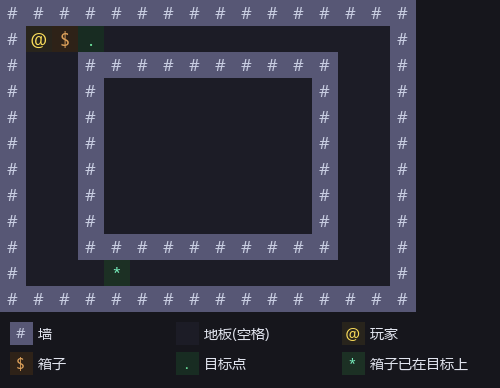
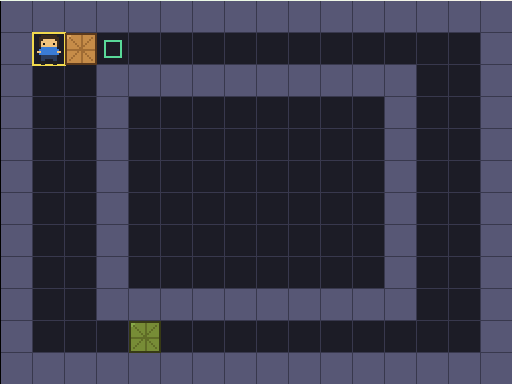
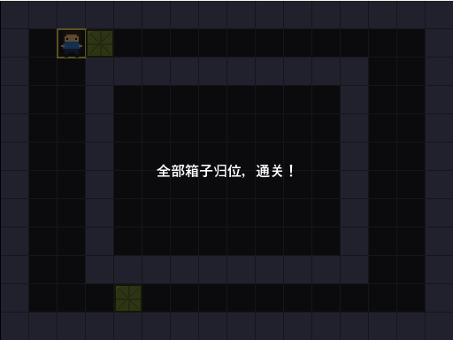
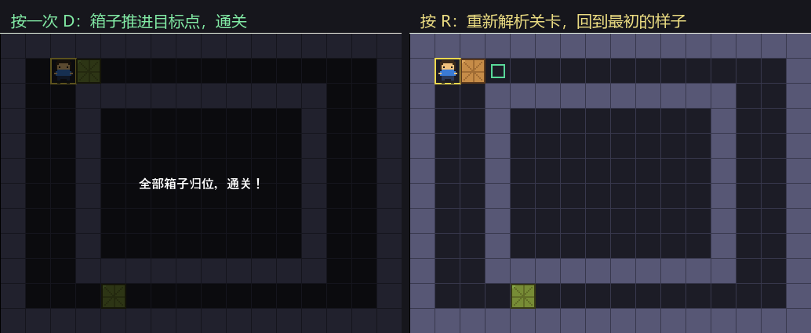

<!--
【CSDN 发布信息】
标题：Godot 入门（12）：关卡数据化，地图写成一份文本
摘要：地图一直写死在代码里，改一格要动逻辑。这篇把它抽成一份纯文本，定一套符号，写个解析函数读进来。改关卡从此只是改几行字，代码一行不用动。
标签：Godot、推箱子、关卡设计、数据驱动、GDScript、入门教程
截图清单（发布时按序上传）：
  1. ../img/12/12_symbols.png —— 关卡文本与符号对照：# 墙 空格地板 @ 玩家 $ 箱子 . 目标 * 箱子已在目标
  2. ../img/12/12_level.png —— 解析出来的画面：玩家 cell(1,1)，两个箱子各就各位
  3. ../img/12/12_win.png —— 按一次 D，箱子推进目标点，通关
  4. ../img/12/12_compare.png —— 按 R 重开：重新解析一遍，回到最初的样子
  5. ../img/12/12_code.png —— 脚本里的 parse_level 与 build_level
  6. ../img/12/12_editor.png —— 场景树与运行界面
-->

# Godot 入门（12）：关卡数据化，地图写成一份文本

> 前面十一篇，地图一直写死在代码里，玩家和箱子在哪儿也是我手填的坐标。
> 想加一关，就得把那几个数组再抄一遍，改个数还得数格子。
> 今天把地图抽成一份纯文本。改关卡从此只是改几行字，代码一行不用动。

## 一、先定一套符号

关卡文本长这样：

```gdscript
const LEVEL := [
	"################",
	"#@$.           #",
	"#  ##########  #",
	"#  #        #  #",
	"#  #        #  #",
	"#  #        #  #",
	"#  #        #  #",
	"#  #        #  #",
	"#  #        #  #",
	"#  ##########  #",
	"#   *          #",
	"################",
]
```

符号一共七个，是推箱子社区通用的那套，网上现成的关卡文件直接能拿来用：



有两点要留神。

**地板是空格，不是点。** 我一开始顺手拿 `.` 当地板，跟目标点抢了符号，解析出来一团乱。空格看着别扭，可它最不容易跟别的字符打架。

**一个字符能表达两件事。** `*` 既是「这里有箱子」又是「这里是目标点」，`+` 是「玩家站在目标点上」。这两个符号看着多余，其实省了大麻烦——不然你得再开一个数组专门记「哪个箱子开局就站在目标上」。

## 二、解析：一个字符一个字符看

```gdscript
func parse_level(lines: Array) -> void:
	# 一个字符一个字符地看，看到什么就往对应的数组里塞
	box_cells.clear()
	goals.clear()
	for r in lines.size():
		var row: String = lines[r]
		for c in row.length():
			var ch := row.substr(c, 1)
			var pos := Vector2i(c, r)
			if ch == "@":
				cell = pos
			elif ch == "+":
				cell = pos
				goals.append(pos)
			elif ch == "$":
				box_cells.append(pos)
			elif ch == "*":
				box_cells.append(pos)
				goals.append(pos)
			elif ch == ".":
				goals.append(pos)
```

两层循环，外层走行、内层走列，看到什么字符就往对应的数组里塞。没有花哨的东西，就是老实遍历。

`box_cells.clear()` 和 `goals.clear()` 写在最前面，是为了让这个函数能反复调用——重开一关就是重新解析一遍，不清空的话箱子会越攒越多。

## 三、墙不用单独存

墙我没解析成数组，判定的时候直接回文本里查：

```gdscript
func is_wall(c: Vector2i) -> bool:
	# 墙还是直接从文本里读，越界一律当墙
	if c.y < 0 or c.y >= LEVEL.size():
		return true
	var row: String = LEVEL[c.y]
	if c.x < 0 or c.x >= row.length():
		return true
	return row.substr(c.x, 1) == WALL
```

地图文本本身就是一份完整的地图数据，没必要再抄一份到别的数组里。多一份数据就多一处对不上的风险。

## 四、解析完，画面自己就出来了

```gdscript
func build_level() -> void:
	# 重开一关只要重新解析一遍，别的都不用动
	parse_level(LEVEL)
	player.position = Vector2(cell) * CELL
	_sync_boxes()
	_refresh()
	queue_redraw()
```

解析完了，玩家在哪儿、箱子在哪儿、目标点在哪儿，全有了。剩下的就是把精灵摆到位、刷一遍颜色、喊一声重画。

`_sync_boxes()` 里多做了一件事：箱子精灵我是事先在场景里摆好几个的，关卡里箱子少就把多余的藏起来。

```gdscript
	for i in box_pool.size():
		if i < box_cells.size():
			box_pool[i].visible = true
			box_pool[i].position = Vector2(box_cells[i]) * CELL
		else:
			box_pool[i].visible = false
```

这叫对象池。关卡里箱子数量不定，总不能每次都现场创建节点。先备几个，用多少显多少，正经项目里基本都这么干。

## 五、跑起来

解析出来的画面：玩家在 `cell(1,1)`，箱子一个在右边、一个已经站在目标点上（绿的）。



按一次 D，箱子推进目标点，两个都满了，通关：



按 R 重开。它做的事就是再调一次 `build_level()`，把关卡文本重新解析一遍：



重开后的画面跟开局那张，我比对过，像素级一模一样。这说明解析是干净的——没留下上一局的任何残渣。

## 写在最后

阶段二到这里收尾了。回头看这四篇，我们干了这些事：

- 第 09 篇：推箱子要看两格，`find_box` 返回下标省得找第二遍
- 第 10 篇：胜利是状态不是事件，每走一步都得重新问
- 第 11 篇：撤销存状态不存动作，数组是引用记得复制
- 第 12 篇：地图抽成文本，改关卡不动代码

现在这个游戏能推、能撤、能赢，关卡还是数据驱动的了。

下一阶段把它做成一个「真的游戏」：多关卡、存档解锁、选关界面、主菜单。第一步是多关卡加载与切换——既然关卡已经是文本了，多备几份轮着读就是了。

下一篇：《Godot 入门 13：多关卡加载与切换》。

这篇帮你把地图搬出了代码，就**点个赞收藏一下**吧；想跟完全程的，**关注「山岚的运维笔记」**。评论区见，有问必回。

---

*本系列配套工程同步放在 GitHub（仓库 seancheng33/Boxman 的 tutorial 分支），每篇打一个 tag，随时能下到对应进度的完整可运行工程。*
