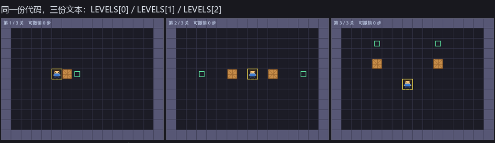
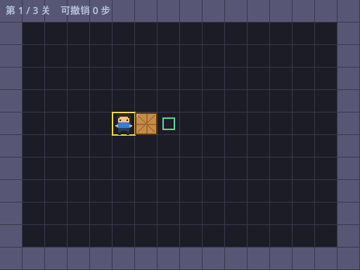
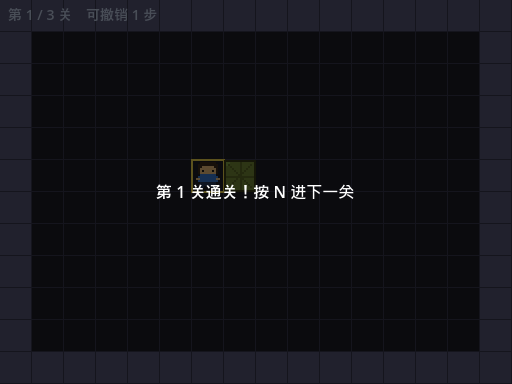
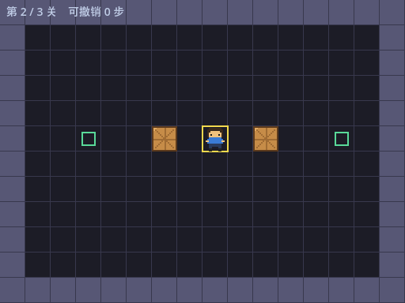
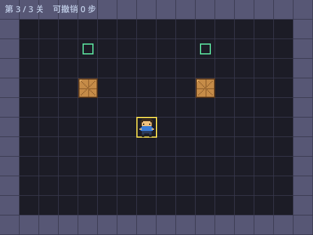
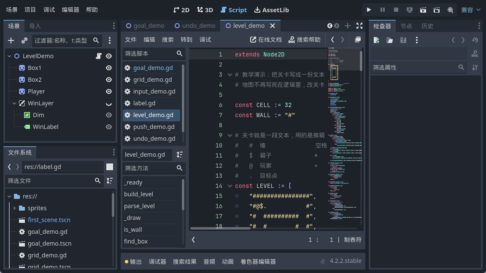
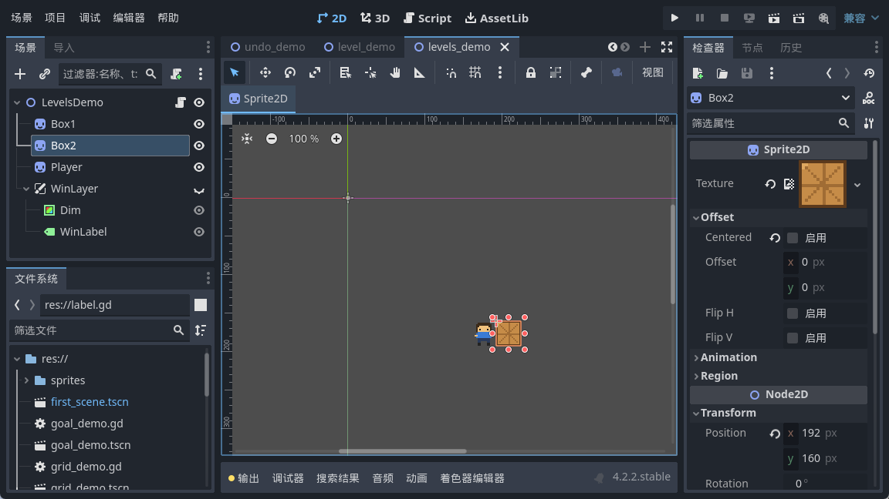

<!--
【CSDN 发布信息】
标题：Godot 入门（13）：多关卡加载与切换，一份数组装三关
摘要：关卡已经是一份文本了，多备几份轮着读就是多关卡。这篇把三份地图装进一个数组，加个 level_index 记住当前第几关，通关按 N 切下一关。顺带讲清换关那一瞬间必踩的两个坑：撤销记录没清、补间没掐。
标签：Godot、推箱子、多关卡、数据驱动、GDScript、入门教程
截图清单（发布时按序上传）：
  1. ../img/13/13_compare.png —— 三关并排：第 1 关 1 个箱子 / 第 2 关 2 个箱子左右推 / 第 3 关要绕到下面往上推
  2. ../img/13/13_level1.png —— 第 1 关开局，左上角显示「第 1 / 3 关　可撤销 0 步」
  3. ../img/13/13_win1.png —— 按一次 D 通关，面板写「第 1 关通关！按 N 进下一关」
  4. ../img/13/13_level2.png —— 按 N 切到第 2 关，箱子变成 2 个
  5. ../img/13/13_level3.png —— 再按 N 到第 3 关；最后一关再按 N 没反应
  6. ../img/13/13_code.png —— 脚本里的 LEVELS 数组与 load_level
  7. ../img/13/13_editor.png —— 场景树与运行界面
-->

# Godot 入门（13）：多关卡加载与切换，一份数组装三关

> 上一篇把地图抽成了一份文本，改关卡不用动代码了。
> 可一共就一关，通关了就没得玩。
> 今日多备两份文本，通关按 N 就直接跳去下一关。听落好顺，不过换关嗰一瞬间有两个坑等紧你。

## 一、多关卡，就是数组的数组

第 12 篇的 `LEVEL` 是一份文本，一份文本就是 `["第0行", "第1行", ...]` 这么个数组。那多关卡呢？再套一层：

```gdscript
const LEVELS := [
	[
		"################",
		"#              #",
		"#              #",
		"#              #",
		"#              #",
		"#    @$.       #",
		"#              #",
		"#              #",
		"#              #",
		"#              #",
		"#              #",
		"################",
	],
	[
		"################",
		"#              #",
		"#              #",
		"#              #",
		"#              #",
		"#  .  $ @ $  . #",
		"#              #",
		"#              #",
		"#              #",
		"#              #",
		"#              #",
		"################",
	],
	[
		"################",
		"#              #",
		"#   .     .    #",
		"#              #",
		"#   $     $    #",
		"#              #",
		"#      @       #",
		"#              #",
		"#              #",
		"#              #",
		"#              #",
		"################",
	],
]
```

`LEVELS[0]` 是第一关那叠文本，`LEVELS[1]` 是第二关。没了，就这点事。

三关长这样，难度是我排着来的：第一关推一下就赢，第二关两个箱子左右各推一个，第三关得绕到箱子底下往上顶。



写呢三关嘅时候我做过一件蠢事：凭手感摆完就走，结果第三关点推都系差一格。后来学乖了，写完文本先拿脚本跑一遍求解器，确认它真能通关再往里填。推箱子呢家嘢，摆错咗就系死局，玩家推到一半先发现推唔动，嗰种体验真系劝退。

## 二、一个函数管所有关卡

关卡多了，就得有个东西记住「现在在第几关」。一个整数够：

```gdscript
var level_index := 0                 # 当前是第几关（从 0 开始数）
```

然后所有换关的动作都走同一个入口：

```gdscript
func load_level(i: int) -> void:
	# 换关就调这一个函数，别的都不用操心
	level_index = i

	# 换关第一件事：把上一关留下的东西清干净
	# 箱子坐标和目标点由 parse_level 里的 clear() 负责，
	# 但撤销记录是这一篇才有的，得自己清
	history.clear()
	# 上一关的补间要是还在跑，它会把新关卡的精灵拽回老位置，先掐掉
	if move_tween != null:
		move_tween.kill()

	parse_level(LEVELS[i])
	player.position = Vector2(cell) * CELL
	_sync_boxes()
	_refresh()
	queue_redraw()
```

这么写有个附带好处：**重开本关和跳下一关走的是同一条路**。按 R 就是 `load_level(level_index)`，按 N 就是 `load_level(level_index + 1)`，不用写两套。

跳下一关单独封一层，主要是放那个边界判断：

```gdscript
func next_level() -> void:
	# 已经是最后一关就没得跳了
	if level_index + 1 >= LEVELS.size():
		return
	load_level(level_index + 1)
```

`level_index + 1 >= LEVELS.size()` 这个判断别省。省了的话按到最后一关再按 N，`LEVELS[3]` 直接越界，Godot 甩你一脸 `Invalid access to property or key '3' on a base object of type 'Array'`。

## 三、换关那一瞬间，两个坑

呢个系我今日真正踩到嘅地方，比「数组的数组」呢种概念值钱得多。

**坑一：撤销记录没清。**

第 11 篇我们做了 Z 键撤销，每走一步往 `history` 里压一份存档。问题来了——这份存档记的是**上一个关卡**的箱子坐标。

我实测了一遍：在第 1 关走一步，`history` 里有 1 条；按 N 切到第 2 关，要是没清，这 1 条还在。这时候你手贱按一下 Z，它会把第 1 关的箱子坐标写回第 3 关的 `box_cells`。画面上一半是这关的箱子、一半是上关的箱子，看着像渲染出了 bug，查半天查不到。

所以 `load_level` 开头那句 `history.clear()` 不是洁癖，是必需的。清完之后切关，`history` 老老实实是 0。

**坑二：补间没掐。**

这个更隐蔽。移动是用 `create_tween()` 摊到 0.12 秒跑的，你要是在小人还在半路上就按 N，那个补间**不会因为你换了关就自己停**。

我做了个对照实验：给一个精灵起个补间往 x=300 走，1 秒到；走了一半我把它挪到 (0, 200)，然后等 0.5 秒再看——位置变成了 `(148.18, 101.21)`。

既不是我新设的 (0, 200)，也不是终点 (300, 0)。它在按**老目标**继续算插值，把我设的新位置整个盖掉了。

解决办法就是把补间存成成员变量，换关前掐掉：

```gdscript
var move_tween: Tween = null

# 移动的时候存下来（下面两行在 _unhandled_input 里面）
	move_tween = create_tween()
	move_tween.tween_property(player, "position", Vector2(cell) * CELL, 0.12)
```

`load_level` 里那句 `move_tween.kill()` 就是干这个的。0.12 秒很短，正常玩不容易撞上，但"不容易撞上"的 bug 才是最烦人的那种——上线三个月后有人反馈"偶尔箱子会飘"，你猜我怎么知道的。

## 四、最后一关要说句不一样的话

通关面板上那句话得看情况变：

```gdscript
	if is_win():
		# 最后一关跟前面几关说的话不一样
		if level_index == LEVELS.size() - 1:
			win_label.text = "全部 %d 关通关！" % LEVELS.size()
		else:
			win_label.text = "第 %d 关通关！按 N 进下一关" % (level_index + 1)
	win_layer.visible = is_win()
```

注意 `LEVELS.size() - 1` 这个减一。数组从 0 数，关号从 1 数，这两个数永远差 1，我在这上面栽过的次数不比越界少。

## 五、跑起来

开局是第 1 关，左上角那行字是我特意加的——`第 1 / 3 关　可撤销 0 步`，切关时一眼能看出有没有切成功：



按一次 D，箱子推进目标点，面板弹出来：



按 N，跳到第 2 关。箱子从一个变成两个，目标点也换了位置，上一关的东西一点没留：



再按 N 到第三关。这时候再按一次 N，画面纹丝不动——我把前后两张截图做过像素比对，0 个像素不同，说明最后一关的边界判断生效了：



顺带说一句，切关之后箱子位置我也逐个格子验过：第 1 关箱子在 (6,5)、第 2 关在 (6,5) 和 (10,5)、第 3 关在 (4,4) 和 (10,4)，跟关卡文本里 `$` 的位置一格不差。呢条「换关清干净」就算钉死咗喇。





## 写在最后

阶段三开咗个头。这篇真正值钱的不是「数组套数组」——那个你一想就通。值钱的是换关那两个坑：**换关不是换个关卡号就完事，凡是跨关还活着的东西，都得挨个点名**。

数据类的（`box_cells`、`goals`、`history`）要清，动画类的（补间）要掐，显示类的（对象池里多余的精灵）要藏。第 12 篇的对象池在这就派上用场了：第 1 关只要 1 个箱子，第 2 关要 2 个，池子里备着的那个自动就显出来了，不用我们操心。

而家可以一关一关咁推落去喇。不过仲有个问题：熄咗游戏再开返，又由第 1 关开始，通咗几关冇人记得。下一篇做存档，将通关进度写落文件。

下一篇：《Godot 入门 14：存档与解锁，ConfigFile 记住你通到第几关》。

呢篇帮大家将三关串埋一齐，顺手**点赞收藏**一下啦；想跟足全程嘅，**关注「山岚的运维笔记」**。评论区吹水都得，有问必回。

---

*本系列配套工程同步放在 GitHub（仓库 seancheng33/Boxman 的 tutorial 分支），每篇打一个 tag，随时能下到对应进度的完整可运行工程。*
