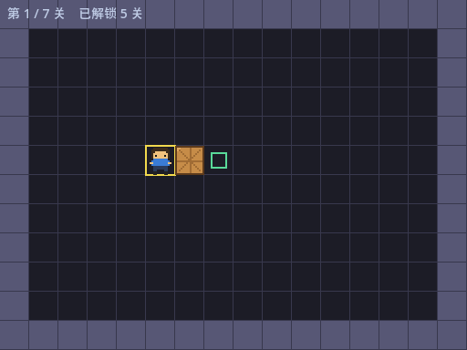
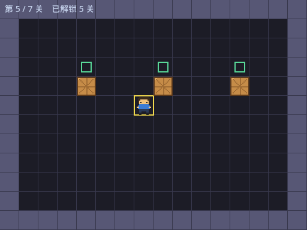
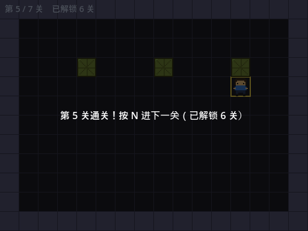
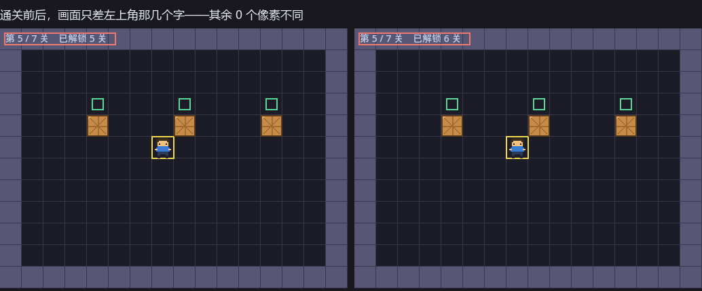
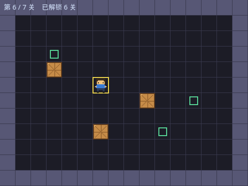
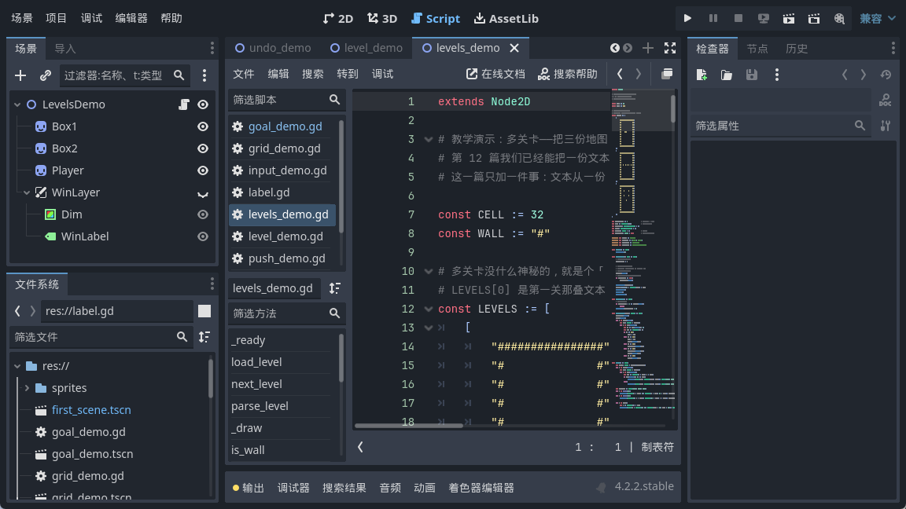
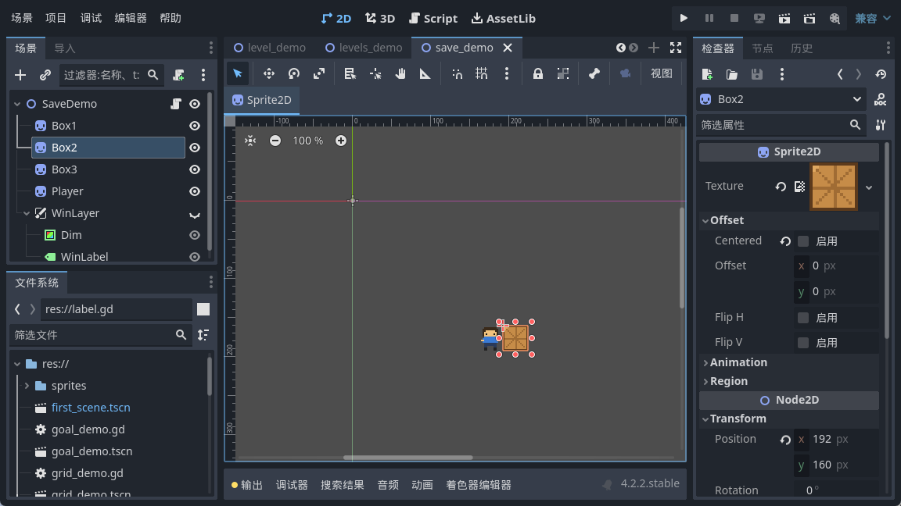

<!--
【CSDN 发布信息】
标题：Godot 入门（14）：存档与解锁，进度写进一个文件
摘要：能一关一关往下推了，可关掉游戏再打开又从第一关开始。这篇用 ConfigFile 把通关进度写进 user://progress.cfg，默认开放 5 关，通关第 5 关自动解锁第 6 关。顺带讲清三件事：存档文件到底落在硬盘哪里、第一次运行文件根本不存在怎么办、解锁数为什么要夹一下。
标签：Godot、推箱子、存档、ConfigFile、解锁进度、入门教程
截图清单（发布时按序上传）：
  1. ../img/14/14_lv1.png —— 第 1 关开局，左上角「第 1 / 7 关　已解锁 5 关」
  2. ../img/14/14_lv5.png —— 连按 4 次 N 到第 5 关
  3. ../img/14/14_locked.png —— 再按 N 没反应：第 6 关还没解锁
  4. ../img/14/14_win5.png —— 通关第 5 关，面板写「已解锁 6 关」
  5. ../img/14/14_compare.png —— 解锁前后对比：画面只差左上角 55 个像素
  6. ../img/14/14_lv6.png —— 解锁后按 N，进第 6 关
  7. ../img/14/14_code.png —— 脚本里的 load_progress 与 save_progress
  8. ../img/14/14_editor.png —— 场景树与运行界面
-->

# Godot 入门（14）：存档与解锁，进度写进一个文件

> 上一篇能一关一关往下推了。
> 可关掉游戏再打开，又从第一关开始，通了多少关没人记得。
> 今日将通关进度写落一个文件。七关入面默认开放五关，后两关要靠通关挣返嚟。唔想次次都由第一关嚟过，就靠呢一步。

## 一、存档放在哪里：`user://`

先解决一个很实在的问题：文件写在哪里。

你可能会想写 `res://save.cfg`。唔使谂，千祈唔好咁做。**`res://` 是游戏资源目录**，导出之后它被打进 pck 包里，是只读的（有的平台甚至压根没有这个文件系统的概念）。往里写要么写不进去，要么写完下次启动就没了。

Godot 给这类需求留了 `user://`，专门放"运行时产生的用户数据"。它在不同系统上落点不同，Windows 上是：

```
C:/Users/sean/AppData/Roaming/Godot/app_userdata/tutorial/
```

这是我在自己机器上跑出来打印的真实路径，`tutorial` 那段就是项目名。macOS 在 `~/Library/Application Support/Godot/app_userdata/`，Linux 在 `~/.local/share/godot/app_userdata/`，网页版则完全不同——那点事留到第 22 篇再说。

想在你自己机器上确认，一行就够。我把它摆在 `_ready()` 的第一行，跑起来控制台头一句就是这个：

```gdscript
	print(ProjectSettings.globalize_path("user://"))
```

`globalize_path` 把 Godot 那套 `user://` 虚拟路径翻译成真实路径，调试的时候好使得很。

## 二、ConfigFile：读写就三板斧

Godot 里存这种小配置，用 `ConfigFile` 最省事。它写出来的文件格式跟老式 ini 一模一样，看得懂也改得动。

读：

```gdscript
const SAVE_PATH := "user://progress.cfg"
const DEFAULT_UNLOCKED := 5          # 第一次玩，先开放 5 关

func load_progress() -> void:
	var cfg := ConfigFile.new()
	# 第一次跑，这个文件根本不存在，load 会返回错误码
	var err := cfg.load(SAVE_PATH)
	if err != OK:
		unlocked = DEFAULT_UNLOCKED
		print("没找到存档（错误码 %d），用默认值 %d 关" % [err, DEFAULT_UNLOCKED])
		return
	# get_value 第三个参数是兜底值：文件里没这一项时就用它
	unlocked = cfg.get_value("progress", "unlocked", DEFAULT_UNLOCKED)
	# 万一以后删了关卡，别让解锁数超过总关卡数
	unlocked = mini(unlocked, LEVELS.size())
	print("读到存档：已解锁 %d 关" % unlocked)
```

写：

```gdscript
func save_progress() -> void:
	var cfg := ConfigFile.new()
	cfg.set_value("progress", "unlocked", unlocked)
	var err := cfg.save(SAVE_PATH)
	print("写存档：unlocked = %d（错误码 %d，0 就是成功）" % [unlocked, err])
```

三个动作：`load` 读进来，`get_value` 取某一项，`set_value` 改完再 `save` 写回去。第一节名（`progress`）随便起，自己分分类就行。

## 三、三个坑，都踩过

**坑一：第一次运行，文件根本不存在。**

这个最容易漏。`cfg.load()` 找不到文件时返回错误码 **7**（`ERR_FILE_NOT_FOUND`），它不会帮你建一个空的，也不会返回默认值——它就那么返回了。你要是不判断，下一句 `get_value` 拿到的就是个鬼知道是什么的东西。呢个错误码唔判，后面就一路错落去。

所以我上面写成"先判错误码，不对就用默认值直接 return"。实测第一次跑，控制台打出来的就是那句"没找到存档（错误码 7），用默认值 5 关"。

**坑二：`get_value` 的第三个参数别忘了。**

`cfg.get_value("progress", "unlocked", DEFAULT_UNLOCKED)` 最后那个 5 是兜底值：文件存在、但里面没有 `unlocked` 这一项时用它。什么时候会这样？你以后加了新字段，老玩家的存档里没有——没这个兜底值，老玩家一升级就崩。呢种崩法最难查，喺自己部机跑得好地地，玩家一装就出事。

**坑三：解锁数要夹一下。**

`unlocked = mini(unlocked, LEVELS.size())` 这行看着多余，其实救过我。总关卡数是会变的，你要是哪天删了两关，存档里还写着"已解锁 7 关"，第 7 关早没了，一进去就数组越界。

我实测过：往文件里硬写一个 `unlocked=999`，读回来被夹成 7，正好等于总关卡数。呢一下夹得值，唔系就轮到玩家中招。

## 四、通关就解锁，立刻写盘

解锁的逻辑就一句：通关第 N 关，把第 N+1 关放开。注意 `level_index` 从 0 数，所以是 +2：

```gdscript
func _unlock_next() -> void:
	# 通关第 N 关（level_index 从 0 数），就把第 N+2 关放开
	var want := mini(level_index + 2, LEVELS.size())
	if want > unlocked:
		unlocked = want
		save_progress()
```

这个函数挂在 `_refresh()` 里，每次刷新都问一句"赢了吗"，赢了才调。跟第 10 篇那个"胜利是状态不是事件"是一套思路——每步都问，别只判一次。

**存档要立刻写，别攒着。**

我见过不少教程把存档放在 `_notification` 里等游戏退出时再写。听着合理，实际很脆：程序崩了、玩家直接关窗口、手机来电话切后台——这些情况下退出回调不一定跑得起来。玩家通咗一关，下次开返发现未解锁，嗰阵真系会闹人。

解锁这事儿一次也就几十字节，写就写了。为咗几十字节搞到玩家白打一关，唔值。

关卡入口也得跟着收一下：

```gdscript
func load_level(i: int) -> void:
	# 没解锁的关卡不放行
	if i >= unlocked:
		return
```

`next_level()` 里那句 `if level_index + 1 >= unlocked` 同理。门不锁死，解锁功能就是摆设。

## 五、跑起来

开局第 1 关，左上角那行字我加了「已解锁 5 关」，方便看状态：



连按 4 次 N 到第 5 关。再按一次 N——画面纹丝不动。我把前后两张截图做过像素比对，**0 个像素不同**，第 6 关确实被拦住了：



把第 5 关通了，面板上直接写明解锁了几关：



这时候按 R 重开本关，跟通关前的画面比一比：



整幅图只有 **55 个像素**不一样，全在左上角那个数字上（5 变 6）；把左上角抠掉，游戏区是 **0 个像素不同**。这个数字我挺满意——说明解锁只改了它该改的东西，没碰别的。

再按 N，第 6 关进来了：



顺带看一眼存档文件里到底写了什么。它就在 `user://progress.cfg`，用记事本打开是这样：

```
[progress]

unlocked=6
```

就咁四行，一睇就明。这也是我选 `ConfigFile` 的原因：出问题的时候你能直接打开看，不用写个专门的读档调试工具。

当然佢有代价——玩家改呢个文件就可以全解锁。小游戏冇所谓，要防就加校验或者存做二进制，嗰啲系另一回事。





## 写在最后

今日呢个游戏第一次有咗「记忆」。

回头数一下，存档这事儿真正要操心的其实就三处：**写到哪儿**（`user://`，不是 `res://`）、**第一次没有文件怎么办**（判错误码，给默认值）、**什么时候写**（立刻，别攒着）。

为什么默认是 5 关？这是我后来做完整版时定的数：237 关全放出来，新手一进来就眼花，看着像劝退；只放 1 关，又显得抠门。5 关刚好够人摸清玩法，又不至于挑花眼。呢个数系试出嚟嘅，唔系拍脑袋定。教学工程里我留了 7 关，默认开 5 关，后两关锁着，正好能看出锁的效果。

而家进度存得住喇。不过玩家仲系只可以一关一关咁推落去，想回头重打第 3 关要由头按 N。下一篇做选关界面，把所有关卡摆成按钮网格，锁着的挂把锁。

下一篇：《Godot 入门 15：选关界面（上），把关卡排成按钮网格》。

呢篇帮大家将进度存住咗，**点赞收藏**一下啦；想跟足全程嘅，**关注「山岚的运维笔记」**。评论区吹水都得，有问必回。

---

*本系列配套工程同步放在 GitHub（仓库 seancheng33/Boxman 的 tutorial 分支），每篇打一个 tag，随时能下到对应进度的完整可运行工程。*
