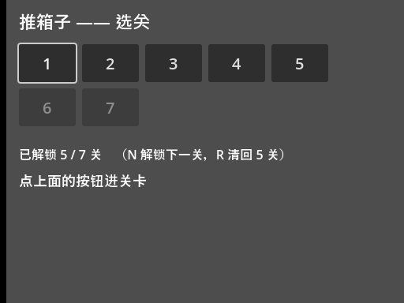
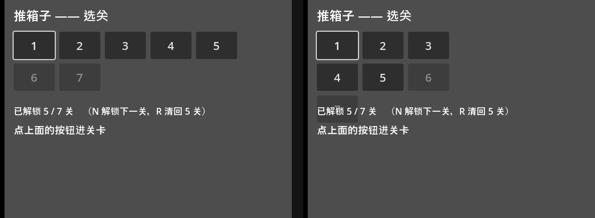
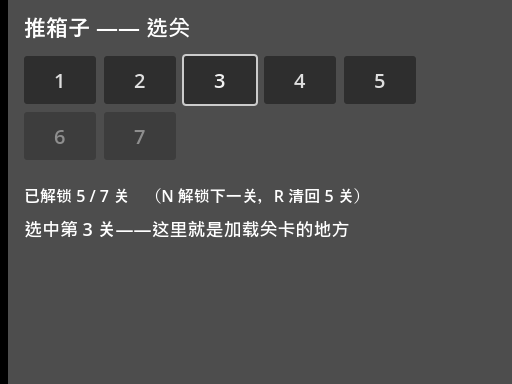
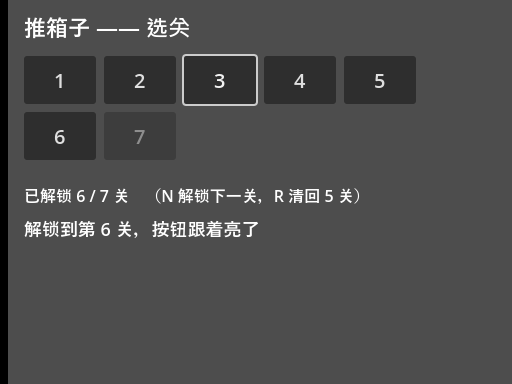
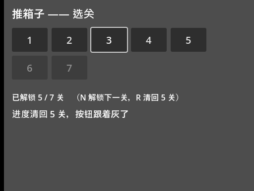

<!--
【CSDN 发布信息】
标题：Godot 入门（15）：选关按钮，一个 for 全造出来
摘要：进度存住了，可进关卡还得按 N 一关一关挪。这篇做选关界面：GridContainer 摆格子，for 循环批量造按钮，bind 让每个按钮记得自己是第几关，disabled 把没解锁的关锁死。顺带讲一个反直觉的坑——按钮状态变了要刷新，千万别删掉重造。
标签：Godot、推箱子、选关界面、GridContainer、bind、入门教程
截图清单（发布时按序上传）：
  1. ../img/15/15_grid.png —— 选关界面全貌：7 个按钮排 5+2，第 6、7 关是灰的
  2. ../img/15/15_columns.png —— columns=5 与 columns=3 的排版对比
  3. ../img/15/15_pick3.png —— 方向键挪到第 3 关，按空格，状态栏跟着变
  4. ../img/15/15_unlock.png —— 按 N 解锁第 6 关，按钮跟着亮了
  5. ../img/15/15_clear.png —— 按 R 清回 5 关，按钮跟着灰了
  6. ../img/15/15_code.png —— select_demo.gd 全貌
  7. ../img/15/15_editor.png —— 场景树与 2D 视图
-->

# Godot 入门（15）：选关按钮，一个 for 全造出来

> 上一篇进度存住了，可进关卡还得按 N 一关一关挪。
> 想重打第三关？从第一关一路按过去。
> 今天做个选关界面，所有关卡摆成按钮，点哪关进哪关。

## 一、手摆按钮，撑不到第十关

先说为什么不用手摆。

你现在有 7 关，从工具箱拖 7 个 Button 到场景里，改改文字，摆整齐，也就一盏茶的功夫。但我手上这个项目最终是 237 关，你让我拖 237 个按钮试试？拖完还得给每个按钮接信号，接完还得保证顺序不出错——这不是写程序，这是给自己埋雷。

动态生成才是正路：**关卡有多少个，按钮就造多少个**。加一关，按钮自动多一个；删一关，自动少一个。代码写一次，以后唔使再管。

本篇的完整工程在 [GitHub 仓库](https://github.com/seancheng33/boxman-tutorial) 的 `tutorial/` 目录，场景是 `select_demo.tscn`，脚本 `select_demo.gd`，跑起来长这样：



七个按钮排成 5+2 两行，下面一行显示解锁进度，第 6、7 关是灰的——锁着。左上角第一个按钮带个白框，那是焦点，后面细说。

## 二、GridContainer：一个数字定排版

按钮谁来摆？不用你摆，交给 `GridContainer`。

它是个网格容器：子节点按顺序往格子里塞，塞满一行换下一行。一行塞几个，就一个属性的事——`columns`：

```text
columns = 5      # 一行 5 个，多了自动换行
```

这个数字改起来多省事，看图就知道：



左边 `columns = 5`，右边 `columns = 3`。代码一行没动，排版即刻变样。以后做 10x10 的关卡页，也就是改个数字的事。

容器里按钮之间的间距，用 `h_separation` 和 `v_separation` 两个属性调，横向纵向各管各的。

## 三、一个 for，按钮全出来

看造按钮的代码，就三步：`new` 出来、设属性、`add_child` 挂进容器。

```gdscript
func build_grid() -> void:
	for i in LEVEL_COUNT:
		var btn := Button.new()
		btn.text = str(i + 1)
		btn.custom_minimum_size = Vector2(72, 48)
		btn.add_theme_font_size_override("font_size", 20)
		# bind 把 "这是第几个" 一起塞进信号，回调里才知道按下的是哪关
		btn.pressed.connect(_on_level_pressed.bind(i))
		grid.add_child(btn)
```

逐行过一遍：

`Button.new()` 在内存里造一个新按钮。注意这时候它还没进场景树，看不见也点不着，要等 `add_child`。

`btn.text = str(i + 1)` 按钮上显示的字。循环变量 `i` 从 0 数，人看的关卡号从 1 数，所以 `str(i + 1)`。

`custom_minimum_size = Vector2(72, 48)` 是个容易漏的细节。GridContainer 的格子大小跟着最大的子节点走，按钮里的文字就一两个字符，不设最小尺寸的话，七个按钮会缩成一小坨。给每个按钮兜一个 72×48 的底，网格就齐整了。

`add_theme_font_size_override("font_size", 20)` 把字号调大。这种 override 是临时的，只管这一个按钮；要全局统一字号得另做主题，那是后面的事。

## 四、bind：让每个按钮记得自己是谁

上面代码里最要紧的一行是它：

```gdscript
		btn.pressed.connect(_on_level_pressed.bind(i))
```

问题是这样的：七个按钮都连到同一个 `_on_level_pressed`，那回调怎么知道按下的是第几个？

傻办法是给每关写一个回调，`_on_level_1_pressed`、`_on_level_2_pressed`……七个函数长得几乎一样，这就又回到手摆按钮的老路了。

正统办法是 `bind`：把参数**焊在信号连接上**。`.bind(i)` 的意思是"这个按钮触发时，把 `i` 一起带给回调"。第 0 个按钮焊了个 0，第 6 个焊了个 6，回调里收到的就是各自的编号：

```gdscript
func _on_level_pressed(i: int) -> void:
	selected = i
	refresh()
	status_label.text = "选中第 %d 关——这里就是加载关卡的地方" % (i + 1)
```

这里有个我踩过的坑：`bind` 绑的是**当时**的值。循环里 `i` 每圈都在变，但 `.bind(i)` 在连接的那一刻就把 `i` 抄了一份存起来，之后 `i` 怎么变都跟这个按钮无关。所以七个按钮拿到的编号各不相同，不会全变成最后一个数。这一点跟某些语言里"闭包捕获循环变量"的坑正好相反，用 `bind` 反而省心。



上图就是运行效果：焦点挪到第 3 关，按空格，状态栏即刻写明"选中第 3 关"。

## 五、没解锁的关：disabled 一锁了之

第 14 篇把解锁数存进文件了，这里直接读：

```gdscript
func load_progress() -> void:
	var cfg := ConfigFile.new()
	if cfg.load(SAVE_PATH) != OK:
		unlocked = DEFAULT_UNLOCKED
		return
	unlocked = mini(cfg.get_value("progress", "unlocked", DEFAULT_UNLOCKED), LEVEL_COUNT)
```

读回来怎么锁？一个循环的事：

```gdscript
func refresh() -> void:
	for i in grid.get_child_count():
		var btn: Button = grid.get_child(i)
		btn.disabled = i >= unlocked
	tip_label.text = "已解锁 %d / %d 关　（N 解锁下一关，R 清回 %d 关）" % [unlocked, LEVEL_COUNT, DEFAULT_UNLOCKED]
	# 把焦点挪到当前选中项上，方向键挪焦点、空格确认，Godot 的 UI 全给你包了
	if selected < grid.get_child_count():
		var cur: Button = grid.get_child(selected)
		if not cur.disabled:
			cur.grab_focus()
```

`btn.disabled = i >= unlocked`，编号大于等于解锁数的全部锁死。`disabled` 的按钮会变灰、点不动，视觉和逻辑一起到位，不用你写一行额外的代码。

这一段还顺手做了个收尾：`grab_focus()` 把焦点挪到当前选中的按钮上。为什么挑已解锁的才给焦点？因为焦点给到一个灰按钮上，按空格也没反应，玩家会觉得游戏卡了，这种细节挺伤手感的。

## 六、状态变了：刷新，千万别重建

按钮亮了灰了要跟着变，怎么改？我见过不少人（包括几年前的我）写出来的版本是这样：把网格里的按钮全删掉，重新跑一遍 `build_grid`。

能用，但有两个坑。一是 `add_child` 只管加不管减，你忘了先删旧的，按钮就会越点越多，最后满屏都是数字；二是重建会把所有按钮的状态打回原形——焦点没了、按到一半的动画没了。

正确的姿势是我上面那样：**按钮是死的，状态是活的**。按钮在 `build_grid` 里造一次就够，之后解锁数变了、选中项变了，都只改属性，跑一遍 `refresh` 完事：

```gdscript
func _unhandled_input(event) -> void:
	if event.is_action_pressed("next"):
		unlocked = mini(unlocked + 1, LEVEL_COUNT)
		save_progress()
		refresh()
		status_label.text = "解锁到第 %d 关，按钮跟着亮了" % unlocked
		return
	if event.is_action_pressed("restart"):
		unlocked = DEFAULT_UNLOCKED
		save_progress()
		refresh()
		status_label.text = "进度清回 %d 关，按钮跟着灰了" % DEFAULT_UNLOCKED
		return
```

按 N 解锁下一关，按 R 清回默认。两次都只改了 `unlocked` 一个数，剩下的交给 `refresh`：





上面两张图，同一批按钮，一亮一灰。按钮从头到尾没死过，这就是刷新和重建的区别。

## 七、白送的手感：方向键挪焦点，空格确认

截图里的操作我全程没用鼠标——方向键把焦点挪到目标按钮，空格按下确认。

这不是我写了什么键盘控制代码，是 Godot 的 UI 系统自带的：焦点在容器里会自动顺着方向键走，空格和回车默认绑定在"激活当前焦点控件"上。你只要保证每个按钮能拿到焦点（默认就能），剩下的白嫖引擎。

顺带讲一下截图里的操作路径，你自己跑的时候可以照着试：启动后焦点在第 1 关，按两下右方向键到第 3 关，空格；按 N 看第 6 关亮起来，按 R 看它灰回去。

## 最后

这一篇的关键词就三个：**动态生成、bind、刷新而不是重建**。

按钮的数量跟着关卡数走，从此加关卡不用碰界面；`bind` 让一份回调逻辑伺候所有按钮；状态变化只改属性，不折腾节点。这三招不只在选关界面好使，背包栏、技能栏、成就列表，凡是"数量不定、长得一样"的界面，全是这套打法。

下一篇是选关的下半场：关卡多了以后一页放不下，做分页；再给按钮加个实时预览——鼠标停在按钮上，能先看到那一关长什么样。

选关界面搞掂，值得**点赞**和**收藏**；想跟完整个系列的，**关注「山岚的运维笔记」**不迷路。有疑问评论区见，有问必回。

---

- 本篇工程：[boxman-tutorial](https://github.com/seancheng33/boxman-tutorial)（`tutorial/select_demo.tscn`）
- 上篇：[Godot 入门（14）：存档与解锁，进度写进一个文件](https://github.com/seancheng33/boxman-tutorial)
