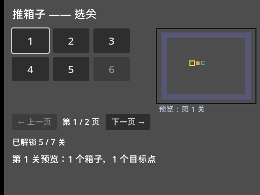
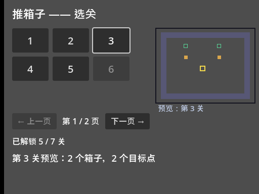
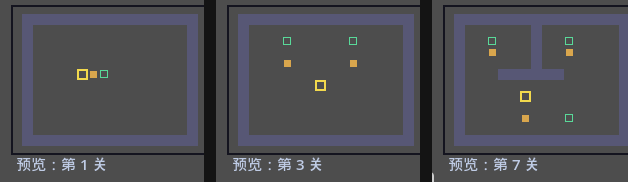
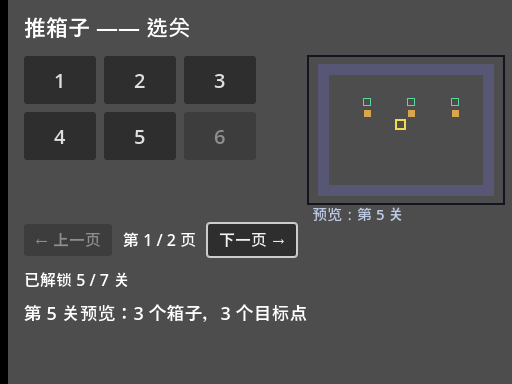
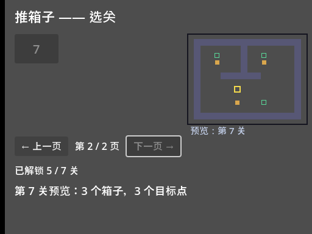

<!--
【CSDN 发布信息】
标题：Godot 入门（16）：选关界面加预览，先看一眼再点
摘要：一页放不下所有关卡怎么办？分页。点之前想先看一眼这关长什么样？实时预览。这篇在上一篇的按钮网格上只加两件事：翻页只改 visible 不重建，预览靠焦点信号联动——焦点挪到哪个按钮，右边就画哪个关的缩略地图。顺带修一个真实的手感问题：灰掉的按钮会偷走 Tab 焦点。
标签：Godot、推箱子、选关界面、分页、预览、入门教程
截图清单（发布时按序上传）：
  1. ../img/16/16_grid.png —— 选关第 1 页：左侧按钮网格，右侧第 1 关缩略地图
  2. ../img/16/16_focus3.png —— 焦点挪到第 3 关，预览跟着换
  3. ../img/16/16_preview.png —— 三关预览对比：第 1 / 3 / 7 关
  4. ../img/16/16_onnext.png —— 焦点到「下一页」按钮
  5. ../img/16/16_page2.png —— 第 2 页只剩第 7 关，预览切过去
  6. ../img/16/16_code.png —— select_page_demo.gd 全貌
  7. ../img/16/16_editor.png —— 场景树与检查器
-->

# Godot 入门（16）：选关界面加预览，先看一眼再点

> 上一篇按钮网格搞掂咗，7 个关卡一页摆得落。
> 不过我手上嗰个完整版有 237 关，一页塞唔落。
> 今日加两件事：分页，同实时预览——拣关之前，先睇一眼呢关系咩样。

## 一、先看要做成什么样

跑起来的效果是这样：



左边是按钮网格（跟上一篇一样），右边多了一个预览框，画着焦点所在关卡的缩略地图。翻到第 2 页，只剩第 7 关一个按钮，预览也跟着切过去。

本篇工程在 [GitHub 仓库](https://github.com/seancheng33/boxman-tutorial) 的 `tutorial/select_page_demo.tscn`。老规矩，只加功能不加废话，上一篇的 `build_grid` 原封不动搬过来，改动集中在两个地方：翻页和预览。

## 二、分页：只改 visible，别手痒重建

关卡 7 个、一页 6 个，就是两页。先算页数：

```gdscript
func page_count() -> int:
	return int(ceil(float(LEVEL_COUNT) / PAGE_SIZE))
```

`ceil` 是向上取整——6 个一页时，7 关就是 2 页，最后 1 关独占一页。这里有个新手常踩的写法：`LEVEL_COUNT / PAGE_SIZE` 整数除法直接得 1，最后一关就凭空消失了。关卡数不是页大小的整数倍时，必须向上取整，这个跟第 12 篇算背包格子是同一个道理。

翻页改什么？上一篇说过"刷新别重建"，这里照样适用：7 个按钮一次造齐，翻页只改每个按钮的 `visible`：

```gdscript
func refresh() -> void:
	var start := page * PAGE_SIZE
	var end := mini(start + PAGE_SIZE, LEVEL_COUNT)
	for i in LEVEL_COUNT:
		var btn: Button = grid.get_child(i)
		btn.disabled = i >= unlocked
		# 灰掉的按钮顺手把焦点也摘掉：Tab 别停在没用的按钮上
		btn.focus_mode = Control.FOCUS_NONE if btn.disabled else Control.FOCUS_ALL
		btn.visible = i >= start and i < end
	page_label.text = "第 %d / %d 页" % [page + 1, page_count()]
	prev_btn.disabled = page <= 0
	next_btn.disabled = page >= page_count() - 1
	tip_label.text = "已解锁 %d / %d 关" % [unlocked, LEVEL_COUNT]
	# 焦点尽量留在当前选中项上；选中项不在本页，就落回本页第一关
	if selected < start or selected >= end:
		selected = start
	if selected < grid.get_child_count():
		var cur: Button = grid.get_child(selected)
		if not cur.disabled:
			cur.grab_focus()
```

重点三处：

**`visible` 的赋值**。`i >= start and i < end`，本页之内的显示，之外的藏起来。按钮仲喺场景树入面，只系唔画，下次翻返嚟即刻就用得，咩状态都唔会冇咗。

**`focus_mode` 那一行**。这是个我实测才发现的坑：`disabled` 的按钮照样能被 Tab 聚焦！玩家一路按 Tab，焦点停在一个灰按钮上，按空格毫无反应，第一反应不是"这关锁了"，是"游戏卡了"。所以灰掉的按钮要顺手把 `focus_mode` 设成 `FOCUS_NONE`，Tab 直接跳过它，一次到位。

**翻页后的焦点归属**。选中项还留在上一页的话，把它拉回本页第一关，再 `grab_focus`。唔好畀焦点悬空——悬空嘅焦点喺纯键盘操作入面等于迷路。

翻页按钮就两句：

```gdscript
func _on_next() -> void:
	if page < page_count() - 1:
		page += 1
		refresh()
		_show_preview(selected)
```

`_on_prev` 对称，方向相反。翻完页将预览切去当前选中项，右边嘅小地图即刻跟住变。

这两个按钮是直接在场景里摆的，信号也是编辑器里连的线——固定的两个控件，犯不着写代码造；真正数量不定的按钮（关卡网格）才用代码。呢条界线划清楚，就唔使成日喺度纠结。

## 三、实时预览：焦点一动，地图就换

预览的核心就一句话：**焦点挪到哪个按钮，右边就画哪个关**。

上一篇说过，方向键挪焦点、空格确认是引擎白送的。那"焦点变了"有没有信号？有，`focus_entered`——按钮拿到焦点的那一刻发出。造按钮的时候把它连上：

```gdscript
func build_grid() -> void:
	for i in LEVEL_COUNT:
		var btn := Button.new()
		btn.text = str(i + 1)
		btn.custom_minimum_size = Vector2(72, 48)
		btn.add_theme_font_size_override("font_size", 20)
		# 焦点一到按钮上就更新预览——键盘挪焦点也能联动
		btn.focus_entered.connect(_on_focus_btn.bind(i))
		btn.pressed.connect(_on_level_pressed.bind(i))
		grid.add_child(btn)
```

又是 `bind`，跟上一篇同一个套路：把"我是第几关"焊在信号上。`focus_entered` 连预览，`pressed` 连进关，一个按钮两条信号各管各的。

预览画什么？把选中关卡的文本地图缩小画出来。第 12 篇讲过关卡是一行行字符串，`#` 是墙、`$` 是箱子、`.` 是目标点——预览就是逐字符往小格子里填色：

```gdscript
func _draw() -> void:
	# 右侧预览区：边框 + 选中关卡的缩略地图
	draw_rect(Rect2(300, 56, 196, 148), Color(0.08, 0.08, 0.12), false, 2)
	var lines: Array = LEVELS[selected]
	var first: String = lines[0]
	var cs := 11.0
	var ox := 300.0 + (196.0 - first.length() * cs) / 2.0
	var oy := 56.0 + (148.0 - lines.size() * cs) / 2.0
	for r in lines.size():
		var row: String = lines[r]
		for c in row.length():
			var ch := row.substr(c, 1)
			var pos := Vector2(ox + c * cs, oy + r * cs)
			if ch == "#":
				draw_rect(Rect2(pos, Vector2(cs, cs)), Color(0.34, 0.34, 0.46))
			elif ch == "$" or ch == "*":
				draw_rect(Rect2(pos + Vector2(2, 2), Vector2(cs - 4, cs - 4)), Color(0.85, 0.65, 0.3))
			elif ch == "." or ch == "*":
				draw_rect(Rect2(pos + Vector2(2, 2), Vector2(cs - 4, cs - 4)), Color(0.35, 0.85, 0.6), false, 1)
			elif ch == "@" or ch == "+":
				draw_rect(Rect2(pos + Vector2(1, 1), Vector2(cs - 2, cs - 2)), Color(0.95, 0.85, 0.3), false, 2)
	var f := ThemeDB.fallback_font
	draw_string(f, Vector2(304, 220), "预览：第 %d 关" % (selected + 1), HORIZONTAL_ALIGNMENT_LEFT, -1, 15, Color(0.75, 0.8, 0.9))
```

套路跟第 6 篇画正地图一模一样，只是格子从 32 像素缩到 11 像素，再居中一下。`cs` 就是小格子的边长，想画大画小改这一个数就够。

每次切换选中关，调一遍 `_show_preview` 更新数据、`queue_redraw` 触发重画：

```gdscript
func _show_preview(i: int) -> void:
	selected = i
	var lines: Array = LEVELS[i]
	var boxes := 0
	var goals := 0
	for row in lines:
		var text: String = row
		for c in text.length():
			var ch := text.substr(c, 1)
			if ch == "$" or ch == "*":
				boxes += 1
			if ch == "." or ch == "*":
				goals += 1
	status_label.text = "第 %d 关预览：%d 个箱子，%d 个目标点" % [i + 1, boxes, goals]
	queue_redraw()
```

顺带数一数箱子数和目标点数，写进状态栏。数箱子这种活就是逐字符比对，`*`（箱子在目标点上）两种都要算。呢个细节第 12 篇讲过，唔记得就翻返去睇。

睇下效果，方向键将焦点由第 1 关挪去第 3 关，右边即刻换图：



三关摆埋一齐睇更直观——第 1 关一个箱，第 3 关两个，第 7 关三个仲有内墙：



## 四、翻页实测

焦点挪到「下一页」按钮（Tab 直接跳过了灰掉的第 6 关，正是 focus_mode 的功劳）：



空格，翻页。第 2 页只剩第 7 关一个按钮，「下一页」自动变灰，预览切到第 7 关：



留意左下角状态栏：第 7 关、3 个箱子、3 个目标点，跟预览图对得上。翻页按钮两头的 disabled 判断（第 1 页不能往左翻、最后一页不能往右翻）也都在图里了。

## 五、连线连出个坑，顺手提一嘴

「上一页/下一页」的信号我是在编辑器里连的：选中按钮，节点面板，双击 `pressed`，连到根节点的 `_on_next`。场景文件里会多两行：

```text
[connection signal="pressed" from="PrevBtn" to="." method="_on_prev"]
[connection signal="pressed" from="NextBtn" to="." method="_on_next"]
```

坑在这里：连完线跑起来报 `_on_prev` 不存在？八成是方法名打错了，或者方法写在了另一个节点上。`to="."` 的意思是连到场景根节点，方法必须定义在根节点挂的脚本里。报错先查呢两处，快过坐喺度睇住个信号发呆好多。

## 最后

这一篇的两个词：**visible 翻页，焦点预览**。

关卡集合固定，翻页只是藏与显；预览不是新窗口，就是根节点 `_draw` 多画一张小地图；`focus_entered` 让"看"跟着"选"走，一行输入代码都没写。

到这里，选关界面完整了。下一篇开始收拾画面：现在这个灰扑扑的格子阵实在配不上"游戏"二字——配色主题、箱子染绿、锁图标，全在下一篇「视觉打磨」里。

进度推到第 16 篇喇，值得**点赞**同**收藏**；想睇画面变靓嘅，**关注「山岚的运维笔记」**唔迷路。评论区吹水都欢迎，有问必回。

---

- 本篇工程：[boxman-tutorial](https://github.com/seancheng33/boxman-tutorial)（`tutorial/select_page_demo.tscn`）
- 上篇：[Godot 入门（15）：选关按钮，一个 for 全造出来](https://github.com/seancheng33/boxman-tutorial)
