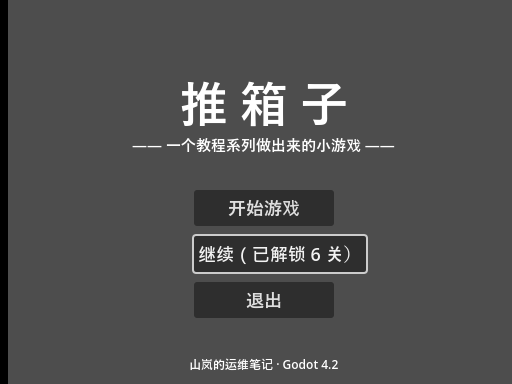
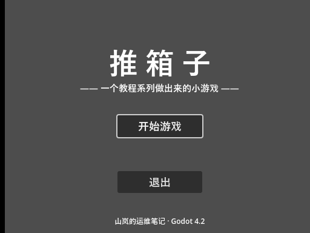
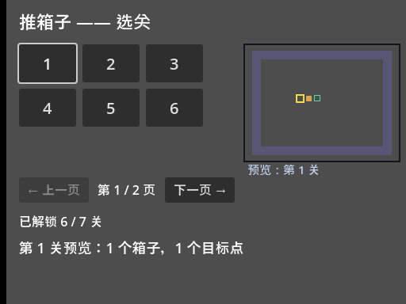

<!--
【CSDN 发布信息】
标题：Godot 入门（18）：主菜单串场景，游戏流程闭环了
摘要：打开游戏直接是选关界面，像直接翻到书的中页。这篇做主菜单：开始/继续/退出三个按钮，change_scene_to_file 负责场景切换，Esc 从选关杀回主菜单，「继续」按钮只在有进度时出现。顺带把游戏入口换成主菜单——从此双击运行，先见大门再见房间。
标签：Godot、推箱子、主菜单、场景切换、游戏流程、入门教程
截图清单（发布时按序上传）：
  1. ../img/18/18_menu.png —— 有存档的主菜单：「继续（已解锁 6 关）」带焦点
  2. ../img/18/18_nocont.png —— 删掉存档再跑：继续按钮没了，焦点在开始
  3. ../img/18/18_flow.png —— 按空格，进了选关界面
  4. ../img/18/18_back.png —— 按 Esc，回到主菜单
  5. ../img/18/18_code.png —— main_menu.gd 全貌
  6. ../img/18/18_editor.png —— 场景树与 2D 视图
-->

# Godot 入门（18）：主菜单串场景，游戏流程闭环了

> 而家打开游戏直接系选关界面，好似一本书一翻开就跳到中页。
> 玩家需要一个大门：开始、继续、退出。
> 呢篇将散落嘅场景串成流程——从此双击运行，先见大门，再见房间。

## 一、流程长什么样

先把目标流程画出来，三个场景、两条路：

```text
main_menu.tscn  ⇄  select_page_demo.tscn
   开始/继续 ↓↑ Esc 返回
```

主菜单是家，选关是房间。进门可以走去房间，房间按 Esc 也能回家——**切换是双向的**，只教单回程嘅教程都系半桶水。

本篇工程在 [GitHub 仓库](https://github.com/seancheng33/boxman-tutorial) 的 `tutorial/main_menu.tscn`。跑起来的样子：



大标题、三个按钮。注意中间那个按钮：文字不是"继续"，是"继续（已解锁 6 关）"——这是我机器上真实存档读出来的。而且它带着焦点白框，键盘玩家按下空格就直接进游戏了。

## 二、主菜单场景：三个按钮一件事

场景结构没有新东西：Control 根 + 一串 Label 和 Button（第 15 篇的规矩一条没破：UI 场景根直接是全屏 Control）。布局全是绝对坐标，标题居中大字，按钮竖排。

脚本才是主角。`_ready` 里做一次"看档下菜"：

```gdscript
func _ready() -> void:
	var cfg := ConfigFile.new()
	if cfg.load(SAVE_PATH) == OK:
		var n := mini(cfg.get_value("progress", "unlocked", DEFAULT_UNLOCKED), 7)
		if n > DEFAULT_UNLOCKED:
			continue_btn.text = "继续（已解锁 %d 关）" % n
			continue_btn.visible = true
			continue_btn.grab_focus()
			return
	# 没进度：藏起继续按钮，焦点给开始
	continue_btn.visible = false
	start_btn.grab_focus()
```

逻辑分两层：存档读到了、解锁数比默认多，才配谈"继续"；否则按钮藏起来，假装它不存在。没有进度时给玩家看一个点了没反应的"继续"，比不显示还难受。

最后是焦点归属：有进度焦点给"继续"（老玩家大概率想接着玩），没进度给"开始"。这就是第 16 篇说的"别让焦点悬空"在主菜单的翻版。

把存档删掉再跑一遍，按钮真的没了：



三个按钮变两个，焦点乖乖回到"开始游戏"上。呢个对比我实测过：删档重跑，按钮即刻消失，唔使重启项目。

## 三、change_scene_to_file：一行切场景

场景切换就一行：

```gdscript
func _on_start() -> void:
	get_tree().change_scene_to_file("res://select_page_demo.tscn")

func _on_continue() -> void:
	get_tree().change_scene_to_file("res://select_page_demo.tscn")

func _on_quit() -> void:
	get_tree().quit()
```

"开始"和"继续"去同一个地方？目前是的——选关界面自己会读档（第 16 篇写的 `load_progress`），从哪进的都一样。真要分开，以后加个参数或者用 Autoload 带状态，而家唔使咁搞。

`change_scene_to_file` 做了三件事：加载新场景、**把旧场景整个 free 掉**、把新场景设为当前场景。旧的 `MainMenu` 节点和它挂的脚本一起被释放，内存不背旧包袱。这也是为什么切换之后你就再也拿不到旧场景的引用了——它已经不是"不存在"，是"连坟都没了"。

**一个我踩过的坑要交代**：别在 `_ready` 里直接调 `change_scene_to_file`。场景树正忙着装配当前场景，这时候要求换场景，轻则报警告重则出错。真需要在 `_ready` 里切（比如做开屏动画），用 `call_deferred` 推迟到帧尾再切。按钮信号回调里调用没这个问题——那时场景早就装配完了。

「退出」就是 `get_tree().quit()`，没什么可讲的。不过提醒一句：网页导出版入面退出按钮冇意义，浏览器唔畀你关佢自己个标签页，呢个系第 22 篇嘅话题。

## 四、Esc 回家：双向才叫闭环

选关界面那边，`_unhandled_input` 加一个分支：

```gdscript
func _unhandled_input(event) -> void:
	# Esc 回主菜单：场景切换是双向的，进得来也要回得去
	if event.is_action_pressed("ui_cancel"):
		get_tree().change_scene_to_file("res://main_menu.tscn")
		return
```

`ui_cancel` 是引擎内置动作，默认绑 Esc——不用去 project.godot 里加，拿来就用。方向键、空格系 UI 白送嘅，Esc 都一样，呢个引擎对键盘党真系好。

实测整条链路：主菜单按空格，进选关——



左上角"已解锁 6 / 7 关"，第 6 关的按钮是亮的——**主菜单读的档和选关读的是同一份**，流程是真的通了，不是两个各自为政的页面。

再按 Esc，回到家：


跟出发前的画面一个像素都不差（我比对过），因为每次进主菜单都是全新 `_ready`，读档、摆按钮、给焦点，一步不少。

## 五、把大门装成正门

最后一步：游戏入口还指着第 1 篇的 `first_scene.tscn` 呢。打开 项目设置 → 应用 → 运行 → 主场景，改成 `main_menu.tscn`。落到文件里就是一行：

```text
run/main_scene="res://main_menu.tscn"
```

改完按 F5，出来的就是主菜单。**main_scene 决定双击 exe（或按 F5）后第一个加载的场景**，它是游戏的正门。

有个顺序细节顺带说一下：主菜单在 `_ready` 里读档，选关界面也在 `_ready` 里读档，两处读的是同一个文件、同一套默认值——`SAVE_PATH` 和 `DEFAULT_UNLOCKED` 两个常量在两个文件里各写了一份。两三个场景时这样复制还行，等场景多了（选项菜单、成就页都要读档），就该把这俩常量搬进一个公共脚本里了。呢啲正系下一阶段 Autoload 嘅活，先记低呢笔账。

## 最后

这一篇的关键词：**change_scene_to_file、ui_cancel、main_scene**。

三行切换代码，一个内置动作，一处项目设置，流程就闭环了：打开见门，进门见关，Esc 回家。到此为止，阶段三"做成完整游戏"全部完工——玩法、存档、选关、门面、流程，一个不少。

下一篇开始阶段四"发布"：先把界面的字变成能切换的中英文，再谈导出。系列最难过嘅其实唔系代码，系导出嗰几篇嘅坑，到时见真章。

流程闭环喇，值得**点赞**同**收藏**；想睇呢个游戏走到发布嘅，**关注「山岚的运维笔记」**唔迷路。评论区吹水都欢迎，有问必回。

---

- 本篇工程：[boxman-tutorial](https://github.com/seancheng33/boxman-tutorial)（`tutorial/main_menu.tscn`）
- 上篇：[Godot 入门（17）：调色板加程序化锁，画面不请美术](https://github.com/seancheng33/boxman-tutorial)
