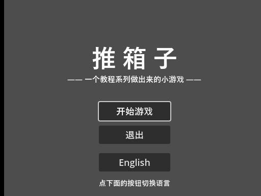
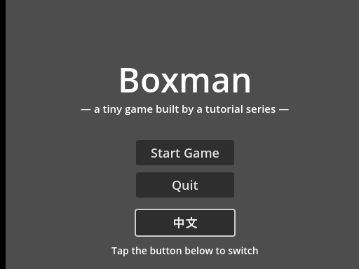
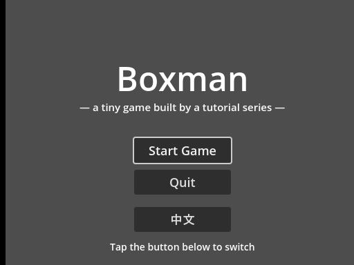

<!--
【CSDN 发布信息】
标题：Godot 入门（19）：界面中英一键切换，重启不忘
摘要：做发布的准备从字开始。这篇用代码把两套词条灌进 TranslationServer，取字一律 tr("KEY")，切换就一句 set_locale——零资源文件。两个真坑当场演示：改完 locale 已显示的字不会自动变，要手动刷；漏刷一个控件就是灵异现场。语言选择写进存档，重启还是玩家的选择。
标签：Godot、推箱子、多语言、TranslationServer、tr、入门教程
截图清单（发布时按序上传）：
  1. ../img/19/19_zh.png —— 默认中文界面
  2. ../img/19/19_en.png —— 点切换后整屏变英文，连提示语都没漏
  3. ../img/19/19_again.png —— 退出重进：还是英文，选择已入档
  4. ../img/19/19_code.png —— lang_demo.gd 全貌
  5. ../img/19/19_editor.png —— 场景树与 2D 视图
-->

# Godot 入门（19）：界面中英一键切换，重启不忘

> 进入发布阶段，第一件事不是打包，是字。
> 界面上的字要能中英切换，而且重启之后不能忘。
> 这一篇把翻译做进游戏——零资源文件，纯代码搞定。

## 一、先想清楚"翻译"是什么

把界面上一句"开始游戏"变成"Start Game"，本质就是**查表**：一个 key（"START"）对应两份文字（中文一份、英文一份），当前语言是英文时就取英文那份。

引擎把这套查表做成了公共服务 `TranslationServer`：往里面登记两本"字典"（一本中文一本英文），取字的时候用 `tr("KEY")`，它按当前语言自动去对应的字典里翻。你只管给 key，选哪本字典是它的事，完全唔使操心。

本篇工程在 [GitHub 仓库](https://github.com/seancheng33/boxman-tutorial) 的 `tutorial/lang_demo.tscn`。默认中文：



## 二、代码灌词条：小项目零资源文件

官方正统做法是维护一份 CSV（第一列 key，后面一列一个语言），导入时引擎自动生成翻译资源。词条多了就该这么干。但我们演示只有六条，为六行字配一套 CSV 资源流水线，有点杀鸡用牛刀，唔划算——**直接用代码把词条灌进去**：

```gdscript
func _setup_translations() -> void:
	var zh := Translation.new()
	zh.locale = "zh"
	zh.add_message("TITLE", "推 箱 子")
	zh.add_message("SUB", "—— 一个教程系列做出来的小游戏 ——")
	zh.add_message("START", "开始游戏")
	zh.add_message("QUIT", "退出")
	zh.add_message("LANG", "English")
	zh.add_message("TIP", "点下面的按钮切换语言")
	TranslationServer.add_translation(zh)

	var en := Translation.new()
	en.locale = "en"
	en.add_message("TITLE", "Boxman")
	en.add_message("SUB", "— a tiny game built by a tutorial series —")
	en.add_message("START", "Start Game")
	en.add_message("QUIT", "Quit")
	en.add_message("LANG", "中文")
	en.add_message("TIP", "Tap the button below to switch")
	TranslationServer.add_translation(en)
```

一个 `Translation` 对象就是一本字典：先声明自己是什么语言（`locale = "zh"`），再一条条 `add_message`。两本都登记进 `TranslationServer`，查表服务就位。

三个细节值得说：

**key 用大写英文**。它是要在代码里到处写的，`tr("START")` 比 `tr("开始游戏")` 靠谱——后者等于把中文焊死在代码里，切了语言代码还认中文 key，乱套。

**切语言按钮的文案是反的**。中文界面显示"English"（点了去英文），英文界面显示"中文"。它不是翻译，是个路标，指向你即将去的地方。

**词条对不上怎么办**？英文字典里漏登记 "TIP"，`tr("TIP")` 会直接把 key 吐出来，界面上出现一个大写的 "TIP"——别嫌丑，这其实是个好特性，漏词当场现形，比悄悄显示中文强多了。

## 三、取字：tr() 是"那一刻"的翻译

控件上字这么取：

```gdscript
func refresh_texts() -> void:
	# 关键：tr() 是"取值那一刻"翻译，改完 locale 必须手动刷一遍
	title_label.text = tr("TITLE")
	sub_label.text = tr("SUB")
	start_btn.text = tr("START")
	quit_btn.text = tr("QUIT")
	lang_btn.text = tr("LANG")
	tip_label.text = tr("TIP")
```

**这里埋着本篇最大的坑**：`tr()` 不是"永久绑定"，是**取值那一刻查一次表**。`text = tr("START")` 执行完，`text` 里存的就是一串确定的字，之后你切换语言、字典翻了天，`text` 都不会动。

所以切换语言必须做两步：`set_locale` 改当前语言，然后**把所有字重新取一遍**：

```gdscript
func _on_lang() -> void:
	locale = "en" if locale == "zh" else "zh"
	TranslationServer.set_locale(locale)
	save_lang()
	refresh_texts()
```

我第一次跑就栽在这：切完英文，按钮全变了，底部一行提示语还是中文——`refresh_texts` 里漏刷了它。截图为证是修好之后的：



整屏六处字全变了，连"Tap the button below to switch"都没漏。多语言界面的灵异问题九成是这个：**改了语言忘了刷控件**。哪个字不听话，去 `refresh_texts` 里找它——多半压根没登记，即刻补上就搞掂。

## 四、选择要记住：写进存档

玩家选了英文，总不能每次开机重新选。第 14 篇的 `ConfigFile` 再出场一次，这次往存档里加一节：

```gdscript
func load_lang() -> String:
	var cfg := ConfigFile.new()
	if cfg.load(LANG_PATH) != OK:
		return "zh"
	# 兜底值仍然要给：老存档里没有 lang 这一节
	return cfg.get_value("lang", "locale", "zh")

func save_lang() -> void:
	var cfg := ConfigFile.new()
	cfg.set_value("lang", "locale", locale)
	cfg.save(LANG_PATH)
```

跟第 14 篇存进度是同一个文件，只是新开了一节 `[lang]`——**进度归进度，偏好归偏好，一个文件分节管理**，玩家不用管内部结构，你也省得维护两个文件。

`get_value` 的兜底值这次格外重要：老玩家的存档是第 14 篇存的，里面根本没有 `lang` 这一节——不写兜底值，老玩家一升级就拿到空值。经典兼容性坑，第 14 篇讲过一次，这次它换个马甲又来了。

实测闭环：切到英文、退出、重进——



开屏就是 Boxman。存档文件里多了一节，用记事本看得一清二楚：`[lang]` 下面 `locale="en"`。

## 五、扩大战线之前

这个演示页只有六条词条。真要把整个游戏翻译了，工作量在"换字"不在"翻译"：选关界面的"第 1 / 2 页"、预览的"第 N 关预览：N 个箱子"、通关面板……每一句都要给 key、进字典、改 `refresh`。

三个建议，按疼的程度排：

一是**别用拼接组句子**。`"第 %d 关" % n` 在英文里语序可能整个反过来，正确姿势是把整句做成带占位符的词条 `"LEVEL_PREVIEW" : "Level %d: %d boxes, %d goals"`，翻译的人自己决定语序。

二是**数字、按钮宽度留余量**。中文两个字的地方英文可能是一行，按钮 `custom_minimum_size` 别卡死宽度。

三是词条超过几十条就**老实换 CSV**，代码里灌字典写到第三十行就该知道疼了。

## 最后

这一篇的关键词：**TranslationServer、tr()、set_locale**。

代码灌词条省了资源流水线，`tr()` 取字语义清晰，切换的两步（set_locale + 手动刷新）坑在明处，语言偏好进存档。至此，界面上的字已经具备上货架的资格。

下一篇解决另一个上架硬门槛：**存档位置**。现在进度存在 `user://`，导出之后它藏在玩家系统的犄角旮旯，玩家想备份都没处找——第 20 篇把它挪到 exe 旁边，跟游戏形影不离。

界面会说话了，值得**点赞**和**收藏**；想看游戏练成可执行文件的，**关注「山岚的运维笔记」**不迷路。评论区有问必回。

---

- 本篇工程：[boxman-tutorial](https://github.com/seancheng33/boxman-tutorial)（`tutorial/lang_demo.tscn`）
- 上篇：[Godot 入门（18）：主菜单串场景，游戏流程闭环了](https://github.com/seancheng33/boxman-tutorial)
