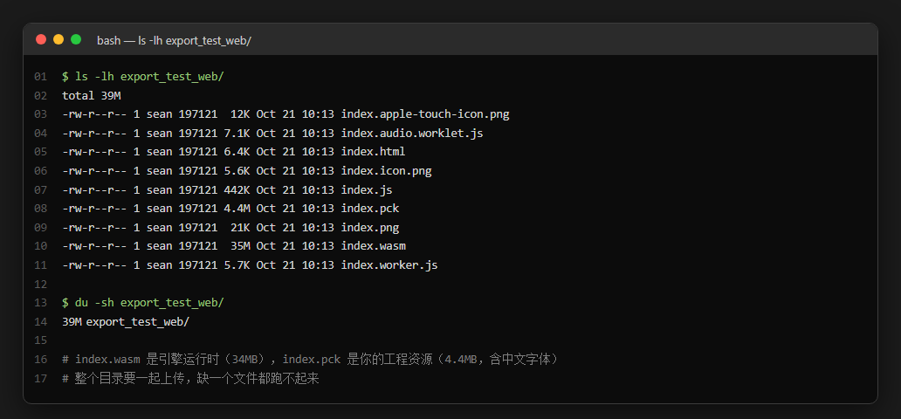
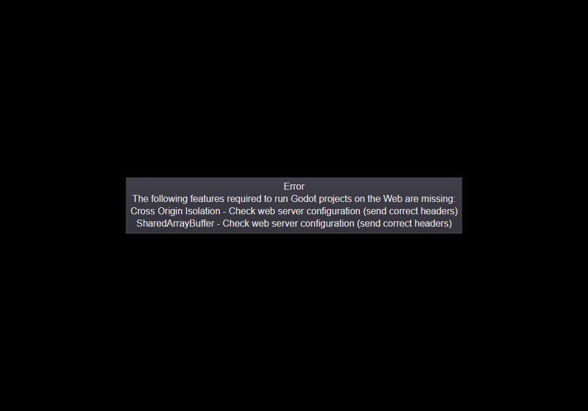
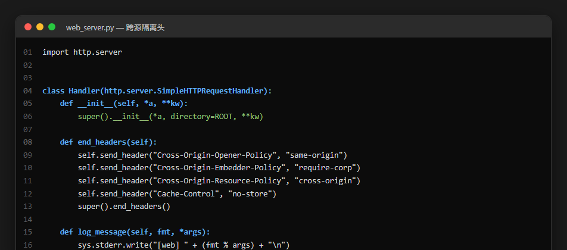
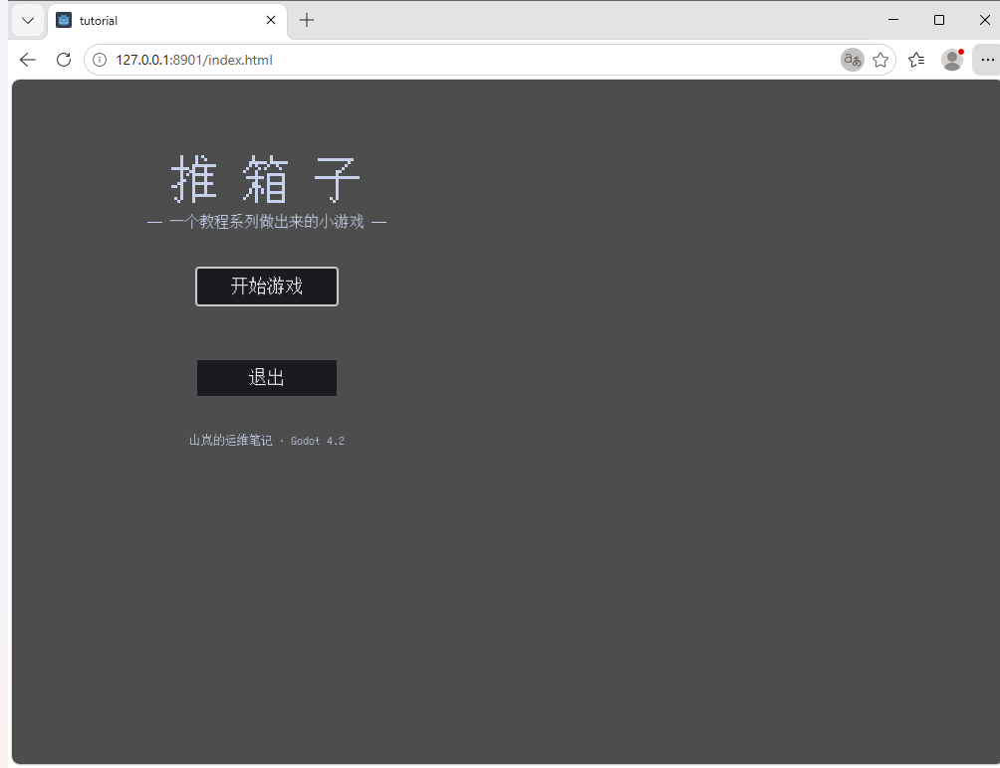
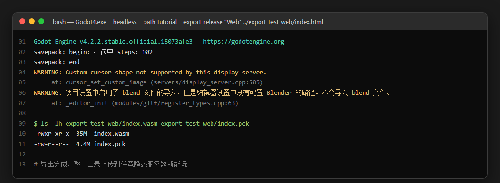
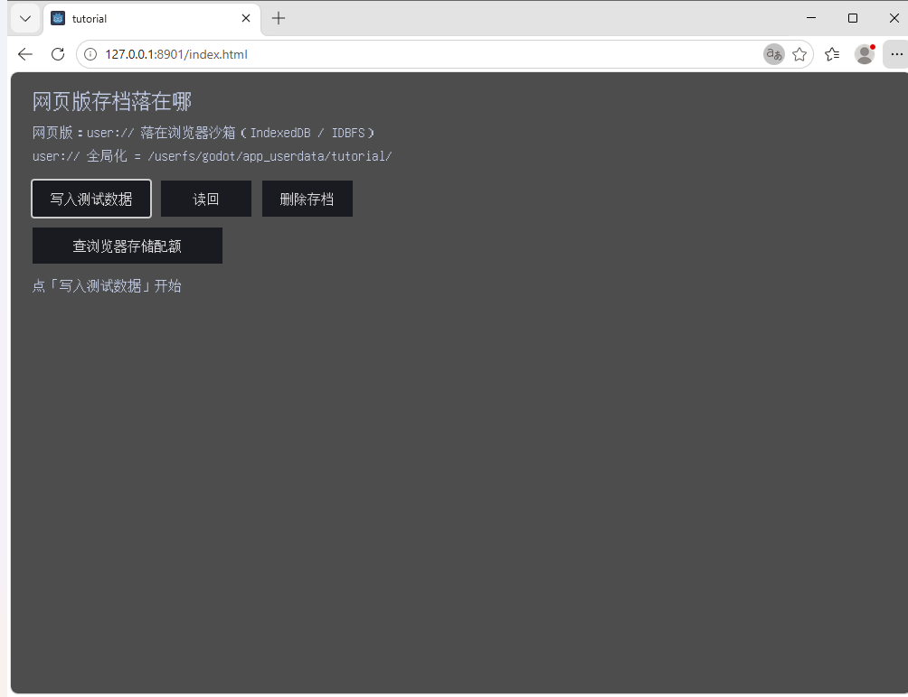
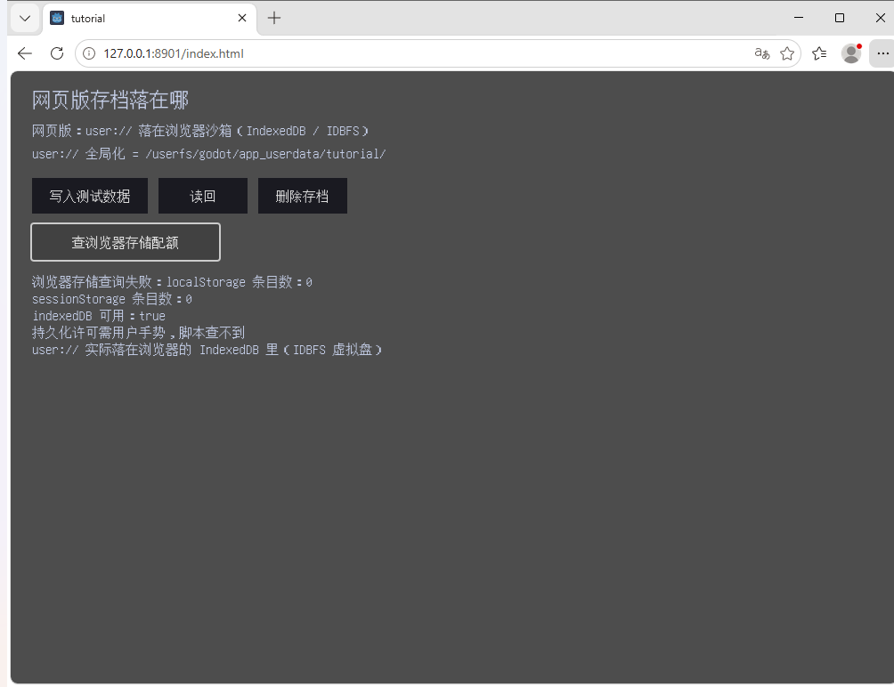
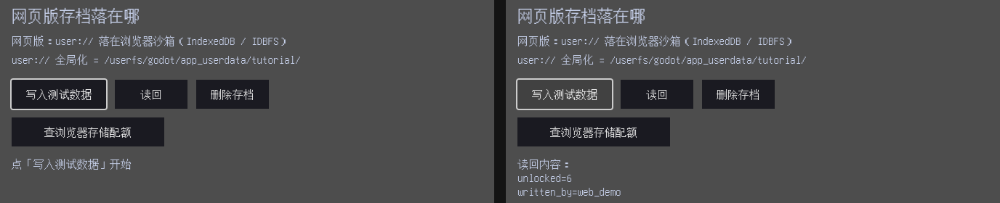

<!--
【CSDN 发布信息】
标题：Godot 入门（22）：导出网页版，浏览器里直接玩
摘要：exe 双击就能玩，浏览器呢？这篇把推箱子导到网页版：写 Web 预设、踩跨源隔离的坑、修中文变方块，最后把存档这事说透——网页版的 user:// 落在浏览器 IndexedDB 里，跟桌面版完全是两套逻辑。
标签：Godot、推箱子、网页版、HTML5、WebGL、IndexedDB、导出、入门教程
截图清单（发布时按序上传）：
  1. ../img/22/22_coi.png —— 没配跨源隔离头，引擎直接拒绝启动（实测）
  2. ../img/22/22_code.png —— 服务器加两个响应头就行
  3. ../img/22/22_export.png —— 命令行导出 Web
  4. ../img/22/22_files.png —— 产物：一个目录，9 个文件
  5. ../img/22/22_web.png —— 浏览器里跑起来了（带中文字体）
  6. ../img/22/22_web_save.png —— 网页版的 user:// 全局化路径
  7. ../img/22/22_web_idb.png —— 写入前 vs 写入后对比
  8. ../img/22/22_web_storage.png —— 浏览器存储：indexedDB 可用
-->

# Godot 入门（22）：导出网页版，浏览器里直接玩

> 上一篇已经将游戏变咗做 exe，双击就玩得。
> 但唔系个个都用 Windows，更加唔系个个都愿意下载一个几十兆嘅文件。
> 呢一篇将佢塞入浏览器——打开网址就玩，跨平台，仲唔使装嘢。

## 一、网页版导出，产物不是一个文件

先说清楚心智模型。桌面版导出得到 exe + pck 两个文件，网页版导出一整个**目录**：



九 个文件，核心是三个：`index.html`（页面外壳）、`index.wasm`（引擎运行时，35MB）、`index.pck`（你的工程资源）。剩下的是 worker、图标、音频 worklet 之类的配套。

关键区别：桌面版双击 exe 就跑，网页版**必须挂在 HTTP 服务器上**。直接双击 index.html 打开？浏览器会用 `file://` 协议加载 wasm，那是不安全的上下文，直接失败。

## 二、第一坑：跨源隔离头，不配就拒绝启动

我第一次导完网页版，浏览器打开系一片黑，报错框写住：



```
The following features required to run Godot projects on the Web are missing:
Cross Origin Isolation - Check web server configuration (send correct headers)
SharedArrayBuffer - Check web server configuration (send correct headers)
```

这不是 bug，是 Godot 4.2 的 Web 导出默认要求，不用怀疑自己的工程有问题——它依赖 `SharedArrayBuffer` 这个多线程共享内存 API。而浏览器为了安全，只有在页面处于**跨源隔离状态**时才开放它。要进入跨源隔离状态，服务器必须发两个响应头：



`Cross-Origin-Opener-Policy: same-origin` 加上 `Cross-Origin-Embedder-Policy: require-corp`，一个管窗口隔离，一个管资源嵌入策略。

用 Python 起个本地服务器，两行代码的事：

```python
class Handler(http.server.SimpleHTTPRequestHandler):
    def end_headers(self):
        self.send_header("Cross-Origin-Opener-Policy", "same-origin")
        self.send_header("Cross-Origin-Embedder-Policy", "require-corp")
        super().end_headers()
```

**部署到线上同理**——Nginx 就是加两个 `add_header`：

```nginx
location / {
    add_header Cross-Origin-Opener-Policy "same-origin";
    add_header Cross-Origin-Embedder-Policy "require-corp";
    root /var/www/boxman;
}
```

顺手提一句：Godot 4.2 的导出预设里有个 `variant/thread_support` 选项，关掉它就不需要 SharedArrayBuffer，也就不需要这两个头了。代价是多线程用不了，大型项目会有点吃亏。自己玩嘅小游戏图省事就关咗佢，要性能就老老实实配服务器。

## 三、第二坑：中文全变方块

跨源隔离配好之后，游戏跑得起喇——但界面一片豆腐块：

「推箱子」三个字变成了三个方框。

原因很简单：桌面版 Godot 能调用系统字体，网页版不行。浏览器沙箱里没有系统字体可借，引擎只能用内置字体渲染，而内置字体不含中文字形。

解法是自己带一份。找一份**可再分发**的中文字体放进工程，这一步就搞定了，我用的是 GNU Unifont（GPL + 字体例外条款，可商用可分发），12MB：



然后建个主题，把字体设成默认：

```text
[gd_resource type="Theme" load_steps=2 format=3]

[ext_resource type="FontFile" path="res://fonts/Unifont.ttf" id="1_font"]

[resource]
default_font = ExtResource("1_font")
default_font_size = 16
```

再在 `project.godot` 里挂上：

```text
[gui]

theme/custom="res://theme.tres"
```

打包后 pck 从 108KB 涨到 4.4MB——字体只占了实际用到的那点字形，引擎做的是动态子集化，不是整个字体塞进去。想再细啲就换更精简嘅中文字体，或者自己裁字形。

## 四、网页版导出预设

跟桌面版一个套路，在 `export_presets.cfg` 里加一个 `platform="Web"` 的预设：

```text
[preset.1]

name="Web"
platform="Web"
export_path="../export_test_web/index.html"

[preset.1.options]

html/canvas_resize_policy=2
html/focus_canvas_on_start=true
progressive_web_app/enabled=false
```

命令行跟上一条一模一样，只改预设名和输出路径：



```text
Godot4.exe --headless --path tutorial --export-release "Web" ../export_test_web/index.html
```

`html/canvas_resize_policy=2` 是"自适应"——浏览器窗口缩放，画布跟着缩，网页版必须开。`focus_canvas_on_start=true` 让页面一打开焦点就在画布上，键盘直接能操作；不开的话玩家得先点一下鼠标才能用键盘，网页游戏第一大劝退点。

## 五、存档：网页版跟桌面版完全不是一套逻辑

呢个先系本篇真正想讲嘅嘢。返到第 20 篇嗰个伏笔——便携模式要导出嘅 exe 先行到第三关，网页版点解必然回退？

答案在这个演示页里：



`user://` 全局化之后是这么一串：`/userfs/godot/app_userdata/tutorial/`。

`/userfs/` 这个前缀就是答案。桌面版的 `user://` 是磁盘上真实的一个文件夹（Windows 上在 AppData 里），你能在文件管理器里翻到它。网页版的 `user://` 是一套**虚拟文件系统**——Godot 4.2 用 IndexedDB + IDBFS 在浏览器里模拟了一个 POSIX 风格的盘，路径长得像磁盘路径，实际上数据躺在浏览器的 IndexedDB 里。



`indexedDB 可用：true`——存档就存在这里。

写入和读回照常工作，API 一行都不用改。左边是刚打开页面时的样子，右边是写入之后——同一个 `user://`，内容已经在浏览器沙箱里了：



这就是"回退模式"的真正含义：网页版没有"exe 同级目录"这回事，你不能往浏览器里写一个文件夹出来（那需要 File System Access API 的用户授权，而且各家浏览器支持不一）。所以第 20 篇那套裁决逻辑在网页版直接走第二关返回 `user://`，一点不亏心。

**不过有几个坑一定要知**，唔好中招：

1. **清浏览器缓存 = 丢存档**。桌面版玩家删了游戏文件夹才会丢档，网页版玩家在设置里点"清除浏览数据"，进度就没了。IndexedDB 会被一起清掉。正式发布时最好加个云存档做兜底。

2. **换浏览器 = 另一个存档**。Chrome 存的进度，Firefox 看不到。IndexedDB 是按"源"隔离的——同一个网站在同一个浏览器里是一份。

3. **无痕窗口 = 临时存档**。窗口一关，IndexedDB 都跟住冇埋。

4. **隐私模式 / 存储受限**时，写入可能直接失败。所以网页版的写入路径要判空、给提示，不能默默吞掉。

## 六、跑起来

一切就绪，浏览器打开，跨源隔离头到位，中文字体到位：


主菜单、选关、游戏本体，一样都冇少。工程里的字体是 Unifont，笔画是点阵风格，略显朴素——但对"证明网页版能跑"这件事足够了。换思源黑体之类嘅字体，观感会好好多，代价系字体文件大啲。

## 最后

这一篇的关键词：**跨源隔离、SharedArrayBuffer、Web 预设、IndexedDB**。

桌面版导出的心智模型是"一个 exe 加一个包"，网页版是"一个目录加两个响应头"。后者多出来的不是技术难度，是浏览器安全策略的账——SharedArrayBuffer 这类高性能 API 必须在隔离环境里才给用，隔离就得有头，头就得服务器配。

存档这块最值得记住：**同一套代码，不同平台两套存储**。桌面版的 `user://` 是文件夹，网页版的 `user://` 是 IndexedDB 里的虚拟盘，API 一样，脾气完全不同。写游戏要记得给玩家一个"我的存档在哪"的说明，最好再加个云同步。

下篇讲发布——将 exe 同网页版打包传上 GitHub Release，畀人下载、畀人玩。

游戏喺浏览器跑得起喇，值得**点赞**同**收藏**；想睇佢点样发上网畀陌生人下载嘅，**关注「山岚的运维笔记」**唔迷路。评论区有问必回，吹水都得。

---

- 本篇工程：[boxman-tutorial](https://github.com/seancheng33/boxman-tutorial)（`tutorial/web_save_demo.gd`、`tutorial/theme.tres`、`.tools/web_server.py`）
- 上篇：[Godot 入门（21）：导出 Windows 版，双击即玩](https://github.com/seancheng33/boxman-tutorial)
