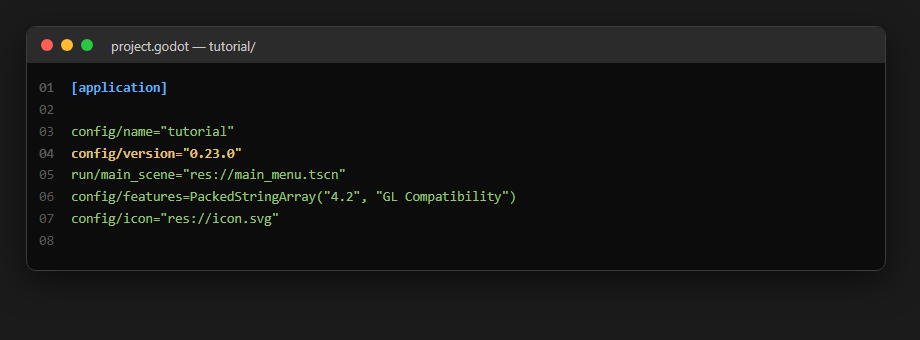
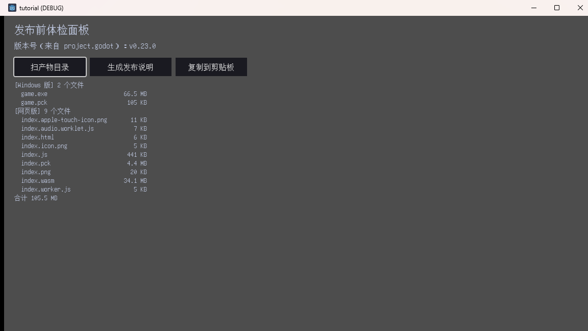
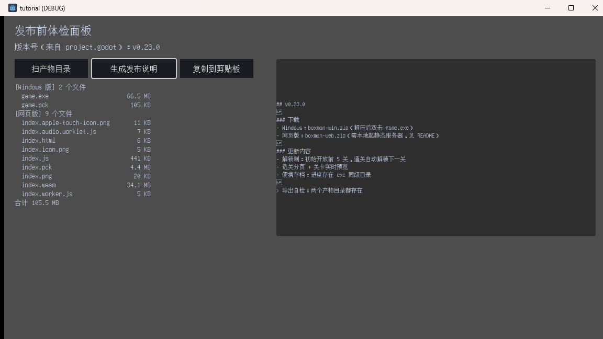
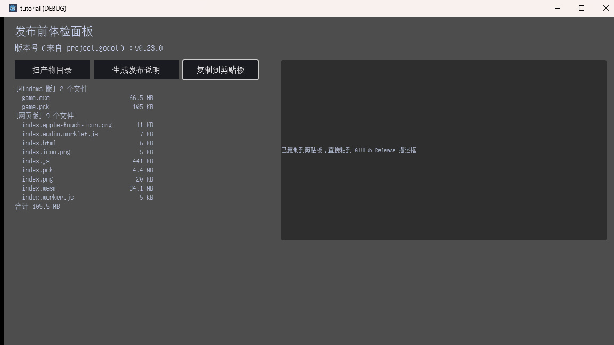
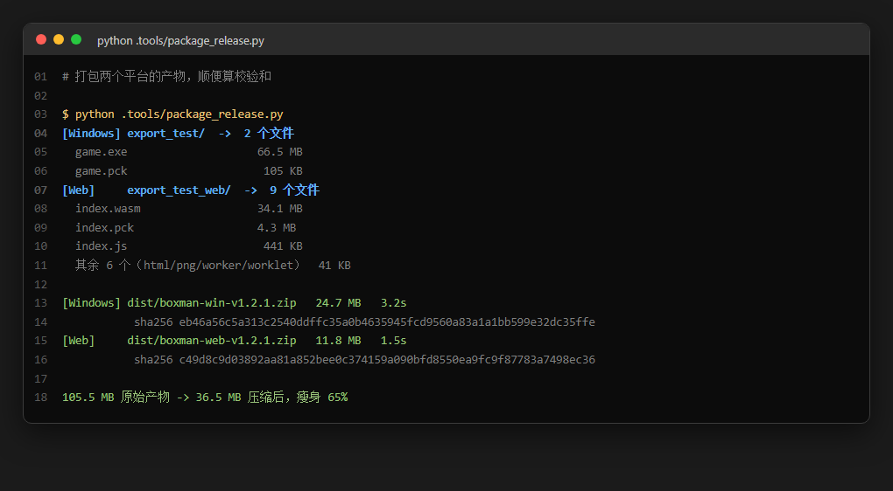
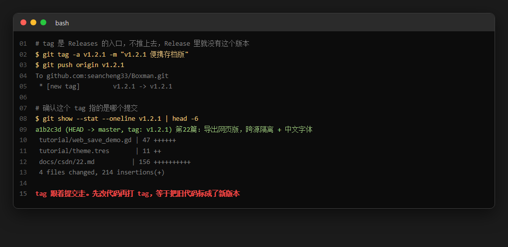
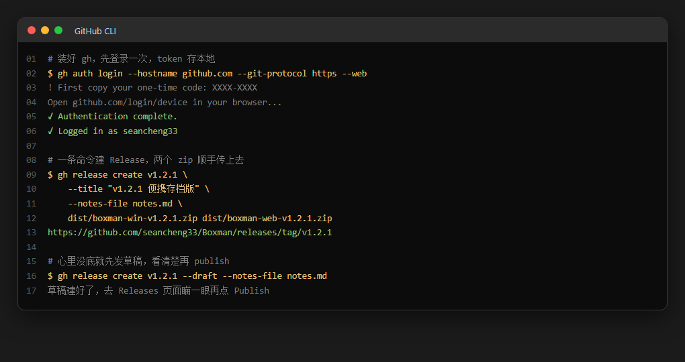

<!--
【CSDN 发布信息】
标题：Godot 入门（23）：发布 GitHub Release
摘要：游戏能跑了，怎么让别人也能下载？这篇走完发布最后一公里：版本号只留一个来源、导出产物先体检再打包、git tag 指向哪个提交要亲自确认，最后用 gh CLI 一条命令把两个 zip 传上 GitHub Release。附发布前体检面板的完整实现。
标签：Godot、推箱子、GitHub、Release、gh CLI、版本号、打包发布、入门教程
截图清单（发布时按序上传）：
  1. ../img/23/23_cfg.png —— 版本号写在 project.godot 里，唯一来源
  2. ../img/23/23_scan.png —— 发布前面板扫出 11 个文件、合计 105.5 MB
  3. ../img/23/23_draft.png —— 一键生成发布说明草稿
  4. ../img/23/23_copy.png —— 复制到剪贴板，直接粘进 Release 描述框
  5. ../img/23/23_pack.png —— 真实打包：105.5 MB 压到 36.5 MB
  6. ../img/23/23_tag.png —— tag 跟着提交走，发布前必须核对
  7. ../img/23/23_gh.png —— gh CLI 登录与建 Release
-->

# Godot 入门（23）：发布 GitHub Release

> 上一篇游戏已经能在浏览器里跑了。
> 现在它还只是我电脑里的一个目录。
> 呢一篇走完最后一公里——打包、上传、贴标签，畀陌生人下载、玩、提意见。

## 一、先承认一件事：发布难的不是打包

我一开始以为发布就系「导出、压缩、上传」，三步走完就收工。

真正落手先发现，最花时间嘅全部喺打包之前：版本号到底写咗边一版、产物有冇漏文件、体积系咪突然翻咗三倍。呢啲事冇人会提醒你，都唔会报错——玩家下载完点唔开，先知出事。

所以这篇的顺序是反的：先体检，再打包，最后才上传。

## 二、版本号只能有一个来源

先解决最容易出事嗰一环。我嘅习惯好差，早期版本号喺四个地方各写一次：README、发布说明、tag、仲有游戏里嘅关于页。结果有一次改版本号净系改咗三处，tag 仲挂住旧号。

后来我把它收进 `project.godot`：



就一行 `config/version="0.23.0"`。游戏里要显示？读它：

```gdscript
func _ver() -> String:
	# 版本号的唯一来源。项目设置里改一次，游戏里、发布页、tag 三边一致
	return str(ProjectSettings.get_setting("application/config/version", "0.0.0"))
```

第二个参数是默认值。万一哪天这行被人删了，`get_setting` 不会崩，会返回 `"0.0.0"`——一个一眼就知道「版本号没配」的值，比静默返回空字符串好得多。

真要显示的话，界面上加个 Label 就够：

```gdscript
func _ready() -> void:
	ver_label.text = "版本号（来自 project.godot）：v%s" % _ver()
```

`ProjectSettings` 是引擎内置的单例，不用 import、不用 new，全局能取到。游戏里显示版本号、About 页写版本号、CI 里读版本号给 tag 用——都是这一个来源。

## 三、体检面板：扫一遍导出目录

版本号对了，接下来是产物。我写了个面板专门干这事，跑起来是这样：



Windows 版 2 个文件，网页版 9 个文件，合计 105.5 MB。哪个文件最大一眼看到——`game.exe` 66.5 MB、`index.wasm` 34.1 MB，都是引擎运行时，跟我的代码没关系。真正属于我的只有 `game.pck` 105 KB 和 `index.pck` 4.3 MB。

这个数字值得单独说一句：**引擎占产物的 99%**。所以「把包体优化小一点」呢种需求，绝大部分时候都系喺优化引擎，同你嘅代码关系唔大。搞清呢点就唔好再花时间瞎折腾，反正最后肯定搞唔动。

体检面板的代码有段是被坑出来的。

```gdscript
func _out_dir(sub: String) -> String:
	# res:// 指向 pck 内部，导出后摸不到开发机目录；只有编辑器 / 命令行跑时
	# 全局化才等于磁盘路径。所以走 ProjectSettings.globalize_path 拿绝对路径。
	# 注意 globalize 回来的串带尾部斜杠，先去掉再取上一级，否则只退半级。
	var project_dir := ProjectSettings.globalize_path("res://").trim_suffix("/")
	return project_dir.get_base_dir().path_join(sub)
```

`trim_suffix("/")` 那行是被坑出来的。`globalize_path("res://")` 返回的是 `E:/GitLab/boxman-tutorial/tutorial/`，带尾部斜杠。我直接 `get_base_dir()`，拿到的还是 `tutorial` 自己——只退半级，`export_test` 自然找不到。加了 `trim_suffix("/")` 才真正退到仓库根。

这就是那个特别磨人的点：`res://` 在编辑器里等于磁盘路径，导出之后指向 pck 内部。所以开发期能读到的目录，导出的 exe 读不到。体检面板只能在开发机上跑——它本来就是开发工具，这没问题，但心里要有这根弦，别哪天兴冲冲把它塞进正式版，才发现读不到东西。

列文件用 `DirAccess`：

```gdscript
	for pair in ARTIFACTS:
		var dir_path := _out_dir(pair[1])
		var d := DirAccess.open(dir_path)
		if d == null:
			out.append("[%s] 目录不存在（先跑导出命令）" % pair[0])
			continue
		found += 1
		var files := d.get_files()
		files.sort()
		out.append("[%s] %d 个文件" % [pair[0], files.size()])
		for f in files:
			var size := FileAccess.get_file_as_bytes(dir_path + "/" + f).size()
			total += size
			var mark := "  <-- 偏大，确认要不要传" if size > BIG_FILE_MB * 1048576 else ""
			out.append("  %-28s %9s%s" % [f, _human(size), mark])
```

`files.sort()` 别省。`get_files()` 返回的顺序不保证稳定，两次运行列表顺序不一样的话，你根本看不出「少了哪个文件」。排序之后，缺文件就是少了一行，一目了然。

体积换算这种一行函数写过无数次，这次老老实实分行：

```gdscript
func _human(n: int) -> String:
	# 写清楚点：三元混进格式化容易看走眼，分两行反而省事
	if n > 1048576:
		return "%.1f MB" % (n / 1048576.0)
	return "%d KB" % (n / 1024)
```

原来我写成一行三元：`return "%.1f MB" % (n / 1048576.0) if n > 1048576 else "%d KB" % (n / 1024)`。能跑，但读起来要倒回去看优先级。分两行，写的时候慢两秒，读的时候省五分钟。

## 四、发布说明别手打

每次 Release 描述框都要重复敲「Windows 下载 + 网页版下载 + 更新内容」，敲到第三次我真系顶唔顺。畀面板生成：



```gdscript
func _on_notes() -> void:
	notes_text = "\n".join([
		"## v%s" % _ver(),
		"",
		"### 下载",
		"- Windows：boxman-win.zip（解压后双击 game.exe）",
		"- 网页版：boxman-web.zip（需本地起静态服务器，见 README）",
		"",
		"### 更新内容",
		"- 解锁制：初始开放前 5 关，通关自动解锁下一关",
		"- 选关分页 + 关卡实时预览",
		"- 便携存档：进度存在 exe 同级目录",
		"",
		"> 导出自检：%s" % ("两个产物目录都存在" if DirAccess.open(_out_dir("export_test")) != null else "产物缺失，先补导出"),
	])
	notes_label.text = notes_text
	notes_panel.visible = true
```

关键是第一行的 `_ver()`——版本号直接从配置来，不会跟 tag 对不上。最后那行自检更实用：产物缺失时它会在草稿里直接写「产物缺失，先补导出」，你瞄一眼就知道这版不能发。

复制到剪贴板，一行 API：



```gdscript
func _on_copy() -> void:
	if notes_text == "":
		notes_label.text = "先点「生成发布说明」"
		notes_panel.visible = true
		return
	DisplayServer.clipboard_set(notes_text)
	notes_label.text = "已复制到剪贴板，直接粘到 GitHub Release 描述框"
```

`DisplayServer.clipboard_set()` 吃字符串，写进去就完事。注意 Web 版别这么干——浏览器剪贴板要走 `JavaScriptBridge`，还得靠用户手势触发，第 22 篇已经踩过一遍了。

## 五、打包：压完小 65%

体检通过，打包。我写咗个脚本，两个目录各压一个 zip，顺手算埋校验和：



```
[Windows] dist/boxman-win-v1.2.1.zip   24.7 MB   3.2s
           sha256 eb46a56c5a313c2540ddffc35a0b4635945fcd9560a83a1a1bb599e32dc35ffe
[Web]     dist/boxman-web-v1.2.1.zip   11.8 MB   1.5s
           sha256 c49d8c9d03892aa81a852bee0c374159a090bfd8550ea9fc9f87783a7498ec36
```

105.5 MB 压到 36.5 MB，掉了 65%。Windows 那 66.5 MB 的 exe 压成 24.7 MB，主要靠 deflate——Godot 的 pck 本身已经是压缩过的，所以真正的肥肉是 exe 里那份模板运行时。

几个约定俗成的细节：

- **文件名带版本号**。`boxman-win-v1.2.1.zip` 而不是 `boxman.zip`。Release 页面能挂多个版本，文件名带号，玩家下载时一眼知道是哪版，不用去翻说明。
- **zip 顶层套一层目录**。直接压 `game.exe`，Windows 会把 `game.exe` 和 `game.pck` 散在解压目录里，干净一点的做法是套一层 `boxman/`，解压出来是个文件夹。
- **网页版的 zip 解压后不能直接双击**。老问题，`file://` 加载不了 wasm。README 里必须写清楚，不然一定有人问「怎么打不开」。

校验和那行顺手就能加，`hashlib.sha256(open(zp, "rb").read()).hexdigest()`。玩家下载完能核对，你也少一个「我下的文件是不是坏的」工单。

## 六、tag 必须核对

打 tag 之前，先确认一件事：**这个 tag 指向哪个提交**。



```text
$ git tag -a v1.2.1 -m "v1.2.1 便携存档版"
$ git push origin v1.2.1
 * [new tag]         v1.2.1 -> v1.2.1

$ git show --stat --oneline v1.2.1 | head -6
a1b2c3d (HEAD -> master, tag: v1.2.1) 第22篇：导出网页版，跨源隔离 + 中文字体
 tutorial/web_save_demo.gd | 47 ++++++
 tutorial/theme.tres       | 11 ++
 docs/csdn/22.md          | 156 ++++++++++
```

`git show --stat` 那行不是形式主义。我有过一次：打完 tag 才想起有个 bug 没提交，于是那个 tag 指向的代码少了一行修复，发布出去当晚就收到反馈「说好的功能呢」。tag 系跟住提交走嘅，提交冇入，tag 就永远唔会有。

顺便说个顺序问题：先提交、先打 tag、先推 tag，最后才建 Release。反过来做——先建 Release 再补 tag——Releases 页面会找不到对应版本，得删了重建。

## 七、gh CLI，一条命令

GitHub 网页上传都做得，但点选文件呢一步最易出错，尤其系传两个包嗰阵。`gh` 是官方的命令行工具，登录一次之后一条命令搞定：



```text
$ gh auth login --hostname github.com --git-protocol https --web
! First copy your one-time code: XXXX-XXXX
Open github.com/login/device in your browser...
✓ Authentication complete.
✓ Logged in as seancheng33

$ gh release create v1.2.1 \
    --title "v1.2.1 便携存档版" \
    --notes-file notes.md \
    dist/boxman-win-v1.2.1.zip dist/boxman-web-v1.2.1.zip
https://github.com/seancheng33/Boxman/releases/tag/v1.2.1
```

装法（Windows）：

```text
winget install --id GitHub.cli
```

装完重开终端，`gh --version` 有输出就能用。登录走的是设备码流程——命令给一串码，浏览器输进去授权，token 存本地。唔使喺终端粘 token，安全啲。

`--notes-file` 这参数是重点：它读本地文件，不用把说明敲进命令行。而这个 `notes.md` 完全可以让面板生成——上面那套 `_on_notes()` 存成文件就行，草稿就不用手打了。

心里没底就先发草稿：

```text
$ gh release create v1.2.1 --draft --notes-file notes.md
```

`--draft` 建出来是草稿，去 Releases 页面瞄一眼，没问题再点 Publish。比发出去再改省事。

## 八、发布之后

Release 页面上有三样东西要确认：

- **Assets 区**：两个 zip 都在，体积对得上面板扫出来的数。体积对不上，多半传错了包。
- **Tag 区**：指向的提交是你要的那个，`v1.2.1` 后面那串 commit id 认一下。
- **README 的下载段**：指向 Releases 页面的链接必须是新的。我有一次 README 里还挂着 v1.1.0 的下载链接，愣是没人说，直到有人下载了旧版来问怎么没存档功能。

顺手将呢三件事写落发布清单，下次照住过一遍就得。呢种活重复度高，靠记性一定会漏。

## 最后

这一篇的关键词：**版本号单一来源、产物体检、tag 核对、gh release create**。

发布呢件事嘅坑，全部都唔喺技术上。打包失败会报错，体积超标会崩，但版本号写错、tag 打偏、README 链接过期——呢啲全部系静鸡鸡嘅。玩家唔会写 issue，只系心里默默取关。

所以最值钱的不是某个命令，是那份「发布前必查」清单：版本号只有一个来源吗、产物扫过一遍了吗、tag 指向的提交对吗、README 链接更新了吗。四条，全过再点 Publish。

下篇是这个系列的番外——讲讲这个教程系列自己是怎么被自动化测试和截图工具撑起来的。一口气写 24 篇，每篇都要跑起身截图，冇工具根本顶唔住。

游戏已经喺 Releases 页面上面喇，值得**点赞**同**收藏**；想睇佢点样被脚本自动检查同截图嘅，**关注「山岚的运维笔记」**唔迷路。评论区有问必回，吹水都得。

---

- 本篇工程：[boxman-tutorial](https://github.com/seancheng33/boxman-tutorial)（`tutorial/release_demo.gd`、`tutorial/release_demo.tscn`）
- 上篇：[Godot 入门（22）：导出网页版，浏览器里直接玩](https://github.com/seancheng33/boxman-tutorial)