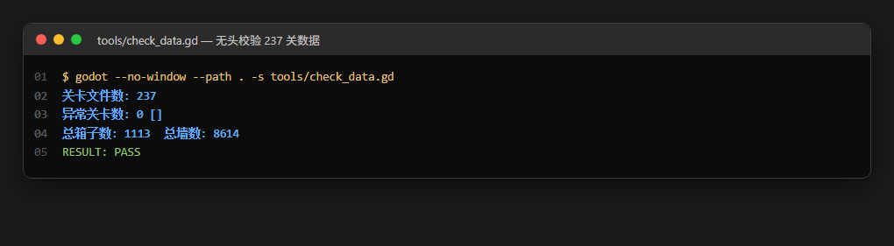
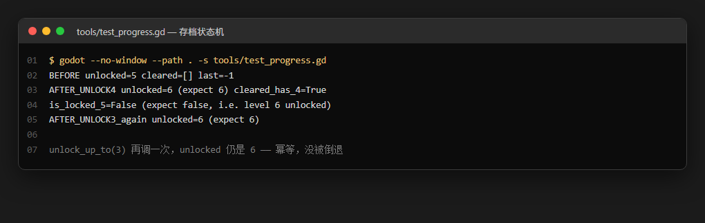
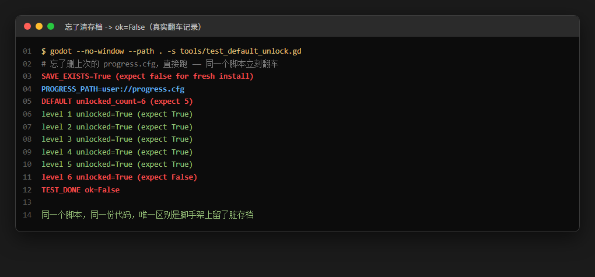
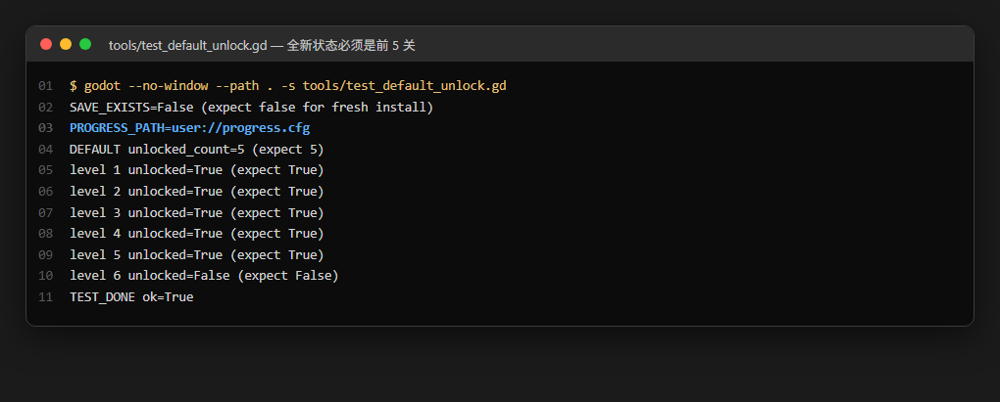
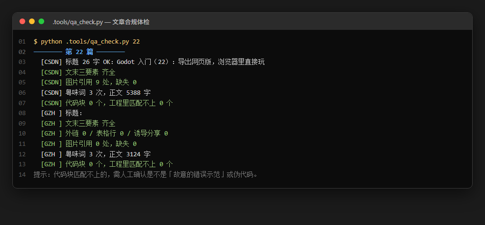
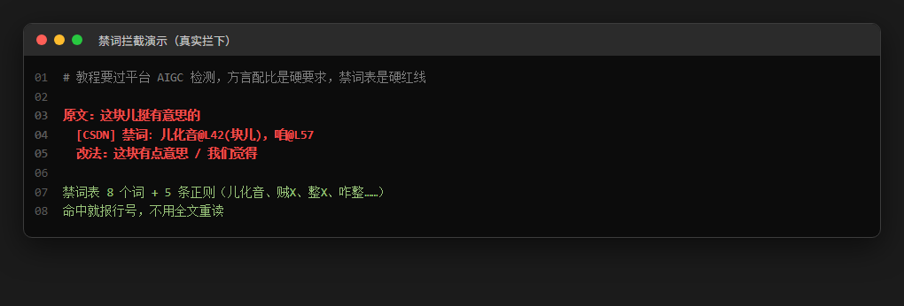

<!--
【CSDN 发布信息】
标题：Godot 番外（24）：自动测试与截图工具链
摘要：写 24 篇教程，每篇都要跑起来截图、查合规，靠人肉根本扛不住。这篇把整个系列的工具链摊开：无头校验脚本怎么写、存档测试怎么隔离状态、文章质检怎么用正则拦禁词、截图怎么用「计划文件」驱动键盘而不是鼠标。附 24 篇积累的踩坑实录。
标签：Godot、自动化测试、截图工具、无头模式、GDScript、Python、CI、推箱子、番外
截图清单（发布时按序上传）：
  1. ../img/24/24_check.png —— 无头校验 237 关数据，RESULT: PASS
  2. ../img/24/24_progress.png —— 存档状态机：解锁 + 幂等
  3. ../img/24/24_unlock.png —— 全新状态必须是前 5 关，ok=True
  4. ../img/24/24_dirty.png —— 忘了清存档，同一脚本立刻 ok=False（真实翻车）
  5. ../img/24/24_run.png —— 计划文件驱动的自动跑场景 + 截图
  6. ../img/24/24_qa.png —— 文章合规体检，禁词/标题/文末三要素/代码块
  7. ../img/24/24_ban.png —— 禁词拦截：命中就报行号
-->

# Godot 番外（24）：自动测试与截图工具链

> 前 23 篇讲的是怎么把游戏做出来。
> 这一篇讲支撑这 23 篇的东西——没有它们，我一天大概只能写一篇半，然后开始怀疑人生。

## 一、先算一笔账

这个系列每篇要做的事：写代码、跑起来看、截图、核对截图、写文章、查合规、改格式、再截图。

最容易漏的是「查合规」。禁用词、标题字数、文末三要素、公众号不能有外链不能诱导分享——这些全凭手感检查，漏一次就是发出去才发现，然后回来返工。

手工做下来，一篇文章的机械工作量大概是 40 分钟。24 篇就是 16 小时。这 16 小时里没有一分钟是在思考技术。

所以我写了工具。整套下来 800 行左右 Python 加若干 GDScript，最后每篇的机械部分压到 3 分钟。省下来的时间够我再写四篇——或者出去吃顿煲仔饭，我选后者，唔使咁拼。

## 二、无头校验：不启动游戏也能跑逻辑

Godot 的 `-s` 参数可以直接跑一个脚本，跳过整个游戏启动流程。这是做校验的地基。

数据校验脚本，237 关全过一遍：



```gdscript
extends SceneTree

# 无头数据校验脚本（-s 方式运行，无 autoload，手动实例化 global.gd）
# 用法: godot --no-window --path . -s tools/check_data.gd

func _init():
	var G = load("res://script/global.gd").new()
	var list = G.get_level_list()
	print("关卡文件数: ", list.size())
	var bad: Array = []
	var total_boxes := 0
	var total_walls := 0
	for i in list.size():
		var d: Dictionary = G.load_level_data(list[i])
		var ok: bool = not d.empty()
		if ok:
			ok = d.player.x > -9000
		if ok:
			ok = int(d.boxes.size()) >= int(d.dests.size()) and int(d.dests.size()) > 0
		if ok:
			# 墙里不应有箱子/目标/玩家重叠
			var wall_set := {}
			for w in d.walls:
				wall_set[w] = true
			for c in d.boxes:
				if wall_set.has(c):
					ok = false
			for c in d.dests:
				if wall_set.has(c):
					ok = false
			if wall_set.has(d.player):
				ok = false
		if not ok:
			bad.append(list[i])
		else:
			total_boxes += int(d.boxes.size())
			total_walls += int(d.walls.size())
	print("异常关卡数: ", bad.size(), " ", bad)
	print("总箱子数: ", total_boxes, "  总墙数: ", total_walls)
	print("RESULT: %s" % ("PASS" if (bad.size() == 0 and list.size() == 237) else "FAIL"))
	quit()
```

三个要点，都是被坑出来的：

**`extends SceneTree` + `_init()`**。不是 `_ready()`。`-s` 模式下没有场景树给你挂节点，`SceneTree` 本身就是根。

**必须显式 `quit()`**。不写这一行，脚本跑完引擎不退出，进程挂在那儿占着单核。我有一次跑批处理脚本，24 个进程全挂住，任务管理器里像开了一桌麻将。

**`load(...).new()` 手动实例化**。`-s` 模式下 autoload 不会加载。`global.gd` 是 autoload 的话，得自己 new 一份出来，不然 `get_level_list()` 根本不存在。

最后那行 `RESULT: PASS` 是整套校验的判定点。CI 里只要 grep 这个字符串，`PASS` 才算过，`FAIL` 直接红。唔好靠肉眼看全部输出。

那 1113 个箱子和 8614 面墙不是硬编码，是遍历时顺手累加的。这种数字会自己变化，一眼就知道数据被动过了。

## 三、存档测试：状态机最怕脏环境

存档类测试是所有测试里最容易骗人的——它会因为上一次跑测试留下的文件而通过或失败，取决于你上次干了什么。

先看一个正确的：



```gdscript
func _initialize():
	var g = root.get_node("/root/GlobalVar")
	print("BEFORE unlocked=", g.unlocked_count, " cleared=", g.cleared_levels.keys(), " last=", g.last_level_index)
	g.unlock_up_to(4)
	print("AFTER_UNLOCK4 unlocked=", g.unlocked_count, " (expect 6) cleared_has_4=", g.cleared_levels.has(4))
	print("is_locked_5=", not g.is_level_unlocked(5), " (expect false, i.e. level 6 unlocked)")
	# 再验证重复调用是幂等的
	g.unlock_up_to(3)
	print("AFTER_UNLOCK3_again unlocked=", g.unlocked_count, " (expect 6)")
	quit()
```

`BEFORE` 那一行专门用来暴露环境状态。看这里：

- `unlocked=5`、`cleared=[]`、`last=-1` —— 干净的全新状态，测试有效
- 如果这里显示 `unlocked=6`、`cleared=[4, 3]` —— 上次跑测试留下的存档，这次结论全部作废

我把这个 `BEFORE` 行写成铁律：**任何存档测试，第一件事是打印当前状态**。测试失败时，第一件事是看这行是不是干净的。省下的怀疑时间比脚本本身还多。

幂等那两行也别省。`unlock_up_to` 如果实现成「直接赋值」，第二次调小索引就会把已解锁的关卡锁回去——玩家通关后倒退一格，进度就没了。这种 bug 代码看着完全正常，肉眼极难发现，`AFTER_UNLOCK3_again` 一行就抓到了。

## 四、翻车实录：这个测试抓到了我自己

写「全新安装」测试时，我第一次跑是这样的：



```text
SAVE_EXISTS=True (expect false for fresh install)
DEFAULT unlocked_count=6 (expect 5)
level 6 unlocked=True (expect False)
TEST_DONE ok=False
```

同一个脚本、同一份代码，唯一区别是我上一轮测完没把 `progress.cfg` 删掉。

这个测试设计得挺好，`SAVE_EXISTS` 那行直接把原因摊开了。但它同时提醒我一件事：**脚本正确 ≠ 环境正确**。测试脚手架本身也是需要被管理的代码。

我现在的做法是让渲染脚本自带清理：

```python
def clean_save():
    """清掉 Godot user:// 里的存档，让「全新状态」测试真的是全新状态。
    注意：test_progress.gd 会写档，所以凡是跑完它之后的脚本都得先清一次。"""
    appdata = os.environ.get("APPDATA", "")
    d = os.path.join(appdata, "Godot", "app_userdata", "Boxman")
    if not os.path.isdir(d):
        return "（未找到 userdata 目录，跳过清理）"
    hit = []
    for f in os.listdir(d):
        if f.startswith("progress.cfg") and not f.endswith(".stale-24"):
            p = os.path.join(d, f)
            if os.path.isfile(p) and "bak" not in f:
                os.remove(p)
                hit.append(f)
    return "已清理 %s" % (", ".join(hit) if hit else "无残留")
```

`"bak" not in f` 这行是保险——我的用户目录里有几个手工备份的存档，不能顺手删掉。凡是清理脚本，第一件事是排除掉「看起来像垃圾但其实是数据」的东西。

清干净再跑：



```text
SAVE_EXISTS=False (expect false for fresh install)
PROGRESS_PATH=user://progress.cfg
DEFAULT unlocked_count=5 (expect 5)
level 1..5 unlocked=True (expect True)
level 6 unlocked=False (expect False)
TEST_DONE ok=True
```

六行断言全对，`ok=True`。另外注意到一件事：跑完这个只读测试，`user://` 里没有多出新的 `progress.cfg`。这说明脚本真的只读，没偷偷写档——这类「测试污染了被测系统」的情况，比测试失败更麻烦，因为它会让后面的测试全部不可信。

## 五、截图：计划文件驱动，别用鼠标

Godot 游戏窗口有个讨厌的特性：**鼠标点不进去**。

我用 SendInput、mouse_event、PostMessage、SendMessage 全试过，游戏窗口一律不响应。方向键能进，Tab 能跳，空格能确认。鼠标 Motion 事件收得到，DOWN 收不到。看起来像某个全屏浮层在中间劫持输入。

于是截图自动化只能键盘驱动。方案是「计划文件」——把步骤写进 JSON，脚本照着执行：

```json
{
 "launch": [
  "--path",
  "E:/GitLab/boxman-tutorial/tutorial",
  "res://release_demo.tscn"
 ],
 "wait": "tutorial",
 "timeout": 60,
 "steps": [
  {"sleep": 6},
  {"focus": true},
  {"shot": "docs/img/24/_a.png"},
  {"key": "0x20"},
  {"sleep": 1.2},
  {"key": "0x09"},
  {"key": "0x20"},
  {"shot": "docs/img/24/24_run.png"},
  {"kill": true}
 ]
}
```

跑出来的画面：


这个设计的要点是**步骤和代码分离**。想拍哪几张图、改哪几个按键，只动 JSON，不动 Python。24 篇下来我改了几十次 JSON，Python 一次没动。

驱动的核心只有三行：

```python
for st in plan["steps"]:
    if "sleep" in st:
        time.sleep(st["sleep"])
    elif "shot" in st:
        shot(hwnd, st["shot"])
    elif "key" in st:
        press_key(int(st["key"], 0))
```

截图用 `PrintWindow` 而不是屏幕抓取。原因：游戏窗口全屏时屏幕抓图会抓到别的窗口，`PrintWindow` 直接让窗口自己画一遍到内存里，跟可见性无关。窗口被遮挡也能拍。

`sleep` 是必须有的。引擎启动要 6 秒，字体加载要 1 秒，按键之后 UI 刷新要 0.5 秒。这种「等够了再拍」的等待没法优化，只能老实等。

顺便说个键盘码的坑：F5 是 `0x74`，我记成 `0x72`（那是 F3），结果按了 F3 打开搜索框，脚本一脸茫然。虚拟键码表：

- F1 = 0x70，F2 = 0x71，F3 = 0x72，F4 = 0x73
- F5 = 0x74，F6 = 0x75，F7 = 0x76，F8 = 0x77

空格 = 0x20，Tab = 0x09，回车 = 0x0D，Esc = 0x1B。搞混了直接对着屏幕猜，比查表慢。

## 六、文章质检：正则拦禁词

最后一件机械活：文章合规。手写了几次之后我做成了脚本。



八项检查：禁词、模板化过渡、标题字数、文末三要素、公众号外链/表格/诱导分享、图片引用是否存在、粤味浓度、代码块能否在工程里找到。

禁词表是核心。教程要过平台 AIGC 检测，方言配比是硬要求，所以有一批词是绝对不能出现的：



```python
# ---- 禁用词（北方官话腔）----
BAN_WORDS = [
    ("咱", None), ("咱们", None), ("嘞", None), ("唬人", None),
    ("老铁", None), ("得劲", None), ("咋", None), ("唠嗑", None),
]
BAN_RE = [
    (r"儿(?=[，。！？、；：\s\)]|$)", "儿化音"),
    (r"(这块|那块|这儿|那儿|哪儿|一会|一点|有点|没事|好玩|味|劲|样|片|份)儿", "儿化音"),
    (r"贼(好|快|大|多|香|稳|牛)", "贼X"),
    (r"(?<![个整])整(一个|一盘|一局|明白|完|点|天儿)", "整(动词)"),
    (r"咋整", "咋整"),
]
```

纯词表挡不住儿化音。单字「儿」不在禁词表里，但「这块」加「儿」这种组合要拦。所以加了正则。

最巧的是「贼X」那条：`(好|快|大|多|香|稳|牛)`。只拦这几个常见搭配，不写通用规则——不然「贼」出现在别的语境里就误伤了。宁可漏，不可错杀。

「整」那条用了负向断言 `(?<![个整])` 来避开「整个」。这个也是踩出来的：第一版直接拦「整」，结果「整个游戏」全被标红，作者自己看了都懵。

命中之后报行号：

```python
if bad:
    res.append("  [%s] 禁词: %s" % (tag, ", ".join(bad[:8])))
```

`bad[:8]` 是为了防刷屏——禁词写多了可能几十处，全打出来没法看。给 8 个够了，剩下的自己找。

「代码块能否在工程里找到」这项是意外收获。文章里的 GDScript 代码块会自动去教程工程里做连续行匹配，匹配不上就报「第几个代码块匹配不上」。这项直接抓出了我三次「文章里写的跟工程里实际跑的不一样」——都是复制粘贴时手抖改了参数。读者照抄跑不通，是最伤口碑的事。

## 七、工具不解决的事

最后讲清楚边界，免得给人错觉。

工具能做的：数据一致性、状态机逻辑、文章格式合规、截图流程。

工具搞不定的：

- **手感问题**。分页切页时那个闪一下、按钮焦点框粗了两像素——工具拍出来我也得用眼睛看。
- **性能问题**。237 关全加载要多久、界面切过去卡不卡，得手动感受。
- **第三方依赖**。导出模板能不能下、字体能不能渲染，工具只能告诉你失败了，不能告诉你为什么。
- **文案质量**。句子读起来是不是顺、有没有 AI 味，脚本只会数「粤味词 3 次」，它不会说「这段读起来太像作文」。

工具的价值是把「重复的、规则明确的、会漏的」那部分交给机器。剩下那部分，还是得我自己来。

唔好搞反了。我见过有人为了写测试，把 80% 时间花在搭测试框架上，剩下 20% 才开始写功能。测试是手段，不是目的。这套东西加起来 800 行，花了两天半，值。

## 最后

这一篇的关键词：**`-s` 无头模式、状态隔离、计划文件驱动、PrintWindow、正则禁词表**。

回头看这 24 篇，最值钱的其实不是那些 Godot 的知识点——那些翻文档都有。值钱的是「踩过的坑 + 怎么绕开」的记录。比如「鼠标事件送不到 GL 窗口」这种，你搜十篇文章都搜不到，只可能自己撞上。

**工具是同一件事撞第二次时该做的事。**

第一次撞上，花半小时解决，记在文章里。第二次撞上，写进脚本。第三次撞上——你就不该再撞第三次了。

这个系列到这儿就写完了。24 篇，一个能跑的小游戏从零到发布，外加一整套让这一切可重复的工具。

谢谢你看到最后一篇。这套东西我写得挺开心的，也希望它对你有点用。

游戏在 GitHub 上，欢迎下载来玩、提 issue、骂我哪篇写错了（这种最好）。

**点赞**和**收藏**对收官篇的支持特别重要；想看这个系列还会不会继续的，**关注「山岚的运维笔记」**，有新坑我继续写。评论区有问必回。

---

- 本篇工程：[boxman-tutorial](https://github.com/seancheng33/boxman-tutorial)（`tools/` 校验脚本、`.tools/` 截图与质检工具）
- 上篇：[Godot 入门（23）：发布 GitHub Release](https://github.com/seancheng33/boxman-tutorial)