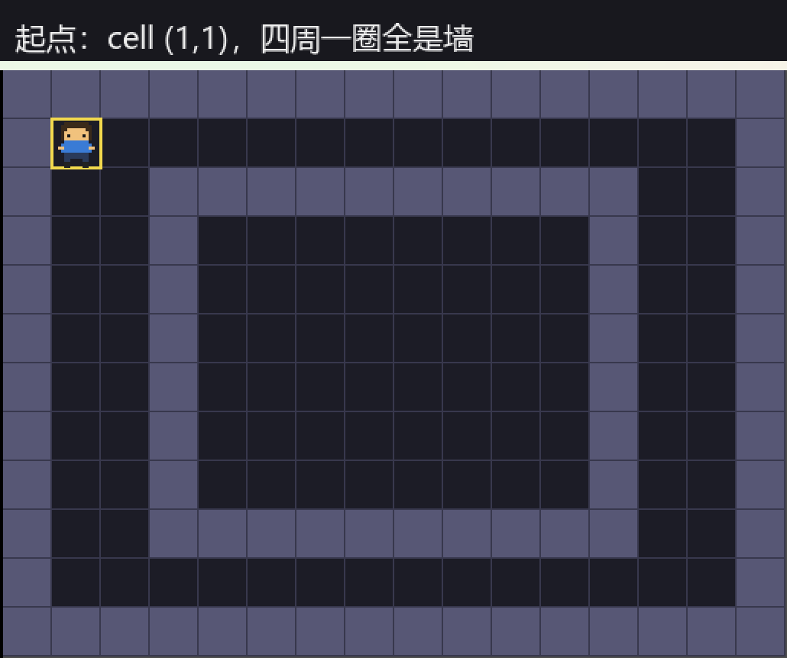
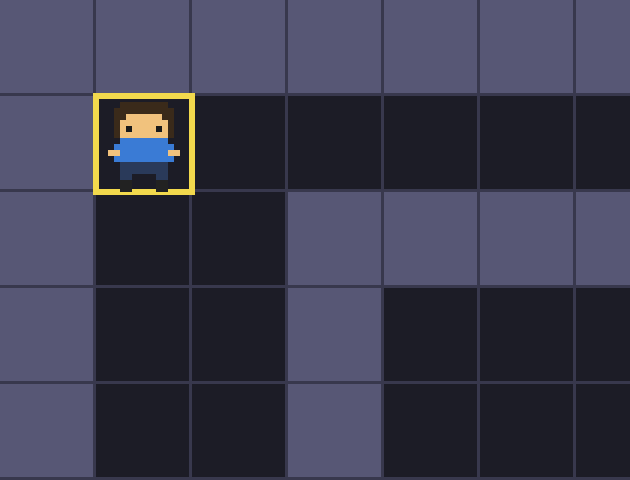
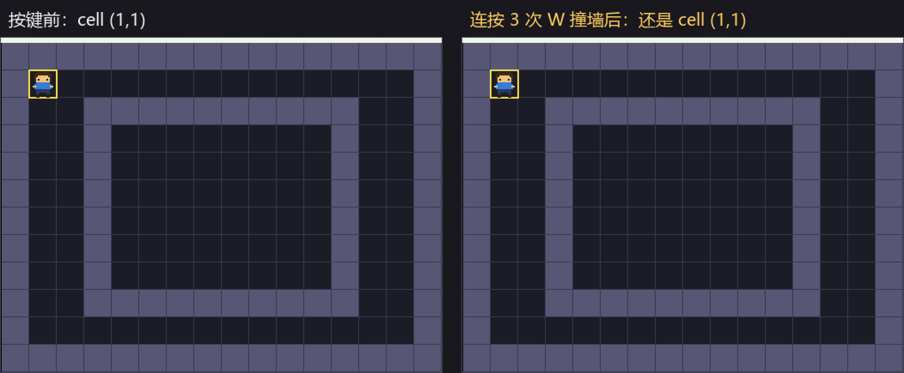
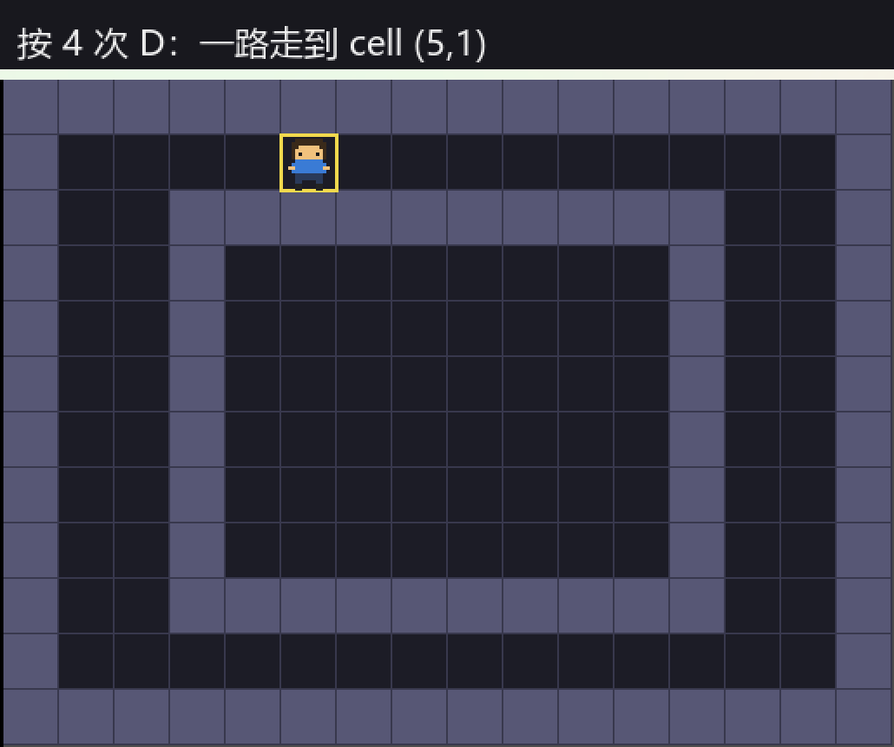
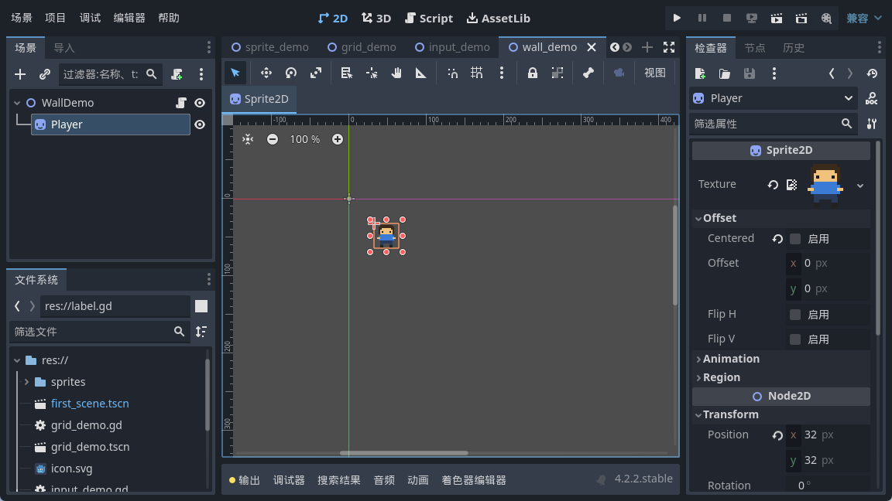

<!--
【公众号发布信息】
标题（备选）：
  A：小人会走了，但它会穿墙
  B：把地图写成几行字，撞墙判定就顺手搞掂了
摘要：小人会走了，可它还会穿墙。这篇给它一张真正的地图——几行字符串就是地图，走之前先问一句「那格能进吗」，越界一律当墙，撞上就原地不动。
截图清单（按序上传，建议居中）：
  1. ../img/08/08_run.png
  2. ../img/08/08_map.png
  3. ../img/08/08_compare.png
  4. ../img/08/08_move.png
  5. ../img/08/08_editor.png
封面建议：08_compare.png
-->

把地图写成几行字，撞墙判定就顺手搞掂了

大家好，我是「山岚的运维笔记」。

上一篇小人总算识行喇，不过佢有个毛病——识穿墙。向左按十下，佢就由画面左边溜出去，连声招呼都唔打。

今日畀佢一张真正嘅地图，再教佢一件事：有啲地方，你去唔到。

**地图不用画，敲几行字就行**

做推箱子，最省事的地图不是画出来的，是敲出来的。

一个字符串数组，每一行就是地图的一行。# 是墙，. 是地板。改地图就是改这几行字，比在编辑器里一块块摆砖头快得多，改完直接跑，也不用等它导入。

画出来是这样：

凑近看，你就能对上号：

深色实心方块就是 #，更暗的是 .。数组里写了什么，画面上就是什么，一个字符对一格。

至于画线、画砖块纹理那些，留到后面做视觉打磨再说。而家先将「边度行得」呢件事定死。

**数组下标就是格子坐标**

呢句值得单独讲，因为我喺呢度卡过。

数组是一行一行存的，所以取一个格子要写成「第几行的第几列」——**y 在前，x 在后**。你习惯的那个顺序在这里是反的。

我第一次就写反咗，人物沿住对角线乱窜，仲以为系输入映射配错。查咗半日，先发觉系行列写反。呢种错唔会报错，佢只会令你嘅人物行得好诡异。

**走之前，先问一句**

核心就一个函数，问「这格是墙吗」。它前半段管边界，后半段管墙，两件事塞一起，调用的时候根本不用分心。

这里有个我很喜欢的偷懒写法：**走出数组范围，就当它是墙**。

想想看，边界这东西，很多人会单独写一堆判断，散落在四个方向里，写四个漏一个。可边界说到底就是「地图外面那一圈不能走的地方」，跟墙是一回事。既然是一回事，就让它返回 true 好了，判定的地方一行都不用多写。

**先算后判，别先走再退**

这是今天最容易写错的地方。

好多人（包括当年嘅我）会咁写：先行前一步，撞咗墙再退返嚟。看着也没毛病对吧？能跑。

但它在给你埋雷。等你后面往格子里加箱子、加目标点，或者移动之后要播个动画、记一步撤销，「先走再退」就会变成「先改了三个地方，再挨个回滚三个地方」。漏一个，游戏状态就跟你的人物对不上。这种 bug 最难查，因为它只在特定顺序的操作下才冒出来。

正确的做法是**先把想去的地方算出来，问完再决定动不动**。算出目标格，问一句「能进吗」，不能进就直接结束，什么都没发生过。干净，而且将来加什么都不用动这段逻辑。

**跑起来，撞一下试试**

我把人物放在 cell(1,1)，就是左上角那条走廊。头顶上那格是墙。

按三次 W：

左边是按之前，右边是按了三次之后。**两张图一模一样**——我比对过，像素级别的相同。按咗，冇动，咁就啱喇。

然后换右边，走廊是空的，按四次 D：

从 (1,1) 走到 (5,1)，一格一格，不快不慢。

编辑器里选中 Player，位置也跟着走：

**两个小提醒**

字符串取单个字符，记得用 substr 去截，别直接拿下标去和 # 比，类型对不上会静默失败——Godot 不报错，它就一直返回 false，你就一直能穿墙。

还有，常量数组取出来的一行，赋值给变量时要写清楚它是字符串类型。不写的话 Godot 会甩你一个解析错误，说它推断不出类型。我第一次就畀呢个拦喺门外。

**最后**

今天三句话。地图就是字符串数组，# 是墙 . 是地板。越界当墙，边界和判定合一。先算目标格再判定，不通过就结束，千万别先走再退。

而家小人撞墙识停喇，不过佢仲系个净系识自己行嘅孤魂。下一篇叫佢推箱子——推得动同推唔动，又系另一套判定。

小人而家识得撞墙就停，抵一个点赞 + 在看；关注「山岚的运维笔记」，后面教佢推箱子。

下一篇见。

（配套工程在 GitHub 的 Boxman 仓库 tutorial 分支，每篇一个进度 tag，搜 seancheng33/Boxman 就能找到。）
