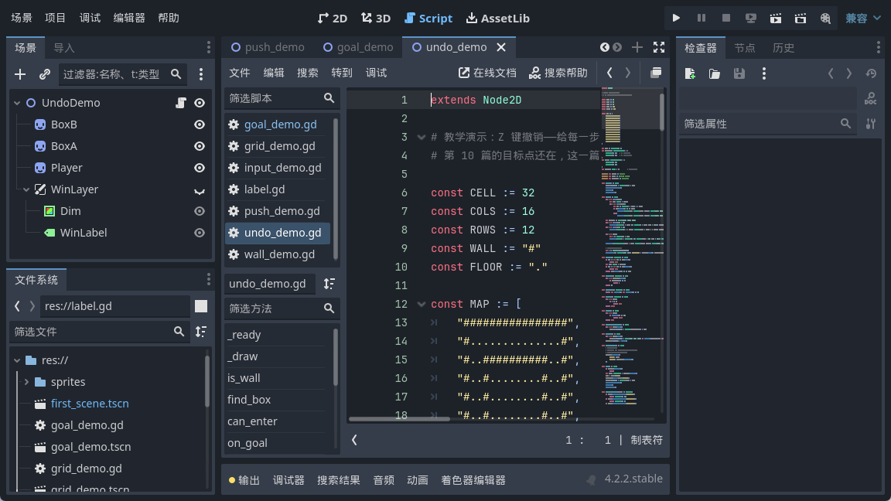

<!--
【公众号发布信息】
标题（备选）：
  A：按了 Z 没反应，我查了半天键位，结果是数组在搞我
  B：撤销功能存的是状态，不是动作——想通这点就简单了
摘要：推箱子最怕推错一步。这篇给它加撤销：用一个数组当栈，每走一步把「动之前」的样子存一笔，Z 键弹出来就退回去。顺带讲两个必踩的坑——数组存的是引用，还有存档必须赶在改数据之前。
截图清单（按序上传，建议居中）：
  1. ../img/11/11_code.png
  2. ../img/11/11_inputmap.png
  3. ../img/11/11_run.png
  4. ../img/11/11_push2.png
  5. ../img/11/11_undo1.png
  6. ../img/11/11_compare.png
封面建议：11_compare.png
-->

按了 Z 没反应，我查了半天键位，结果是数组在搞我

大家好，我是「山岚的运维笔记」。

上一篇游戏有输赢喇，不过推错一步净系得个睇字，要由头嚟过。推箱子呢个游戏，一步行错整关报废，真系最劝退嘅体验。

今日同佢加粒后悔药：按 Z 就退返一步，用个栈将每一步记落嚟。

**撤销要存什么**

答案很朴素：存「这一步动之前」的样子。

不是记「我按了往右」，也不是记「我走了一格」。存动作的话，撤销时你得反过来推——往右走了一格，撤销就是往左走一格；可万一那一步是推箱子呢？箱子往回滚一格，人往回退一格，两个动作，顺序还不能错。

存状态就冇咁头痕，省心好多。动之前，将人同箱子喺原位影张相；要撤销，就将张相攞返出嚟贴返上去，搞掂。

**第一个坑：数组存的是引用**

这段是我本篇最想让你看的地方。

GDScript 里，数组、字典、对象这些是引用类型。你把它塞进另一个数组，拿到的不是一份拷贝，是同一份东西的门牌号。

也就是说，你要是图省事直接把箱子数组塞进历史里，存进去的和外面那个是同一个数组。等你下一步把箱子往前推一格，历史记录里那份也跟着变了。等你想撤销，弹出来的「历史」跟现在一模一样，按 Z 毫无反应。

我第一版就是这个毛病。按咗 Z，画面郁都唔郁，我仲以为系按键冇绑上，查咗半日键位。

解决办法是存之前先复制一份，Godot 里有专门的方法干这个。复制出来的那份跟原件再无瓜葛。

**第二个坑：存档要赶在改数据之前**

顺序很要紧。存档必须排在改数据之前。存晚了，存的就是「走之后」的样子，等于没存。

还有个顺带的好处：撞墙、推不动这些情况，走的是提前返回的分支，压根没走到存档那一步。所以「撞墙那一下」不会进历史，撤销也就不会退回到一个你根本没动过的地方。

净系真正行咗嗰一步，先配有后悔药。

**栈，就是个数组**

「栈」这词听着吓人，落到代码里就是一个数组，加上两个动作：从尾巴塞进去，从尾巴拿出来。

后进先出。最后存的那步，第一个被撤掉——正好符合直觉。

里面还有一句兜底：栈空了就别硬撤。不然取出来是个空值，后面直接崩。

**绑个键**

第 07 篇说过，键位和动作名要分开。撤销也一样，加个叫 undo 的动作，绑到 Z 上。

将来你想改成别的组合键，或者给手柄也配一个，只动这个面板，代码一行不用改。

代码这边就两行：检测到撤销动作，调撤销函数，然后直接返回。撤销跟走路是两码事，处理完就走，别让它掉进下面走路的逻辑里。

**跑起来，推两步再撤**

起点：一个箱子已在目标上（绿的），另一个还差一格。右下角那行字是栈里还剩几步。

按两次往右。第二次把箱子推过了目标点，反而没赢。

按一次 Z，退回上一步——箱子回到目标点，通关面板跟着弹出来。

我一直按到底，将两步都撤晒，画面返到起点嗰张，同最初像素级一模一样。再按一次 Z，个栈早就空晒，画面郁都唔郁——兜底嗰句起作用喇。

**最后**

今天三句话。撤销存的是状态不是动作，存「动之前」的样子。数组是引用，存进历史之前一定先复制，不然历史跟着一起变。存档要排在改数据之前，撞墙那些没走成的步子本来就不该进历史。

而家推得、撤得、赢都得，不过地图系写死喺代码入面。下一篇将地图抽出嚟做一份文本文件，改关卡唔使再动代码。

后悔药配好喇，想睇下集就点赞加在看；关注「山岚的运维笔记」，下一篇将张地图搬出代码。

（配套工程在 GitHub 的 Boxman 仓库 tutorial 分支，每篇一个进度 tag，随时能下到对应版本。）
