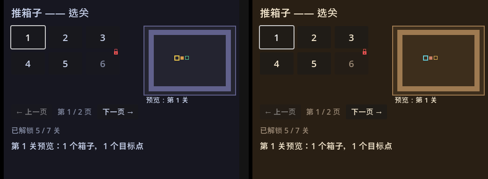
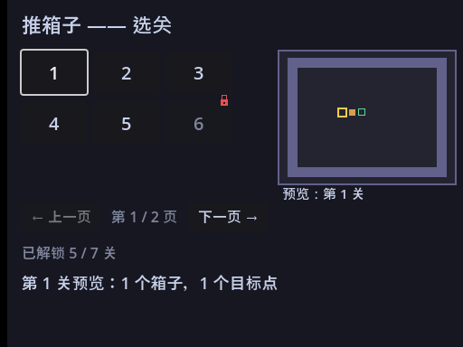
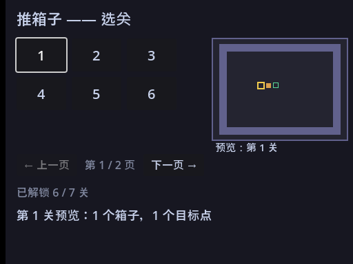

<!--
【公众号发布信息】
标题（备选）：
  A：不改一行逻辑，画面从程序员灰变成能见人
  B：游戏里的锁图标，我是用代码画出来的
摘要：功能齐了，画面还灰扑扑的。这篇不改逻辑只收拾门面：颜色收进一个 const 字典调色板，改一处全局变；锁图标用代码逐像素画，不请美术、不占资源。顺带讲一个"有时候点得动有时候点不动"的灵异问题的真凶。
截图清单（按序上传，建议居中）：
  1. ../img/17/17_theme.png
  2. ../img/17/17_lock.png
  3. ../img/17/17_unlock.png
封面建议：17_theme.png
-->

不改一行逻辑，画面从程序员灰变成能见人

大家好，我是「山岚的运维笔记」。

功能到上一篇就齐晒喇：玩得、存得、选得关。可画面还是那个灰扑扑的程序员配色，锁着的关卡也光靠"变灰"撑着。

呢一篇唔改任何逻辑，净系收拾门面——调色板，同一把用代码画出嚟嘅锁。

**散落的颜色是种债**

先盘点我自己的债。

画地图那篇，墙色写了一个 Color(0.34, 0.34, 0.46)；箱子染绿那篇，又写了一个绿色；预览小地图那篇，墙色再抄一遍。同一个"墙"，两个文件里各存一份——哪天想把墙调成暖棕，就得满项目搜色号，漏一处就阴阳脸。

呢个就系散落嘅魔法数字，颜色版嘅重复代码。治法和治重复代码一样：收拢到一处，起个名字。

**调色板：一个 const 字典管全部**

做法简单到不好意思写：一个 const 字典，十一个颜色，每个都按"这东西是什么"起名——底色、面板、墙、目标点、玩家、箱子、进目标的箱子、正文文字、暗淡文字、锁。

以后画任何东西，从字典里按名取色。控件文字的颜色用主题覆盖一个一个挂上去，正常态一个色，禁用态单独一个更暗的——灰按钮上那个"暗一档"的感觉就是这么来的。

这套调色板值不值，看换主题的速度：

代码零改动，就换了字典里几个数。要是颜色散在各个文件里，这次换肤就是一次全项目大扫除。

**程序化锁图标：代码逐像素画**

未解锁嘅按钮净系变灰仲未够——玩家扫一眼都睇唔出边个点得。挂返把锁，一眼就明。

图片素材去边度搵？唔搵喇，用代码画。十二乘十四像素，两根竖梁加一条顶横拼出锁梁，填一个实心矩形当锁身，最后在锁身中间写四个全透明像素，把锁孔"挖"出来——带透明通道的格式里，写一个透明度为零的颜色就是把那个点抠穿。

整个过程零资源文件：不用找美术、不用管图片格式、导出时也不多一个字节。像这种十几个像素的小图标，代码画比找素材还快。

**挂锁的四个讲究**

图标往按钮右上角一挂，有四个细节，个个都踩过：

一是挂之前先查——刷新逻辑每次都跑，不先查有没有挂过，翻一页页就多长一把锁，最后按钮上长出一把锁的刷子。

二是解锁要摘锁——解锁不只是"按钮不禁用"这一个状态，挂件也要跟着删。第 15 篇说"按钮是死的，状态是活的"，锁就是状态的一部分。

三是锚点定位——把图标钉在按钮右边缘，再用偏移往回收一点、往上挑一点，让锁"骑"在按钮角上。按钮怎么变，锁都跟着右上角走。

四是鼠标穿透——这个最阴险：锁压在按钮上，它自己要是吃鼠标事件，点在锁上的那一小块就点不到按钮。玩家会遇上"有时候点得动有时候点不动"的灵异问题，排查起来能把人逼疯。把图标设成忽略鼠标，事件穿过去，按钮的点击才完整。

**预览也用同一块调色板**

预览小地图顺手全部改成调色板取色。字典里我还备了一个颜色：箱子已经在目标点上的。虽然而家呢几关数据入面仲未用到呢种静态摆法，但颜色先备好、分支先写上，第日要用即刻用得。

这就是调色板的另一个好处：颜色的"词汇表"先于内容存在。画新东西先想"这在语义上是什么"，从表里挑名字，而不是临时又捏一个色号。

**最后**

这一篇其实就干了一件事：把"长什么样"从代码里抽出来，集中管理。

调色板系颜色嘅集中，锁图标系素材嘅集中。到呢一步，游戏应该有嘅皮都有齐喇。

不过现在打开游戏直接就是选关，少个正经的"开始"。下一篇做主菜单：标题画面、开始按钮、场景切换，把游戏串成完整的"打开→开玩→回来"。

视觉收拾完喇，值得**点赞、在看**来一套；想同游戏加返个正经大门嘅，**关注「山岚的运维笔记」**，下一篇接着。评论区有问必回。
