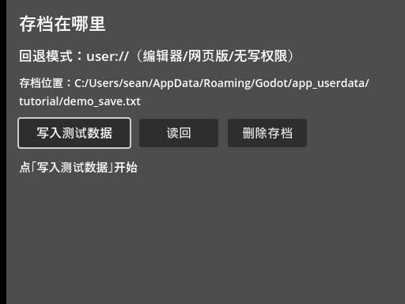
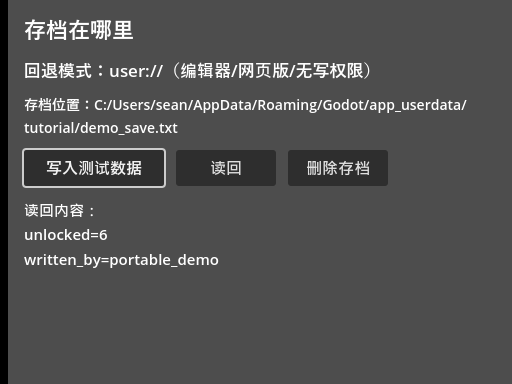

<!--
【公众号发布信息】
标题（备选）：
  A：玩家的存档藏在 AppData 深处，怪谁？
  B：便携化存档：三道关卡，永远留后路
摘要：user:// 把存档藏在玩家系统目录深处，想备份都找不到。这篇给存档搬家：优先写 exe 同级目录，用"写探针"验证可写，不行就回退 user://。附带一个教训：场景文件里 connection 段插错了位置，按钮点下去没反应。
截图清单（按序上传，建议居中）：
  1. ../img/20/20_idle.png
  2. ../img/20/20_written.png
封面建议：20_written.png
-->

便携化存档：三道关卡，永远留后路

大家好，我是「山岚的运维笔记」。

存档仲系匿喺玩家系统嘅死角——AppData 深处，想备份都揾唔到地方。我见过最离谱的求助是"我重装了系统，游戏还在 D 盘，进度没了"——进度好好的，躺在 C 盘 AppData 的废墟里。

解法就是便携化：存档写在游戏文件夹里，游戏去哪它去哪。成个文件夹拷去 U 盘，进度跟住走。

**三道关卡，谁才有资格用便携模式**

存档位置不是拍脑袋定的，走一套裁决流程。

第一关：编辑器。编辑器里跑，程序拿到的"exe 路径"是编辑器自己的安装目录——照搬便携逻辑，存档就写进 Godot 的安装目录，这种事干了会被未来的自己骂。所以编辑器环境直接回退，引擎有现成的特征判断，跑在编辑器里它就是 true。

第二关：网页版。浏览器沙箱里没有真正的文件系统，也直接回退。

第三关：写探针。到了导出版的本地环境，也不是闭眼写——玩家完全可能把游戏装在 Program Files 里，那目录对普通程序是只读的。裁决方式简单粗暴：往目标目录写一个探针小文件，马上就知道能不能写，写得进去就说明可写，写完立刻删；写不进去就回退。用实测代替假设，点都好过查一堆系统 API，呢条规矩系我踩咗几次坑之后定落嚟嘅。

三关全过，存档先至入到 exe 同级目录；任何一关唔过，都退回原处。玩家永远不会因为"便携化"而丢档，这是底线。

**写文件必须判空**

写入用打开文件的接口，返回空就是失败，错误码可以打出来看——磁盘满、目录只读、路径乱码，全在这一步现形。写完记得关，唔好指望垃圾回收帮你收尾，缓冲区冇刷盘嗰种痛，边个痛过边个知。

**这一篇最大的坑**

截图流程走到一半，按钮突然全部失灵：点写入没反应。查咗一圈，代码冇问题、焦点冇问题、键盘事件都到咗——最后喺场景文件度捉到真凶。

给按钮连信号，场景文件里会多几行连接声明。我用脚本批量改文件时，把这几行插在了某个节点的属性中间——场景文件是有格式的：所有节点在前、连接声明必须在最后。插错了位置，解析器直接报错，连接整个没加载，按钮自然成了摆设。

修好之后实测：空格按下，写入、读回、删除，一条链全通。

给你两条预防针：手改场景文件要小心段落顺序；改完先跑一遍无头模式，解析错误当场现形——这次就是一行 Parse Error 救的场。

**编辑器里测不出便携模式，怎么办**

编辑器里跑，永远是回退模式。便携模式要导出的 exe 才能走到第三关，而导出是下一篇的事。顺序别搞反：先有"可写就便携、不可写就回退"的裁决逻辑，再谈导出。反过来做，就系先打包装箱，再发现玩家存档周围乱咁扔。

**最后**

关键词：取 exe 路径、写探针、回退。便携化不是"换个目录写"这么一句漂亮话，是三道关卡裁决加永远留后路的工程决策。

下一篇正式开始导出：把这套教程工程打包成 Windows 可执行文件，把导出参数那些坑一个个踩给你看。

存档跟住 exe 走咗，值得**点赞、在看**嚟一套；想睇游戏变成 exe 嘅，**关注「山岚的运维笔记」**，下一篇接着。评论区有问必回。
