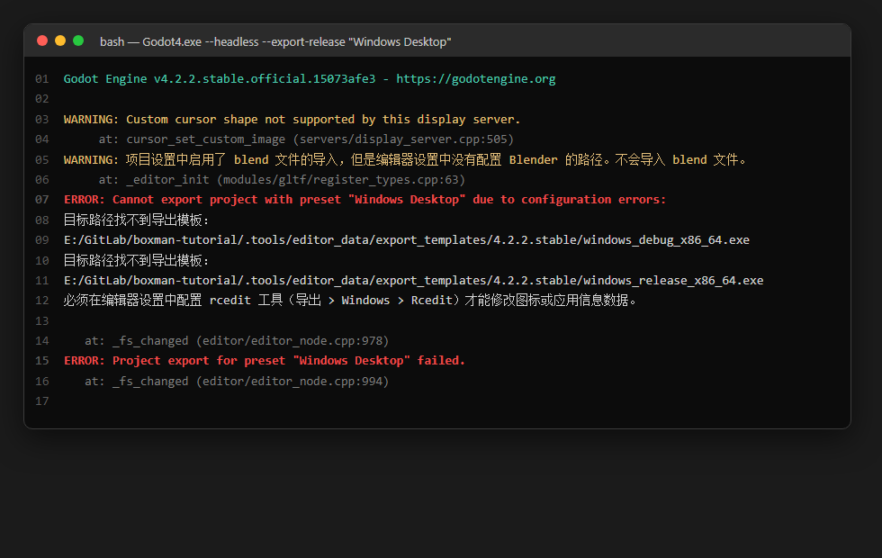
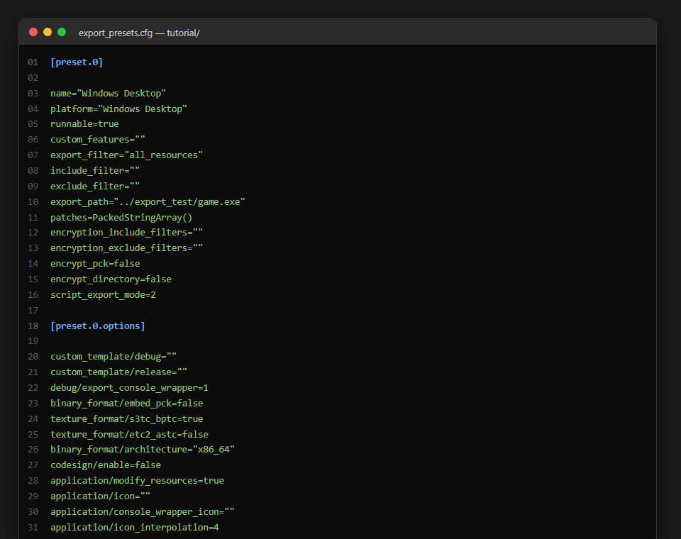
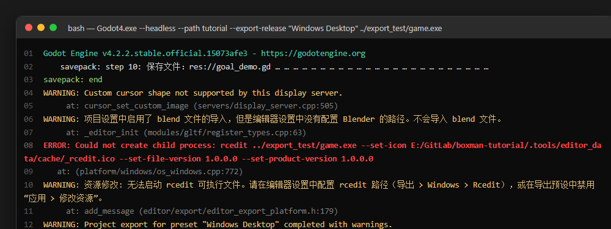
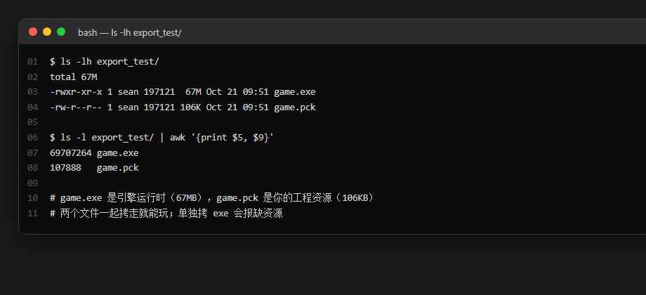
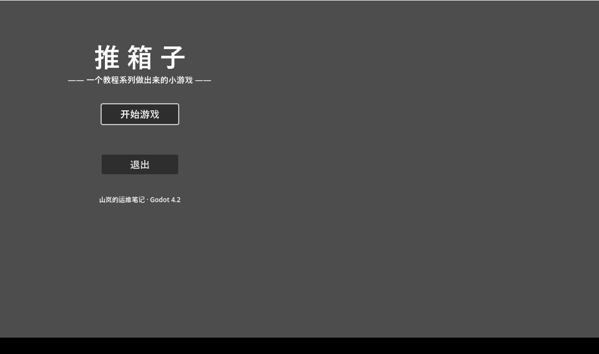
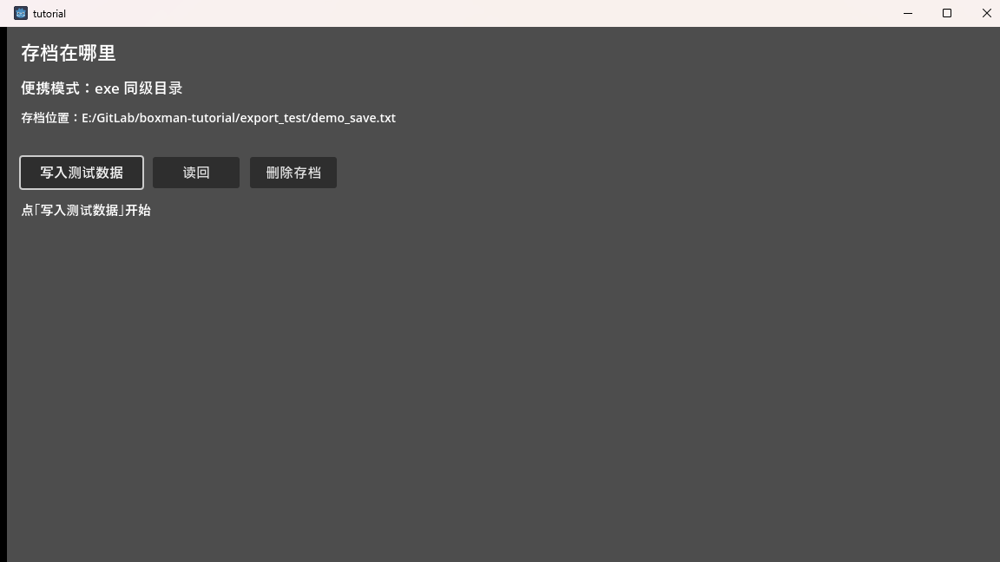
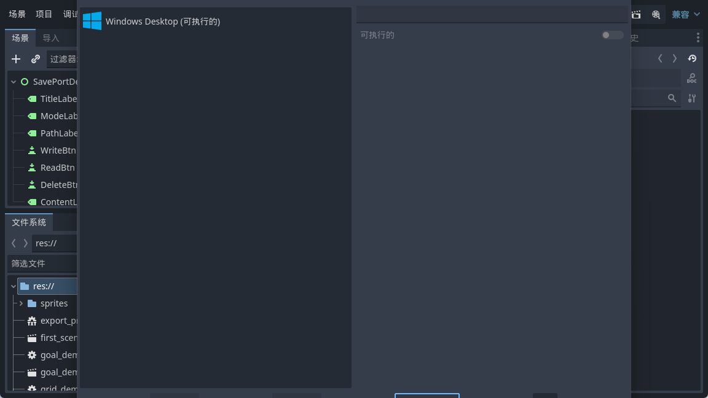

<!--
【公众号发布信息】
标题（备选）：
  A：写了二十篇，游戏终于能双击就玩了
  B：导出 Windows 版：模板、预设、一行命令
摘要：二十篇写下来，玩法存档选关主菜单多语言都齐了，可游戏一直活在编辑器里。这篇把它变成双击就能玩的 exe：装导出模板、写导出预设、命令行一行打包，顺带把上一篇便携存档的伏笔在真实导出环境里兑现。
截图清单（按序上传，建议居中）：
  1. ../img/21/21_notpl.png
  2. ../img/21/21_code.png
  3. ../img/21/21_export.png
  4. ../img/21/21_files.png
  5. ../img/21/21_run.png
  6. ../img/21/21_portable.png
  7. ../img/21/21_editor.png
封面建议：21_run.png
-->

写了二十篇，游戏终于能双击就玩了

大家好，我是「山岚的运维笔记」。

上一篇我把存档搬到了 exe 同级目录，留了个小坑：编辑器里跑永远是回退模式，要看到便携模式生效，得先有一个导出来的 exe。

嗰个 exe，今日就嚟。

**导出到底导出了什么**

先说清楚一件事：导出不是"把工程变成一个文件"，是产出**两样东西**——一个引擎运行时（exe），一个资源包（pck）。你的场景、脚本、贴图、翻译，全被打包压进 pck；玩家双击 exe，引擎读 pck，跑你的主场景。

呢个模型可以解释后面所有现象，搞掂咗呢层，后面就顺。为什么 exe 拷到别人电脑也能跑（引擎自带），为什么改了代码得重导（pck 里存的是打包那刻的快照），为什么 exe 单独拷走跑不起来（资源还在 pck 里躺着）。

**第一个坑：导出模板根本没装**

新手第一次导出，十个有九个都死喺呢度。菜单点导出、命令行敲命令，得到的都是同一句——"目标路径找不到导出模板"。

不是工程坏了，是**导出模板压根没装**。这东西每个 Godot 版本自带一套"出厂运行时"，官方按版本发布，**不随编辑器一起装**。去官网下载页找跟你编辑器一模一样的版本号（差一个小版本都不行），下那个几百兆的 tpz 压缩包。

它不需要安装程序，本身就是压缩包，解压出来的 templates 文件夹改名成版本号，丢到引擎数据目录下，马上就能认得。这一步每个版本只做一次，以后所有同版本工程直接导。

嫌全量大也行，Windows 平台实际只要两个文件（debug 和 release 各一个），但说实话，全量解压省心。

**导出预设：一次配置，反复使用**

模板是引擎侧的，预设是工程侧的。项目里那个 export_presets.cfg 文件，编辑器里点"项目 → 导出 → 添加 Windows Desktop"会自动生成，我是直接手写的，关键的就那么几行。

`export_filter="all_resources"` 表示资源全打包，不想带某些文件就往 exclude 里扔，支持通配符——比如你项目里躺着 psd 源文件，导出去纯属浪费体积，实在没必要。

`export_path` 是产物落点。我指到仓库根的 export_test 目录，这目录进了 gitignore——导出产物不进版本库，跟构建产物一个待遇。

`binary_format/embed_pck=false` 是个选择题：false 产出 exe 加 pck 两个文件，改一个字只要重导 pck；true 把 pck 塞进 exe，单文件分发最爽，但每次改动都要重导整个 exe。开发期用 false，正式发布图省事再切 true。

**一行命令的事**

预设配好，导出就一条命令：

Godot4.exe --headless --path tutorial --export-release "Windows Desktop" ../export_test/game.exe

四个部件拆开看：headless 不开窗口纯后台跑，path 指工程目录，export-release 是命令本体，后面跟着**预设名**——就是配置文件里 name 那个字符串，一字不差——最后是输出路径。

这里有个历史包袱值得记一笔：Godot 3 时代这个参数叫 `--export`，4 改成 `--export-release`。我正式版系 3.5 做嘅，切 4.2 嗰阵第一把就顺手写错咗。

好在 4.x 遇到唔识嘅参数会直接报错退出，唔似 3.x 咁静静鸡忽略——将游戏当编辑器跑起身空转，你对住一个根本唔存在嘅 exe 等半日，嗰种绝望我而家都记得。参数名跟版本对不上，先查文档再硬试。

**双击验证**

拷去边个目录双击，主菜单就出嚟喇。主菜单、选关、游戏本体，跟编辑器里跑的一模一样。

这一步其实验证了两件事：模板跟引擎版本严丝合缝；pck 把工程打全了——少一个资源，进对应场景就黑屏报错。

**回收上一篇的伏笔**

第 20 篇说过，便携模式要导出的 exe 才能走到第三关。现在兑现：把主场景临时换成存档演示页，再导一版，双击，点写入。

看路径栏，"回退模式"变成了**便携模式**，存档就在 exe 同级目录。整个文件夹拷到 U 盘，进度跟着走。上一篇嗰三道关卡，喺真实导出环境里全部走通晒。

验证完把主场景换回主菜单，重新导出正式版。两次导出加起来唔够两分钟，呢啲就系预设配好嘅红利。

**最后**

这一篇的关键词：**导出模板、export_presets.cfg、export-release**。

模板是引擎侧的一次性投资，预设是工程侧的一次性配置，之后每次发布就是一行命令。游戏终于从编辑器里走咗出嚟，双击就玩得。

但桌面只是第一站。下一篇导出网页版——浏览器里玩推箱子，而且网页版的存档跟桌面完全不是一套逻辑，上一篇回退模式的另一半原因在那边等着呢。

游戏变成 exe 喇，值得**点赞、在看**嚟一套；想睇佢喺浏览器里跑起身嘅，**关注「山岚的运维笔记」**，下一篇接着。评论区有问必回。
