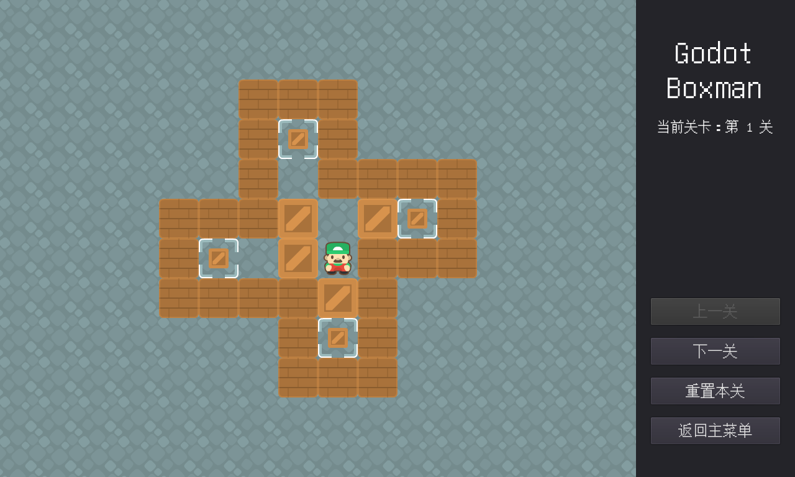

# Godot Boxman（推箱子）

[English](readme_en.md) | 简体中文

一个基于 Godot 3.5.2 的推箱子（Sokoban）游戏，支持中英文界面切换。

## 简介

- 游戏素材下载自免费游戏素材网站：https://kenney.nl/
- 游戏关卡来自：http://sokoban.cn/ 中的经典关卡，去重处理后共 **237 关**
- 关卡采用**解锁制**：初始开放前 5 关，通关一关自动解锁下一关；进度自动保存
- 支持键盘（方向键 / WASD）操作与鼠标点按菜单，按 **Z** 键可撤销上一步
- 不同章节的关卡使用**不同的配色主题**（棕 / 红 / 蓝 / 绿 / 灰 轮换），箱子压上目标点会变为同色暗版
- 界面支持 **中文 / English** 切换（主菜单按钮，偏好自动保存）

## 在线试玩

直接打开试玩地址：<http://three-corner.xyz/static/boxman/Boxman.html>

> 注意：HTML5 版进度保存在浏览器本地（IndexedDB），换浏览器或清除站点数据会重置进度。

## 游戏截图

### 主界面

### 游戏内

### 游戏选关（实时预览）

## 操作说明

- 菜单按键：鼠标点击
- 人物移动：键盘方向键或 【W、A、S、D】
- 撤销：按 【Z】 撤销上一步操作
- 把**所有目标点**都推上箱子即通关（个别关卡的目标点数量少于箱子数量，多余的箱子是干扰项，不必归位）
- 通关后可选下一关或返回主菜单，游戏中也可通过「上一关 / 下一关」按钮切换关卡（仅限已解锁的关卡）

## 技术架构

- 引擎：Godot 3.5.2（GDScript）
- 开发环境：Win11（主要）、macOS（偶尔）
- **关卡数据**：`levels_txt/` 下的标准 sokoban ASCII 文本（`#` 墙 `@` 人 `$` 箱 `.` 目标，`*`/`+` 为箱/人压目标）。关卡由 `scene/LevelTemplate.tscn` + `script/level_builder.gd` 在运行时生成，**新增关卡只需往 `levels_txt/` 放一个文本文件**，零编辑器操作
- **游戏状态**：解锁进度、通关记录、上次游玩关卡统一持久化在 `user://progress.cfg`（HTML5 端为 IndexedDB）
- **导航**：所有界面统一走 `global.gd` 的 `goto_level(索引)` 入口
- **多语言**：文案集中在 `global.gd` 的 `TEXTS` 表，语言偏好持久化在 `user://settings.cfg`
- **选关界面**：分页数字网格 + SubViewport 实时渲染所选关卡（预览与实际关卡永远一致，自动继承配色主题），不再依赖关卡截图
- 导出配置：`export_presets.cfg` 含 `include_filter="*.txt"`，保证导出包携带关卡数据

## 关卡质量验证

`tools/` 目录附有关卡反解析与求解器脚本：

- `tools/parse_levels.py`：tscn → ASCII 反解析（历史迁移工具，237/237 无损校验通过）
- `tools/solve_levels.py`：A* + 死格/冻结剪枝求解器，支持 `SOLVE_LIMIT` 环境变量与指定关卡参数
- `tools/level_shot.gd`：关卡截图工具（`SCENE_PATH` / `BOXMAN_LEVEL` / `SHOT_PATH` 环境变量控制），用于界面与主题的视觉验证
- 验证结论：**227 关证实可通关**；原 Level071/131/146 三关因关卡数据转录错误无解，已修正地图并复验通过；其余 10 关求解器 300 秒内未出解（未定，不代表无解）

## 下载

Windows 版与 HTML5 版本可在右侧 **Releases** 页面下载（HTML5 版解压后需本地起一个静态服务器打开，浏览器直接双击 `Boxman.html` 会因 CORS 无法加载）。

## 关于

关卡和其他的内容将逐步更新。如果您发现了 bug 或者有其他建议，欢迎发送至我的邮箱：aya234@163.com

## 最近更新

### v1.2.0

- **关卡解锁制**：初始开放前 5 关，通关自动解锁下一关；选关界面锁定关置灰、已通关关卡绿色标记
- **选关界面重构**：237 张截图按钮改为分页数字网格 + 实时关卡预览（自动继承配色主题），打开时自动定位到上次游玩的关卡
- **分关配色主题**：每 20 关轮换棕 / 红 / 蓝 / 绿 / 灰 5 套主题（墙、箱子、目标点同色系），箱子压上目标点切换为同色暗版
- **修复**：游戏内「当前关卡」提示过长被裁剪；选关预览上下颠倒；箱子在相邻目标点间移动时深色状态丢失；通过「下一关」按钮可进入未解锁关卡
- **界面**：主菜单与关于页全新视觉设计；关于页补充 Z 键撤销说明
- **包体**：474 张选关截图退役，导出包体显著瘦身
