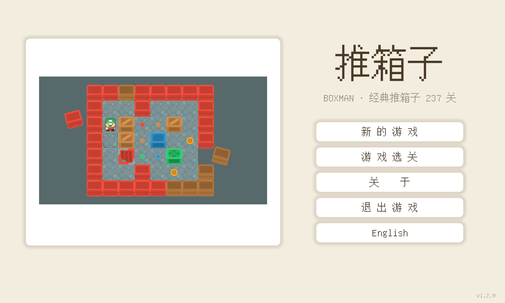
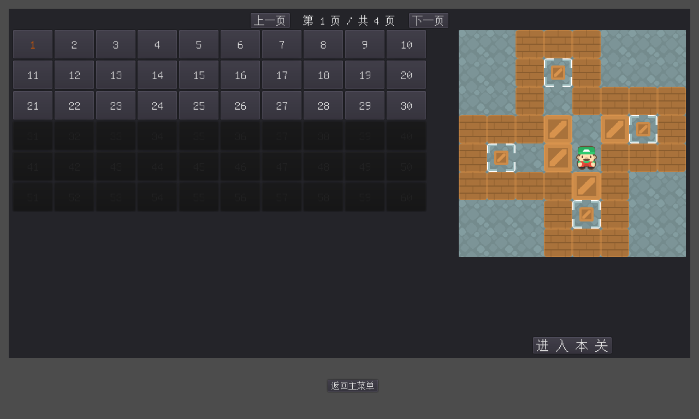

# godot boxman

## 简介

这是一个基于godot的练习作品。
游戏素材下载自免费游戏素材网站：https://kenney.nl/。
游戏关卡来自：http://sokoban.cn/ 中的经典关卡，目前去重处理后为237关。

开发环境基于以下的开发环境：

- win11 （主要）
- mac 12.6.7（偶尔）
- godot 3.5.2

目前，游戏全部237关已经制作完成，而且选关功能也已经完成。

关卡已从 237 个手工 .tscn 场景迁移为 `levels_txt/` 下的标准 sokoban ASCII 文本（`#` 墙 `@` 人 `$` 箱 `.` 目标，`*`/`+` 为箱/人压目标），由 `scene/LevelTemplate.tscn` + `script/level_builder.gd` 在运行时生成，新增关卡只需往 `levels_txt/` 放一个文本文件。
`tools/` 目录附有关卡反解析与求解器脚本，已用求解器批量验证：227 关可通关；原 Level071/131/146 三关因关卡数据转录错误无解，已修正地图（各仅改动 1~2 格）并复验通过；其余 10 关求解器 300 秒内未出解（未定，不代表无解）。

游戏的大致界面：

### 主界面

### 游戏关卡

### 游戏选关

## 游戏操作介绍：

游戏内菜单按键使用鼠标点击，人物的移动使用键盘的方向键或者【A、S、D、W】字母键进行上下左右移动。按【Z】键可以悔棋（撤销上一步）。推动箱子到目的位置，游戏完成后可选下一关或者返回主菜单界面，也可以在游戏中通过上一关和下一关按键选择游戏的关卡。

## 在线试玩

可以在我的网站 <http://three-corner.xyz> 上面的小玩意栏目里面找到本游戏的html5导出版本并进行试玩。

## 打包下载

游戏的docker镜像和win版的二进制可执行文件和html5版本已经打包完成，放在百度盘供有兴趣的朋友下载，windows版和HTML5版本，也可以在源码的dist目录中直接下载zip包。
右侧的releases下载亦可。

### docker镜像

链接：https://pan.baidu.com/s/1_ukZqLLnVp-5GWDG6Y_wJw?pwd=8888 
提取码：8888

### win版

链接: https://pan.baidu.com/s/1xIEm1tUhqxuSbB-oA55z0A?pwd=8888 
提取码:8888 

### html5版本

链接:https://pan.baidu.com/s/1YpamQMTw50kkVmW73RHtGQ?pwd=8888
提取码:8888 
